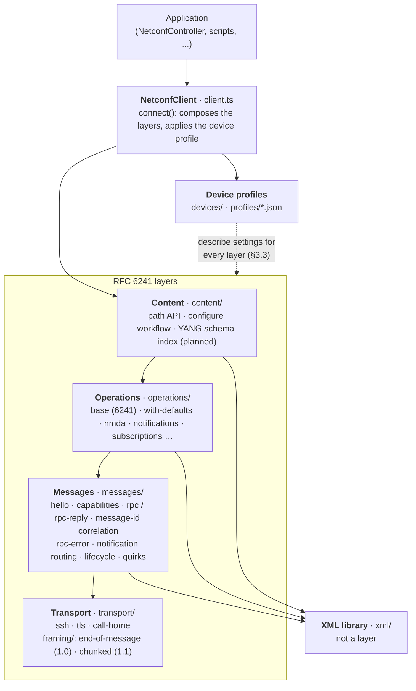
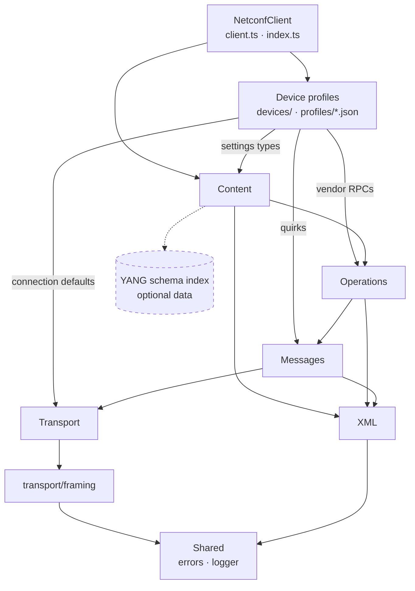

# @node-net/netconf: design

Status: draft for review, revision 3, 2026-11-07. Revision 3 reorganises the code around the RFC 6241 layers (§3, §4) and renames the main types: `Connection` (Transport), `Session` (Messages) and `NetconfClient` (the facade). Companion document: [rfcs.md](./rfcs/rfcs.md), which lists each RFC, its importance tier, and where it lands in this design.

## 1. Why build it

npm has no maintained, widely used NETCONF client. Today we run a fork of `node-netconf` (318 lines, ssh2 ^0.4, xml2js 0.4). The fork has three structural problems:

1. **Protocol, transport and device behaviour are mixed together.** SSH setup, framing, hello handling, reply matching, XML shape and error encoding all live in one class. Device-specific usage (for example Junos `get-chassis-inventory`) has no defined home, so it leaks into callers and into the README.
2. **The message layer is unsound.** Defects (a)–(d) in §10 come from the design itself, not from isolated bugs.
3. **It isn't RFC 6242-complete.** It supports only EOM framing (base:1.0), with no chunked framing, no notification routing and no typed errors.

## 2. Goals and non-goals

**Goals**

- **RFC-correct:** RFC 6241 and 6242, with both framings, and the P1 extensions from `rfcs/rfcs.md`.
- **Strict layering that follows RFC 6241, with devices completely outside the protocol stack.** Adding a device means adding a JSON file (or, rarely, a folder), with no edits to any layer.
- **Secure by default:** host-key verification, hardened XML parsing, framing limits, no credentials in logs.
- **Modern TypeScript API:** Promises, `AbortSignal`, `await using` for guaranteed close, `AsyncIterable` notifications, typed errors.
- **Minimal dependencies:** `ssh2` and the sibling `@node-net/yang` at runtime. The XML parser is the library's own (§5.3).

**Non-goals**

- API or code compatibility with the fork, upstream `node-netconf`, or any other NETCONF package. The API is designed from first principles, and consumers such as `NetconfController` will be rewritten against it.
- RESTCONF, a NETCONF *server*, or YANG validation in the library.
- Generating typed models from YANG. That could be a later, separate tool; see §12.

## 3. Layered architecture

The library follows the four-layer model of RFC 6241 §1.2: **Content**, **Operations**, **Messages** and **Secure Transport**. Each layer has its own directory, a dependency rule and a product area, so the spec, the code and the product definition all use the same words. Four things sit outside the stack: the XML library, device profiles, the `NetconfClient` facade that puts the layers together, and test support. See [the RFC 6241 summary](./rfcs/summaries/rfc6241-netconf.md#conceptual-layers) for the RFC's model.

Names follow the RFCs:

| Name | Layer | RFC meaning |
|------|-------|-------------|
| `Connection` | Transport | The transport connection: an SSH channel running the `netconf` subsystem, a TLS connection, or a call-home socket. It is reliable, ordered, and has no idea that the bytes are NETCONF (RFC 6241 §2.1). |
| Framing | Transport | How whole messages are marked out on a connection: end-of-message or chunked (RFC 6242 §4, reused by RFC 7589) |
| `Session` | Messages | The NETCONF session: the hello exchange, `session-id`, capabilities, `<rpc>`/`<rpc-reply>`, `<rpc-error>`, notifications (RFC 6241 §1.1 and §4) |
| `NetconfClient` | Outside the stack | What `connect()` returns: the application's handle on one device. It owns a `Session` and adds the operations, content, device profile and extensions. RFC 6241 calls our side of the session the *client*. |



| RFC 6241 layer | Directory | Area | Contains | Main RFCs |
|----------------|-----------|--------------|----------|-----------|
| Content | `content/` | Content | The path API (YANG instance identifiers turned into filters and edits), the `configure` workflow (`ConfigTransaction`), and the YANG schema index (planned, §3.5) | 7950 (path syntax only) |
| Operations | `operations/` | Operations | `base`, the RFC 6241 operations, which are always available, and the optional extensions. Each extension is an `Extension` (§6): it implements one or more NETCONF capabilities, and builds requests and decodes replies over `rpc()`. | 6241 §7, 6243, 6022, 8526, 5277, 8639–8641 |
| Messages | `messages/` | Messages | `Session`: hello and version negotiation, the capability set, `message-id` correlation and pipelining, `<rpc-error>` → `RpcError`, routing notifications away from replies, the lifecycle state machine, and quirks (§7) | 6241 §4 and §8.1, 5277 (routing) |
| Secure Transport | `transport/` | Transport | `Connection`s over SSH, TLS and call-home, plus `framing/`, which turns a connection's byte stream into whole messages | 6242, 7589, 8071 |

| Outside the stack | Directory | Area | Contains |
|-------------------|-----------|--------------|----------|
| XML library | `xml/` | XML | Element model, hardened parser, serializer, `x()` builder, `toObject()` |
| Device profiles | `devices/`, `profiles/` | Device Profiles | Profile format, JSON loader, auto-detection, and TypeScript profiles; built-in JSON profiles live in `profiles/` |
| Client facade | `client.ts`, `call-home.ts`, `index.ts` | Client API | `connect()`, `withClient()` and `NetconfClient`. It puts one `Session`, the base operations, the path API, the device profile and any extensions together behind one object. `call-home.ts` adds `listenCallHome()`, which turns calls from devices into clients. |
| Test support | `testing/` | Testing | Fake NETCONF server and the device contract suite (`@node-net/netconf/testing`) |
| Shared | `errors.ts`, `logger.ts` | (none) | Leaf modules that every layer may import |

### 3.1 Where we depart from the RFC model, and why

The RFC model describes a protocol. It doesn't describe a codebase, so we follow it where it helps and depart from it in four places:

1. **Framing is a sub-layer of Transport, kept as a separate leaf.** RFC 6242 defines framing as part of the SSH mapping, and RFC 7589 reuses it for TLS, so it belongs to the transport layer. It still has its own folder, `transport/framing/`, and imports nothing except the shared leaves. That way it can be fuzzed with arbitrary bytes, and SSH, TLS and call-home all share it. The transport layer gives the messages layer a **framed message channel**: a `Connection` with framing applied, which delivers whole messages as strings. It has a single `useChunkedFraming()` switch, which the `Session` flips after the hello exchange.
2. **Content means the tools, not the data.** In the RFC, the content layer is the configuration data itself, modelled in YANG, and we don't own that. Our `content/` holds the code that works on content without knowing any schema: the path API, the configure workflow, and later the optional schema index.
3. **Device profiles cut across every layer.** A profile carries connection defaults and SSH algorithms (Transport), quirks (Messages), vendor RPCs (Operations), and named paths and a commit workflow (Content). It therefore can't live inside one layer. Profiles sit beside the stack, and `NetconfClient` passes each part of a profile down to the layer it belongs to. **No layer imports a device profile.** Each layer defines the type of its own settings (`SshOptions`, `Quirks`, `Workflow`), and the profile format is built from those types.
4. **`NetconfClient` is a facade above the stack.** The messages-layer `Session` only knows how to send an `<rpc>` and route what comes back. It has `rpc()`, notification and close listeners, RPC guards, `serverCapabilities`, `sessionId` and `close()`, and nothing more. The convenience methods (`editConfig()`, `commit()`, `set()`, `configure()`) belong to the layers above it, so they live on `NetconfClient`'s `ops` and `content` objects, never on `Session`. That keeps every dependency pointing downwards. `Session`'s public surface is the `RpcContext` extension seam from §6, so the base operations use the same seam as any third-party module. Applications that need raw access use `client.session`.

### 3.2 Dependency rules

**These rules are enforced by `npm run check`** with dependency-cruiser (`.dependency-cruiser.cjs`). "Barrel" means the layer's `index.ts`, which is its public surface; a layer never imports another layer's internal files.

| Module | May import |
|--------|-----------|
| `errors.ts`, `logger.ts` | nothing internal |
| `xml/` | shared |
| `yang/` (RFC 7951 JSON output and input) | `xml/`, shared, and @node-net/yang, which nothing else in `src/` may import |
| `transport/framing/` | shared |
| `transport/` (ssh, tls, call-home) | `transport/framing/`, shared |
| `messages/` | `transport/` barrel, `xml/`, shared |
| `operations/` | `messages/` barrel, `xml/`, shared, other `operations/` modules |
| `content/` | `operations/` barrel, `messages/` barrel, `xml/`, shared |
| `devices/` (format, loader, detection) | the barrels of every layer (types and settings), `xml/`, shared |
| `devices/<name>/` (TypeScript profiles) | the public API (`index.ts`) and its own folder only |
| `client.ts`, `client-ops.ts`, `client-content.ts`, `client-yang.ts`, `call-home.ts`, `index.ts` | anything in `src/` except `testing/` |
| `testing/` | anything |

**Portable core and the Node entry.** `core.ts` is the `@node-net/netconf/core` entry: the protocol, the client, the built-in device profiles, and the connection interface with an in-memory pair. It needs nothing from Node.js, so it runs in any JavaScript runtime (a browser, a worker). `index.ts`, the `@node-net/netconf` entry, is `export * from './core.js'` plus the Node-only parts: SSH, TLS, call home, known_hosts, `duplexConnection()`, loading profiles from files, and a `connect()`/`withClient()` that can read YANG module directories (they shadow core's, since a module's own exports beat `export *`). Node users import from `@node-net/netconf` exactly as before. The Node-only modules are `index.ts`, `call-home.ts`, `transport/node.ts` (their barrel) with `ssh.ts`, `tls.ts`, `call-home.ts`, `host-keys.ts`, `fingerprint.ts` and `duplex.ts`, `devices/profile-loader.ts` and `yang/files.ts`. Every other module in `src/` is portable, and three checks keep it so:

| Check | What it refuses in portable modules |
|-------|-------------------------------------|
| dependency-cruiser (`portable-core-*` rules) | importing a Node built-in, ssh2, the Node entry of @node-net/yang, or a Node-only module (type-only imports are fine) |
| ESLint (`no-restricted-imports`, `no-restricted-globals`) | the same imports, and the Node-only globals `Buffer`, `process`, `require`, `__dirname`, `setImmediate` |
| `npm run portable:check` | anything the browser can't load: it bundles `@node-net/netconf/core` and `@node-net/netconf/testing` with rolldown for the browser platform, with no aliases, then runs the bundle with only web-platform globals and connects to a FakeServer (hello, get-config, close) |

@node-net/yang has the same split (`@node-net/yang/core`, and `@node-net/yang` adding `fileSource()`), with the ESLint rule and its own `portable:check`. The library adds no browser-specific code: the portable modules use only what JavaScript and the web platform share with Node (`Uint8Array`, `TextEncoder`/`TextDecoder`, `queueMicrotask`, `AbortSignal`).

Two rules matter most:

- **Dependencies only point downwards.** Transport never sees XML, messages never sees an operation, and nothing below the facade imports `client.ts`, `index.ts` or `devices/`. That one rule is what stops protocol and device code from mixing again.
- **Third-party code has the same access as built-in code.** A TypeScript device profile or an outside extension gets exactly what `@node-net/netconf` exports, and nothing more.



Points to notice:

- `transport` and `xml` have no arrow between them. `messages` is the only module that uses both, which makes it the single place where text becomes XML and XML becomes text (§3.4).
- Device profiles point *into* the layers. Every layer defines its own settings, and a profile is just values for those settings. Adding a device therefore never changes a layer.
- Every arrow out of a layer is drawn to the layer directly below, but a layer may also use lower layers' barrels for types (content uses `Datastore` from operations and `RpcContext` from messages, for example).

### 3.3 Extensions, by example

The stack on its own speaks plain NETCONF (RFC 6241): hello, `get`, `get-config`, `edit-config`, `lock`, `commit` and so on, plus the path API. Everything else plugs in through one seam (§6), the messages layer's `RpcContext`. There are two kinds of extension, and they answer different questions:

| | Extension | Device profile |
|---|---|---|
| Answers | "What *standard* features beyond the base protocol do I want?" | "What is *this vendor's box* like?" |
| Defined by | An RFC, so it is the same on every device that supports it | A vendor, or one product line |
| Contains | Typed operations, and the capabilities they need | Detection, connection defaults, quirks, config workflow, named paths, vendor RPCs |
| Layer | Operations | Beside the stack; it holds settings for every layer |
| How many per session | Any number | At most one |
| Written as | TypeScript in `operations/` (built: `with-defaults`) | JSON in `profiles/` (built); TypeScript in `devices/<name>/` only when JSON can't describe it |
| Example | `nmda`: `getData({ datastore: 'operational' })` (RFC 8526) | `nokia-sros-md`: commit through the candidate datastore; an MD-CLI `cli` operation |

A session against a Nokia 7210 that changes the system name, runs a show command, and reads operational state:

```ts
import { connect, ssh, autoDetect, builtinDeviceProfiles } from '@node-net/netconf';
import { nmda } from '@node-net/netconf/operations/nmda';          // extension

await using client = await connect({
  transport: ssh({ host: 'router1', username, password, hostKey }),
  profile: autoDetect(await builtinDeviceProfiles()),              // picks nokia-sros-md from the hello
  extensions: [nmda],                                        // extensions (§6, §8)
});

// Content: the path API. '@systemName' is a named path from the profile.
// set() follows the profile's workflow: lock candidate, edit, validate, commit, unlock.
await client.content.set('@systemName', 'router1');

// Device profile: a vendor RPC, described as an XML template in the JSON file.
const version = await client.ops.device.call('cli', { command: 'show version' });

// Operations: a standard RPC that is the same on any NMDA-capable device.
const ports = await client.ops.nmda.getData({ datastore: 'operational', filter: subtree(x('state', { xmlns: NOKIA_STATE }, x('port'))) });
```

What happens underneath, layer by layer:

1. **Transport:** `connect()` opens an SSH `Connection` and wraps it in end-of-message framing.
2. **Messages:** the `Session` exchanges hellos, settles on a base version and, for base:1.1, switches the channel to chunked framing.
3. **`NetconfClient` and device profiles:** `autoDetect` scores each profile's `match` rule against the server's hello. `nokia-sros-md` matches because the device advertises the `nokia-conf` module. `NetconfClient` applies the profile's capability corrections and quirks to the `Session`, and its workflow and named paths to the content layer.
4. **Operations:** `nmda` declares the capabilities it needs. `NetconfClient` checks them against the hello and fails with `CapabilityError` if the device lacks them.
5. Each call becomes an `XmlElement` and then goes through `Session.rpc()`, the only way any layer above Messages reaches the device. No extension touches framing, the `Connection` or the `Session`'s internals.

The same application code works on a Juniper or Cisco device by adding (or auto-detecting) a different profile. The `nmda` call doesn't change at all.

### 3.4 Where XML fits

XML is **not a layer in the stack**. It is a self-contained library, a vocabulary for NETCONF messages, that Messages and the layers above it use. Transport, framing included, sits below it and never imports it.

- **Transport** moves bytes over SSH or TLS. **Framing**, inside it, splits the byte stream into whole messages (`]]>]]>` or chunked `#n`) and wraps outgoing messages the same way. A message is an opaque string to both.
- **Messages** is the single point where messages turn into XML and back:
  - inbound: framing hands over a message string, then `xml/parse` turns it into an `XmlElement`. The `Session` then inspects the root (`<hello>`, `<rpc-reply>`, `<notification>`) to route it;
  - outbound: the `Session` wraps a request body in `<rpc message-id="…">`, then `xml/serialize` turns it into a string for framing to send.
- **Operations, Content, device profiles and applications** never see raw XML strings. They build request bodies with the `x()` builder and read replies by navigating `XmlElement` (`child()`, `path()`, `text()`), or through `toObject()`.

So a request travels down the stack as an `XmlElement` until Messages serializes it, and as bytes after that. A reply travels up as bytes until Messages parses it, and as an `XmlElement` after that:

```
content / operations  x('get-config', …)            XmlElement ──┐          ┌── XmlElement   reply.child('data')
messages              wrap in <rpc>, serialize ──── string       │          │   parse, route by message-id
transport/framing     add ]]>]]> or #n chunks ───── string       │          │   reassemble whole message
transport/ssh         ssh2 channel write ────────── bytes  ──────┘  device  └── bytes  ssh2 channel data
```

Keeping XML out of Transport is deliberate. Framing can be fuzzed with arbitrary bytes, without an XML parser in the loop, and the size limit applies before anything is parsed. It also makes Transport and the XML library independent leaves, so each can be tested or replaced on its own.

**Why `x`.** The builder is named in the hyperscript style (`h()` in Preact and Vue) because request bodies nest it several levels deep on one line, where a longer name hurts readability. `x` also reads as "XML". The alternatives clash more with user code: `el` and `element` are the natural names for the `XmlElement`s that replies return, and `xml` is the usual name for a serialized string. Users who want another name can rename it on import.

### 3.5 Where YANG fits

**NETCONF does not require YANG.** NETCONF (RFC 4741, 2006) came first. It only says "send XML in these envelopes"; what goes *inside* `<config>` or `<data>` is up to the device. YANG (RFC 6020, 2010) was created afterwards as the language for describing that content. In practice almost every modern device models its data in YANG, and the newer NETCONF features (YANG library, NMDA, YANG-Push) are themselves defined in YANG. Older devices, and vendor RPCs such as Nokia's MD-CLI command, may carry content that no published YANG model describes.

So this library **works without any YANG files**, and uses YANG at four levels of depth:

1. **Paths use YANG syntax, without YANG files (built).** `client.content.read('/ietf-interfaces:interfaces/interface[name="eth0"]')` is a YANG instance identifier. The content layer turns it into XML, and only needs each module's namespace, which it takes from the device's own hello or YANG library. Values come back as strings. The path *syntax* is standard (RFC 7950 §9.13, in the module-name form of RFC 7951 §6.11), but the path API is our own convenience layer: NETCONF has no path-based operations, so each path is translated into a standard subtree filter or `edit-config` content.
2. **RFC 7951 JSON output uses real schemas (built, opt-in).** `format: 'json'` on `ops.get`, `ops.getConfig`, `nmda.getData`, `content.read` and `content.readValue`, and `content.toJson()` on any data element, convert YANG data to RFC 7951 JSON typed by the device's schema. The schema is compiled at runtime by the sibling package **@node-net/yang**, a direct dependency since JSON output was added. It is compiled lazily, from only the modules the data uses (every namespace in it, so augmenting modules come along, plus deviating ones), and cached per session or in a shared `YangCache`. The module list comes from the YANG library, else the hello. Module text comes from `connect({ yang: { modules } })`, the profile's `yang.modules`, @node-net/yang's bundled IETF modules, then `<get-schema>`. Each top-level member of the data is either fully typed or, when it can't be (and `requireSchema` is off), projected schema-less with a `warning` event. The conversion is an output step after the reply: no layer changes what it sends. @node-net/yang is imported only by the adapter in `src/yang/` (outside the stack, like `xml/`); the facade's `client-yang.ts` supplies the schema sources, and extensions reach the conversion through `ExtensionContext.toJson`. Both rules are enforced by dependency-cruiser. The Operations layer's reads default to `format: 'xml'`, where nothing here runs, so the core still moves XML without schemas. The Content layer's `read()` and `readValue()` default to JSON: they read XML through the Operations layer and convert it themselves, so the conversion of Content-layer data happens in the Content layer.
   **JSON input (built)** is the same machinery run the other way, before a request is built. A plain object given as `config` (edit-config, inline copy-config, validate, nmda edit-data, `withCandidate`'s `txn.editConfig`) or as `filter` (get, get-config, nmda get-data, compare, `txn.getConfig`) is RFC 7951 JSON; an `XmlElement`, string or array is XML as before, and a `subtree()`/`xpath()` filter is told apart by its `type` member, which a JSON filter (all `module:name` members) never has.
   - *Where:* the facades (`client-ops.ts`, and the nmda, compare and transaction modules through `ExtensionContext.toXml`) call `convertJsonArgs()` from `operations/json.ts`, so the Operations layer never sees YANG; the request builders refuse unconverted JSON. `src/yang/encode.ts` does the conversion and `filter.ts` the filter walk, sharing `schemas.ts` (the cache key, `compile()` with `only`, the datastore pick) with output. Modules to compile come from the member names at any depth and from `module:identity`-like values.
   - *Edits:* @node-net/yang's `decodeJson(…, { edit: true })` then `encodeXml()`. RFC 7952 metadata `ietf-netconf:operation` becomes `nc:operation`, and `yang:insert` with `yang:key`/`yang:value` positions ordered-by-user entries; their values are copied as written, as libyang does (so `yang:key="[name='a']"`), which netopeer2 accepts. A leaf being deleted or removed may be `null`. The schema is the target datastore's, so config-false nodes are refused.
   - *Filters:* an object is a containment node, `{}` or `null` selects, and a leaf value is a content match written as the schema's canonical text (1500 and "1500" both match a uint16). `<get>` filters use operational, get-config its source, get-data its datastore; `json.datastore` overrides.
   - *Strictness:* unlike output, JSON that doesn't match its schema always rejects with a `YangDataError` listing every problem, unless `json.validate: false` sends that member schema-less. A member no schema covers goes schema-less with a `warning` (prefixed values undeclared), or with `requireSchema` rejects with `SchemaUnavailableError`. No must/when/leafref validation.
   - *Datastore comparison (built):* `content.compareDatastores({ source, target, filter })` reads both configuration datastores and compares them in the client (yang/diff.ts): both sides decoded with one schema, compared with @node-net/yang's `diffTrees`, each change's nodes encoded on their own. `getCandidateChanges()` is running → candidate. No schema-less fallback, unlike JSON output: without keys, list entries match only by position. RFC 9144 `<compare>` stays available as the compare extension, but few servers have it and their patches differ in form.
   - *Also:* `content.toXml(json, { datastore, filter })` is the inverse of `toJson()`; `configure()` takes whole subtrees with `txn.merge(json)`/`txn.replace(json)`; nnc takes inline JSON (a word starting with `{` runs until its braces balance) or `@file` for config and filters. Later: `txn.set(path, json)`, RPC/action input, notification and subscription filters.
3. **A schema index adds types to paths (planned, optional).** A compact JSON file, compiled offline from YANG modules, tells the content layer which nodes are lists, keys or numbers, so paths can be checked before they are sent. It is data in a models directory, shown as the dashed "YANG schema index" box in §3.2. The JSON output above may make it unnecessary.
4. **Some extensions are about YANG itself.** In the operations layer, `yang-library` lists the models a device supports per datastore (built), `monitoring` fetches their source with `<get-schema>`, and `yang-push` streams changes to YANG data.

Device profiles relate to YANG only through paths: a profile's `match` rule may name a YANG module (`nokia-conf`), and its `paths` give friendly names to YANG paths (`@systemName`). Details are in §6.4.

## 4. Source layout

Everything lives in a single package with subpath exports. A monorepo isn't needed yet, because subpath exports already give tree-shaking and separate entry points. Files marked (planned) don't exist yet.

```
src/
  core.ts           @node-net/netconf/core: the portable public API (§3.2)
  index.ts          @node-net/netconf: core plus SSH, TLS, call home, file loaders, and connect() that reads YANG directories
  client.ts         facade: connect(), withClient(), NetconfClient (composes the layers below)
  client-ops.ts     client.ops: base operations, list/run, vendor, extensions' ops sections
  client-content.ts client.content: path API, configure, module loading, extensions' content sections
  call-home.ts      facade: listenCallHome() (RFC 8071), turning calls from devices into NetconfClients
  errors.ts  logger.ts  timers.ts
  xml/              element.ts  parse.ts  serialize.ts  builder.ts  project.ts  chars.ts
  transport/        index.ts  types.ts  channel.ts  memory.ts  join.ts             (portable)
                    node.ts  duplex.ts  ssh.ts  host-keys.ts  fingerprint.ts  tls.ts  call-home.ts  (Node only)
    framing/        index.ts  framing.ts  byte-queue.ts
  messages/         index.ts  session.ts  hello.ts  capabilities.ts  rpc-error.ts  quirks.ts
                    emitter.ts  constants.ts
  operations/       index.ts  base.ts  descriptors.ts  extension.ts  with-defaults.ts  monitoring.ts
                    identities.ts  nmda.ts  yang-library.ts  notifications.ts
                    transaction.ts  base-notifications.ts  subscriptions.ts  yang-patch.ts
                    partial-lock.ts  compare.ts
  content/          index.ts  path.ts  configure.ts  (schema-index.ts, planned)
  devices/          index.ts  device.ts (format, detection)  profile-spec.ts
                    profile-builtin.ts  builtin-profiles.ts (generated from profiles/*.json)
                    profile-loader.ts (files; Node only)
  yang/             the YANG adapter over @node-net/yang/core;  files.ts (module directories; Node only)
    <name>/         TypeScript profiles, only for behaviour JSON can't describe (none yet)
  testing/          fake-server.ts  (contract suite, planned)
profiles/           built-in device profiles as JSON, plus profile.schema.json for editors
test/
  unit/  framing-fuzz/  fake-server/  contract/  integration/ (netopeer2 in Docker)
```

Exports: `@node-net/netconf`, `@node-net/netconf/core` (the portable part, §3.2), `@node-net/netconf/operations/<name>`, `@node-net/netconf/devices/<name>`, `@node-net/netconf/testing` (fake server and the device contract suite, so third-party profiles can be tested too; portable).

The built-in profiles are embedded: `scripts/gen-builtin-profiles.mjs` writes `src/devices/builtin-profiles.ts` from `profiles/*.json` at build time (a unit test fails if the committed copy is stale), so `builtinDeviceProfiles()` needs no filesystem. @node-net/yang embeds its bundled IETF modules the same way.

**Moved from `src/core/` (phase 3a, done 2026-11-07).** The code built before revision 3 lived in `src/core/` and `src/framing/`. It moved as follows:

| Today | Moves to | Notes |
|-------|----------|-------|
| `core/session.ts` | `messages/session.ts` + `client.ts` | Split along the line in §3.1 item 4. `Session` keeps the hello, correlation, routing and lifecycle. `NetconfClient` gets `connect()`, the operation methods, `read`/`set`/`configure`, and device and extension wiring. **This is a public API change:** `connect()` returns a `NetconfClient` instead of a `Session`, and `withSession()` becomes `withClient()`. The methods themselves are unchanged. |
| `framing/*` | `transport/framing/` | A new `transport/channel.ts` puts a `Connection` and framing together as the framed message channel. |
| `transport/types.ts` `Transport`, `TransportFactory` | `Connection`, `ConnectionFactory` | Renamed to the RFC term. The `transport:` option of `connect()` keeps its name, because it picks the layer's implementation (`ssh(…)`, later `tls(…)`). |
| `core/hello.ts`, `capabilities.ts`, `rpc-error.ts`, `emitter.ts`, `constants.ts` | `messages/` | |
| `core/operations.ts` | `operations/base.ts` | Request builders become functions over `RpcContext`. |
| `core/path.ts`, `configure.ts` | `content/` | `Workflow` moves into `content/configure.ts`, so content no longer imports the device module. |
| `core/device.ts`, `profile-spec.ts`, `profile-loader.ts` | `devices/` | |

## 5. Layer APIs

The subsections follow the stack from the bottom up: Transport (§5.1, §5.2), the XML library (§5.3), Messages (§5.4), and the `NetconfClient` facade (§5.5), which puts Operations and Content together on top. §5.6 and §5.7 cover the API style and errors, and §5.9 the naming rules, which apply throughout.

### 5.1 Transport: connections

```ts
interface Connection {
  readonly peer: { host: string; port: number; identity?: string };
  receive(receiver: ConnectionReceiver): void;  // once; held bytes come later
  write(bytes: Uint8Array): void;      // nothing after end() or close
  end(): void;                         // half-close our side; keep receiving
  destroy(): void;                     // drop now
  close(): Promise<void>;              // graceful; idempotent; never rejects
}
interface ConnectionReceiver {
  data(chunk: Uint8Array): void;       // raw bytes; framing is on top (§5.2)
  end(): void;                         // the peer ended its sending side
  close(error?: Error): void;          // exactly once, last; error if it failed
}
type ConnectionFactory = (signal: AbortSignal) => Promise<Connection>;
```

A `Connection` is the RFC 6241 §2.1 "persistent connection": reliable, ordered bytes, with authentication and encryption already done. Each factory below returns a `ConnectionFactory`, which is what `connect({ transport })` takes.

The interface is the library's own rather than a Node stream, so the protocol and client run in any runtime (§3.2), and it holds only what the library uses: the channel never needed backpressure, and Node stream semantics (event order, `destroy()` propagation in `duplexPair`) vary between Node versions. A single receiver, attached once, keeps the "one listener, attached before anything is written" guarantee (fork defect a) in the type itself: bytes that arrive before it are held, and nothing is delivered during `receive()`, so the caller can finish setting up. `end()` is a half-close, which nnc's raw `eof` uses.

- **`duplexConnection(stream, { peer, close? })`** (Node entry) adapts a Node duplex stream. A stream `error` is reported as the close's error at once, so a transport's own error class (such as TLS's `AuthenticationError`) reaches the channel unchanged. `ssh()` and `tls()` are built on it; anyone with their own Node transport (a socket, a tunnel, a child process) can use it too.
- **`connectionPair()`** (portable) returns two connected in-memory ends: what one writes, the other receives in a later microtask, in order, copied. Ending both directions closes both; `destroy()` closes both at once. FakeServer runs on it, and so can an in-process server.
- **`joinConnections(a, b)`** (portable) splices two connections: data, ends and closes flow both ways. Tests serve a FakeServer over real SSH or TLS with `joinConnections(duplexConnection(channel, { peer }), server.connection)`.

- **`ssh`**: uses `ssh2` and opens the `netconf` subsystem, or an exec command when a device needs one (old Junos used `xml-mode netconf need-trailer`). Options:
  - `hostKey` is **required**. It accepts a fingerprint, a list of fingerprints, a known_hosts file, or a verifier function. To skip checking, the caller must pass the explicit string `'insecure-accept-any'`, and the library logs a warning.
  - Auth: `password`, `privateKey` + `passphrase`, or `agent`. Secrets may be supplied as functions, so they're read lazily and never stored on the object.
  - Refused credentials are an `AuthenticationError`. So is a server that closes the connection after the key exchange but before authentication succeeds, as servers that limit failed attempts do (MaxAuthTries, lockouts); ssh2 reports no authentication failure then, only the close. A close before the key exchange is a `TransportError`. This holds on every hop, and the message names the hop.
  - Every private key is parsed and decrypted locally before the first hop is contacted (for call home, once `identify` has chosen the credentials, before any is offered). A wrong or missing passphrase, or a key that can't be read, is an `AuthenticationError` with `reason: 'key'` naming the endpoint (never the key or passphrase), so callers can tell it from a server's refusal (`reason: 'refused'`) and needn't retry with other credentials.
  - Algorithms default to ssh2's secure set. Legacy algorithms must be named explicitly.
  - Also: `keepaliveInterval`, `readyTimeout`.
  - When the policy knows a host's key types (known_hosts or key lines), those are negotiated first, as OpenSSH does. Without this, a server with several host keys could present one the known_hosts file doesn't hold.
  - `jump`: one jump host or a list, like OpenSSH's `ProxyJump`. Each hop is an `SshEndpoint` with its own credentials and its own **required** `hostKey`, and port 22 by default. The next hop is reached through a `direct-tcpip` channel, and SSH to the NETCONF server runs end to end inside it, so a jump host relays only encrypted bytes and never sees NETCONF credentials or data. Errors name the hop that failed (`jump host jump1:22 could not open a connection to router1:830`). Closing the session closes every hop, innermost first. A failure anywhere in the chain ends the session. `jump` can't be combined with `sock`.
- **`tls`** ✅ (RFC 7589): `node:tls` with mutual X.509 and `minVersion: 'TLSv1.2'`, port 6513 by default. Options:
  - `cert` and `key` (with an optional `passphrase`) are **required**, and may be supplied as functions like SSH secrets.
  - The server must be verified, as `hostKey` is required for SSH: `ca` (the only trust anchors; Node's public roots are never used) gives chain validation plus the RFC 6125 name check against `serverName ?? host`, DNS or IP SAN; `fingerprint` pins the server certificate's SHA-256 (`SHA256:` base64 or hex), alone or on top of `ca`. Neither is a `CertificateError` from `tls()` itself; `insecure: 'insecure-accept-any'` skips verification with a warning on every connection, and can't be combined with either.
  - `sock` runs TLS over an already-connected socket (call home, tunnels). `keepalive` sets TCP keepalive.
  - Errors: a server certificate that fails the chain, name or pin is a `CertificateError`. A server alert refusing our certificate is an `AuthenticationError`. With TLS 1.3 that refusal, or a close before the server's hello (cert-to-name found no user), only arrives after our handshake completed, so the connection's stream reports it, and the channel passes a transport's `NetconfError` through unwrapped so `connect()` rejects with it. A TLS 1.2 server that resets instead of alerting is a `TransportError` with a hint.
  - `peer.identity` is the server certificate's `SHA256:` fingerprint. `close()` sends close_notify, then waits up to 2 s for the server to close.
- **Call home** ✅ (RFC 8071): `listenCallHome({ ssh: { port: 4334 }, tls: { port: 4335, cert, key, ca }, identify, connect })` resolves once listening with a `CallHomeListener`, an `AsyncIterable` of `{ client, device, caller }` (leaving the loop closes it). Only the TCP connection is reversed: on the accepted socket we are still the SSH or TLS client and the NETCONF client. A device is identified by its key or certificate, never its address (RFC 8071 §7). Over SSH (`transport/ssh.ts` `callHomeSsh`), the handshake completes (so the device has proved it holds the host key), then `identify({ transport, fingerprint, keyType, key, remote })` runs once, from the first call of ssh2's `authHandler`, and returns that device's credentials (`username` with `password`, `privateKey`/`passphrase` or `agent`, plus per-device `connect` options), which are then offered in ssh2's default order (none, password, publickey, agent), so nothing is sent to an unknown caller. A re-key must present the same host key, and does not run `identify` again. A TLS `identify` is bounded by `handshakeTimeout` and ends if the caller drops. Over TLS (`callHomeTls`), our certificate is the listener's (Node can't choose one after seeing the server's), the chain is checked against `ca` when given with no host-name check, and `identify` sees the `fingerprint` and parsed `certificate`. Undefined, false or a throw refuses the caller. Refused calls are `rejected` events, set-up failures (handshake, authentication, hello, timeout) are `failed` events; nothing is thrown. `wrapConnection(connection, caller)` lets a tool wrap each identified call's connection before the hello (nnc's trace and hello capture); a throw fails the call. Limits for an open port: `maxPending` calls being set up (16), `handshakeTimeout` (30 s) and `maxQueued` untaken clients (16). `close()`/`await using` stops accepting, aborts calls being set up and closes untaken clients; clients already taken are the caller's. The TCP listener is `transport/call-home.ts`; the facade that turns calls into clients is `src/call-home.ts`, which sits beside `client.ts` and may import it. Integration tests run netopeer2's call home through a relay inside its container (`scripts/callhome-relay.py`), because some hosts drop TCP from containers to the host.

Because a connection is just bytes in and out, QUIC, a WebSocket or an in-process server can be added without touching the rest of the stack. SSH jump hosts are built into `ssh` (above).

### 5.2 Transport: framing and the message channel

Framing (RFC 6242 §4) turns a connection's byte stream into whole messages. It lives in `transport/framing/` and never sees XML. `transport/channel.ts` puts a `Connection` and framing together into the **message channel** that the messages layer uses:

```ts
interface ChannelHandler {                  // implemented by the Session
  message(text: string): void;              // each whole message, synchronously and in order
  end(reason: NetconfError): void;          // connection failed or closed, or framing broke; at most once
}

interface MessageChannel {
  readonly peer: ConnectionPeer;
  readonly framing: FramingMode;            // 'eom' | 'chunked'
  encode(message: string): Uint8Array;      // frame without sending; throws FramingError (EOM injection)
  write(framed: Uint8Array): void;
  useChunkedFraming(): void;                // called once, by the Session, after the hello exchange
  destroy(): void;                          // stop delivering and drop the stream at once
  close(): Promise<void>;                   // close the underlying Connection; never rejects
}
function openChannel(connection: Connection, handler: ChannelHandler, options?: { maxMessageBytes?: number }): MessageChannel;
```

Delivery is a synchronous callback rather than an `AsyncIterable`, so the switch to chunked framing happens within the same call that handles the server's hello, before any later byte is decoded. `encode()` and `write()` are separate so a request that can't be framed is rejected before it is queued or counted as in flight. Underneath, `FrameDecoder` is pull-based (`push()` bytes, then `next()` one message at a time) and `encodeMessage()` frames outgoing messages. `FrameDecoder` is also a public export, so a tool that already holds a copy of the bytes (such as nnc's trace) can decode them exactly as a session does.

- **Bytes:** framing works on `Uint8Array` with `TextEncoder`/`TextDecoder` (the decoder with `ignoreBOM`, which keeps a BOM for the EOM stripping below and is also V8's fast path). Received bytes are held as the chunks they arrived in (`ByteQueue`; small chunks are packed into 64 KiB blocks), and a message is copied once, at its exact size, only if it spans chunks, so a large reply never passes through a growing buffer. `npm run bench:framing` measures encode and decode throughput on an 8 MiB reply.
- **EOM:** a streaming scan for `]]>]]>`, across chunk boundaries. Sending a message that contains `]]>]]>` is **refused**, because that sequence would act as a framing injection. Whitespace and a BOM around each message are stripped, since an XML declaration must come first in a document, and whitespace-only messages are skipped.
- **Chunked:**
  - A strict state machine for `\n#<len>\n…\n##\n`.
  - `len` is validated to 1..4294967295 with no leading zeros.
  - Any other byte is a `FramingError`, which is fatal to the session.
- **Limits for both:**
  - `maxMessageBytes` defaults to 64 MiB and is configurable.
  - Exceeding it is a fatal `FramingError`.
- **Switch:** framing always starts in EOM mode. The `Session` calls `useChunkedFraming()` immediately after the hello exchange if both peers advertised `base:1.1`. Bytes already received after the server's hello are handed to the new decoder, and because the decoder is pull-based the swap happens exactly between two messages. Straight after the swap, and only until the first chunk header, stray whitespace left after the hello's `]]>]]>` is tolerated; after that, chunked framing is strict.
- **Framing quirks** (§7, none needed yet) will arrive in the channel options. Framing doesn't know about device profiles.
- **Testing:** the decoders are property-tested by fuzzing random chunk splits of known message streams.
- **Public (TRANSPORT-09):** `openChannel`, `MessageChannel`, `ChannelHandler`, `ChannelOptions`, `FramingMode` and `DEFAULT_MAX_MESSAGE_BYTES` are exported, so a tool can drive framing without a `Session` (the CLI's framed sessions, [cli.md](../../../docs/cli.md) §4). The caller then owns everything the `Session` normally does: the hello, the switch to chunked framing, `message-id`s and parsing. `test/transport/channel.test.ts` tests the contract above through the public API.

### 5.3 XML

The XML library is **namespace-aware and order-preserving**. NETCONF depends on namespaces (`nc:`, `yang:` and vendor namespaces), and the order of user-ordered lists matters. xml2js-style objects lose both.

```ts
interface XmlElement {
  readonly name: string;            // local name
  readonly ns: string | undefined;  // resolved namespace URI
  readonly attrs: ReadonlyMap<string, XmlAttr>;
  readonly children: readonly (XmlElement | string)[];
}
// navigation helpers
el.child('data'), el.children('interface', NS_IF), el.text(), el.path('a/b/c')
// builder (always escapes; cannot produce ']]>]]>')
x('get-config', { xmlns: NC }, x('source', x('running')))
// projection for convenience (opt-in, lossy, documented)
toObject(el, { arrays: 'always' | 'auto', stripNs: true, parseNumbers: false })
```

- **Parser (decided): our own, single-pass**, in `src/xml/parse.ts`. It reads the text once and builds the frozen `XmlElement` tree directly, resolving namespaces as each element opens. It has no dependencies and recurses nowhere, so nesting costs heap, not stack.
  - It accepts exactly what `@rgrove/parse-xml` 5.2 accepts, and builds the tree the old path built from it. A differential fast-check property (`test/xml/parse-differential.test.ts`) holds it to that, with the old path (`@rgrove/parse-xml` plus our namespace pass) kept in the tests as the reference. `@rgrove/parse-xml` is now a devDependency of @node-net/netconf; @node-net/yang still uses it.
  - Why it replaced `@rgrove/parse-xml`: that parser builds its own tree first, so every reply was two full trees, and the raw one set the peak. Measured on a 64 MB get-config reply: 1.39 GB of heap at peak (21.7× the text), of which the raw parse alone took 1.26 GB before the conversion began. The single pass peaks at 0.5 GB (7.9×) and is 2.8× faster. See §12, "Performance".
  - `@rgrove/parse-xml` was chosen first: dependency-free, maintained and strictly conformant. On an 8.9 MiB config reply it parsed in 237 ms, against 532 ms for `fast-xml-parser` (validate + parse) and 330 ms for `sax`. It also applied its own `maxElementDepth` of 256, so a `maxDepth` above 256 never took effect until it was replaced.
  - `fast-xml-parser` was used first and replaced. It leaves numeric character references undecoded, accepts trailing junk and multiple roots, silently renames elements such as `<toString>` to `__toString`, refuses `__proto__`/`constructor` as names, and brings six transitive dependencies.
  - `saxes` was rejected because it hasn't been published since 2022.
- **Hardening:**
  - Reject any `<!DOCTYPE`, which blocks XXE and entity-expansion attacks.
  - No external entities; only the five predefined entities and character references to legal XML characters.
  - `maxDepth` (default 256, ceiling 1024) and `maxNodes` limits. Nesting deep enough to overflow the parser's stack is reported as an `XmlError`.
- **Caller-supplied raw XML** (`rpc('<foo/>')`) is accepted, but checked for well-formedness before it's sent, so a typo can't corrupt the session's framing.

### 5.4 Messages: Session

A `Session` is the NETCONF session of RFC 6241: one hello exchange, one `session-id`, one fixed capability set, and the `<rpc>`/`<rpc-reply>` conversation on top of a message channel. It doesn't know about datastores, paths or vendors. Applications reach it as `client.session`, and extensions receive its `RpcContext` surface (§6).

```ts
const s = client.session;              // from connect() (§5.5)

s.sessionId; s.serverCapabilities;     // CapabilitySet, always a set (fixes defect d)
const reply = await s.session.rpc(x('get-chassis-inventory'), { timeout: 10_000, signal });
s.onNotification((n) => …);          // a subscription handle comes from the notifications extension (§8)
s.session.on('closed', ({ cause }) => …);
```

Responsibilities:

- **Lifecycle state machine:** `connecting → hello → open → closing → closed`. Any connection or framing error, or the connection closing, rejects every pending RPC with `SessionClosedError({ cause })` and ends notification iterators. **Nothing throws from an event handler** (fixes defect b).
- **Hello:**
  - We send our hello as soon as the channel is open.
  - The server hello must include a positive integer `session-id` and at least one base capability.
  - We pick the highest common base version, and fail with `HelloError` if there is none. For base:1.1 we then call `useChunkedFraming()` on the channel.
  - The capability list is always parsed as a list.
- **Capabilities:** a `CapabilitySet` that parses URIs and their query parameters (`module`, `revision`, `features`, `deviations`, `basic-mode`, `also-supported`, `content-id`), with `has()`, `supports(':candidate')` and `module(name)`.
- **Correlator:**
  - **One** demultiplexing reader is attached to the channel *before* the first write (fixes defect a).
  - Pending requests live in a `Map<messageId, Pending>`. Each has its own timer and `AbortSignal`.
  - Pipelining is allowed, and `maxInFlight` bounds it.
  - A reply that arrives after its request timed out or was aborted is logged and dropped (its id is kept as a tombstone). The session stays usable.
- **Routing:** `<rpc-reply>` goes to the correlator and `<notification>` goes to notification subscribers. Anything else is a protocol error and is logged. Whether it's fatal is decided by a quirk.
- **Errors:** an `<rpc-reply>` that contains any `<rpc-error>` with `error-severity=error` rejects with `RpcError`. A reply with only warnings resolves, and the warnings are put on `reply.warnings`.
- **Close:**
  - `close()` is idempotent.
  - It sends `<close-session>` with a short timeout (default 5 s), then always closes the channel and its connection.
- **Observability:** `node:diagnostics_channel` channels `@node-net/netconf:rpc:start`, `:end` and `:error` (zero cost when unused), plus an injectable logger. Message bodies are logged only at `trace` level, through a `redact(xml)` hook, and are also emitted, redacted the same way, as the `message` event. The default redact masks `password`, `secret` and `key` elements.
- **Logger and level at run time:** everything logs through one forwarding object (`LogSwitch` in `logger.ts`) that the client owns for its whole life. `setLogger()` and `setLogLevel()` change it in place, never replace it, so every component that already holds `session.logger` or `ctx.logger` follows the change. The forwarder has a method only for the levels that are enabled and that the target implements, so `if (logger.trace)` stays a free check: nothing is redacted for a level nobody receives. A target method that throws is ignored. Transport and call-home loggers are separate and unaffected.

### 5.5 NetconfClient

`NetconfClient` is what `connect()` returns: the application's handle on one device. RFC 6241 calls our side of the session the *client*; the `Netconf` prefix avoids a clash with other libraries' `Client` types. It owns one `Session` and adds the layers above it. Each call sits on the object for the RFC 6241 layer it works at, so `client.content.set()` and `client.ops.editConfig()` say which level they work at:

| Property | Layer | Holds |
|---|---|---|
| `client.transport` | Secure Transport | `peer` (host, port, server identity) |
| `client.session` | Messages | the `Session`: `rpc()`, capabilities, session-id, state, events, guards, logger |
| `client.ops` | Operations | base operations, the YANG 1.1 `action()`, `list` (every operation as descriptors) and `run(name, args)`, `device.call()` (the device profile's operations), each extension's `ops` section under its id |
| `client.content` | Content | `read`, `readValue`, `readFilter`, `toXPath`, `configure`, `set`, `remove`, `checkEdits`, `invoke` (an RPC or action by path), `compareDatastores`, `getCandidateChanges`, `resolvePath`, `moduleNamespace`, `loadModules`, each extension's `content` section under its id |
| `client.profile` | (all) | the device profile in use; it shapes every layer, so it belongs to none |

The placement rule: a call's layer is what it hands in and back. Raw XML, or an `<rpc>` and its reply, is `ops`; paths, typed values and parsed objects are `content` (so `configure()` is content although it runs operations underneath). The top level has only `close()`, `[Symbol.asyncDispose]`, and the logging controls (`logger`, `logLevel`, `setLogger()`, `setLogLevel()`), which reach every layer at once. Events live only on `client.session`.

```ts
const client = await connect({
  transport: ssh({ host, port: 830, username, password, hostKey }),   // a ConnectionFactory (§5.1)
  profile: nokiaSros,                  // optional DeviceProfile (§6), or autoDetect([...])
  extensions: [nmda, notifications],   // optional extensions (§8)
  timeouts: { connect: 15_000, hello: 15_000, rpc: 60_000 },
  logger,                              // optional; redacting by default
  logLevel: 'debug',                   // optional; 'trace' (everything) by default
  signal,                              // AbortSignal for the whole connect
});
await using c = client;                // close-session, then connection close, on scope exit

await client.ops.getConfig({ source: 'running', filter: subtree(x(...)) });   // Operations: base
await client.content.set('@systemName', 'router1');                               // Content: path API + workflow
await client.ops.device.call('cli', { command: 'show version' });            // device profile
await client.ops.nmda.getData({ datastore: 'operational' });              // extension
client.session;                                                           // Messages (§5.4)
```

Responsibilities:

- **Connect, in order:** open the `Connection` from the factory, wrap it in a message channel, and start the `Session` (hello). Then choose the device profile (`autoDetect` scores the hello), apply its capability corrections and quirks, check each extension's `requires` against the capabilities (`CapabilityError`, or a warning), and build the layer objects: `client.transport` (the peer), `client.ops` and `client.content`, each with the extensions' sections under their ids. If any step fails, everything already opened is closed before `connect()` rejects.
- **Base operations** (`client.ops.get`, `getConfig`, `editConfig`, `lock`, `commit`, …) are methods (`client-ops.ts`) that call the functions in `operations/base.ts` with the session's `RpcContext`. The client adds nothing to them.
- **Content** (`client.content.read`, `readValue`, `set`, `remove`, `configure`, `resolvePath`, `expandPath`, `toXPath`; `client-content.ts`) calls `content/`, through `client.ops`, with the device profile's named paths (expanded by `content/named-path.ts`: reads may drop a whole-predicate parameter, edits need them all) and workflow. A module's namespace (`moduleNamespace()`) comes from `connect({ namespaces })`, then the profile's `namespaces`, then the hello, then the YANG library once read (`module-namespaces.ts`, shared with the JSON conversion). The first three are fixed when the session opens and the library only fills gaps, so reading it never changes an answer already given; an override of the server's namespace is logged at debug level. `loadModules()` uses the session's one YANG library read (`/yang-library`, or `/modules-state` on a `:yang-library:1.0` server; shared with the yangLibrary module; a failed read is retried; each caller with its own signal and timeout) and adds every implemented and import-only module. The async path methods call it themselves on the first unknown module; a failed read becomes the `PathError`'s cause. `ConfigTransaction` checks path syntax when an edit is added but resolves namespaces when built, so `configure()` can load the library after the callback and before `<edit-config>`. The synchronous `resolvePath()`/`toXPath()` never read it; their `PathError` (whose `module` names the unknown module) says to call `loadModules()` first when that would help. nnc does so for path and XPath arguments.
- **Events** are the session's (§5.6): `client.session.on(…)`. The client has no event methods of its own.
- **Close:** `close()` and `Symbol.asyncDispose` call `session.close()`. The `withClient(opts, fn)` helper closes in `finally`, so the session leak from defect c can't happen in new code.

### 5.6 API style: promises for requests, events for things that just happen

The API has no callbacks. Each kind of interaction uses the mechanism that fits it:

| Interaction | Mechanism | Why |
|-------------|-----------|-----|
| Requests you initiate (`connect`, `rpc`, `getConfig`, `commit`, `close`) | **Promise** (`async`/`await`) | One request has exactly one outcome. A promise ties the outcome to the call, gives `try/catch` error handling, and supports cancellation through `AbortSignal`. Doing request/reply over pub/sub would mean re-correlating replies by hand, which is the job the library exists to do. |
| Things the session does unprompted (closing, closed, warnings, every notification, every message) | **Typed events** (`session.on('closed', …)`) | Any number of listeners, unpredictable timing, fan-out to observers. |
| A specific notification subscription | **Subscription handle**: an `AsyncIterable` that also supports `await using` | `for await` gives backpressure through a bounded queue and a natural end when the subscription terminates. Disposing the handle deletes or kills the subscription on the server. |

```ts
interface SessionEvents {
  closing:      { reason: 'user' };           // close() called; <close-session> being sent
  closed:       { cause?: NetconfError };     // always emitted exactly once
  warning:      SessionWarning;               // rpc-error warnings, unmatched replies, stray messages
  notification: Notification;                 // every notification, for observers and loggers
  message:      { direction: 'send' | 'receive'; xml: string };  // every message, redacted
}
session.on('closed', ({ cause }) => …);     // typed; returns an unsubscribe function

await using sub = await client.ops.notifications.createSubscription({ stream: 'NETCONF' });
for await (const n of sub) { … }            // ends when the subscription or session ends
```

There is no `opened` event: `connect()` only resolves once the session is open, so no listener could be attached in time.

The events use a small `TypedEmitter<SessionEvents>` of our own rather than `node:events`. **No event is ever called `error`.** Node throws an unhandled `'error'` event, which would crash the process exactly like defect (b). Failures arrive through rejected promises and through the `cause` on `closed`. A listener that throws is logged and doesn't affect other listeners or the session. A lint rule forbids `emit('error', …)` anywhere in the codebase.

### 5.7 Errors

Every failure of a call with well-formed arguments, through any entry point, is a `NetconfError` with a stable `code`. Programming errors are deliberately outside the tree, so catching `NetconfError` never hides a bug: malformed arguments and API misuse throw `TypeError`, out-of-range values `RangeError`. An error thrown by the caller's own code (a transaction callback, a keyboard-interactive handler, a secret function) reaches the caller unchanged, or as the `cause` of the error that reports it. The fake server's protocol assertions (`@node-net/netconf/testing`) are test support and stay plain `Error`s. `test/errors-surface.test.ts` checks every exported error class against this tree.

```
NetconfError                         ERR_NETCONF; base, always has .code, .cause when there is one
├─ TransportError                    ERR_NETCONF_TRANSPORT: connect, socket, SSH/TLS
│  ├─ AuthenticationError            ERR_NETCONF_AUTH; .reason: 'refused' | 'key' (our private key unusable) | 'prompt' (a keyboard-interactive question the password can't answer)
│  ├─ HostKeyError                   ERR_NETCONF_HOST_KEY: host-key mismatch or not configured
│  └─ CertificateError               ERR_NETCONF_CERTIFICATE: TLS server certificate not trusted / wrong name / pin mismatch, or no trust configured
├─ FramingError                      ERR_NETCONF_FRAMING: fatal
├─ XmlError                          ERR_NETCONF_XML: malformed / limits exceeded / DOCTYPE
├─ HelloError                        ERR_NETCONF_HELLO: bad hello, no common base version
├─ TimeoutError                      ERR_NETCONF_TIMEOUT; .phase: connect | hello | rpc | close
├─ AbortError                        ERR_NETCONF_ABORTED; .cause is the signal's reason
├─ SessionClosedError                ERR_NETCONF_SESSION_CLOSED; .cause says why, when it closed because something failed
├─ ProtocolError                     ERR_NETCONF_PROTOCOL: the server broke the protocol
│  └─ BaseNotificationError          ERR_NETCONF_BASE_NOTIFICATION (operations/base-notifications)
├─ CapabilityError                   ERR_NETCONF_CAPABILITY; .capability the operation needs
├─ RpcError                          ERR_NETCONF_RPC; .errors: RpcErrorDetail[], .reply: the <rpc-reply> element
├─ SubscriptionError                 ERR_NETCONF_SUBSCRIPTION (operations/notifications)
│  └─ SubscriptionOverflowError      ERR_NETCONF_SUBSCRIPTION_OVERFLOW
├─ PathError                         ERR_NETCONF_PATH: unparsable path, unknown module or named path
├─ SchemaUnavailableError            ERR_NETCONF_SCHEMA_UNAVAILABLE: no YANG schema for JSON with requireSchema, or a datastore/schema modules() can't find
├─ YangDataError                     ERR_NETCONF_YANG_DATA; .issues; .cause is @node-net/yang's error (wrapped in src/yang/engine.ts)
├─ TransactionError                  ERR_NETCONF_TRANSACTION; .phase, .cleanupErrors
│  └─ LockDeniedError                ERR_NETCONF_LOCK_DENIED; .datastore, .holder
│     └─ PartialLockDeniedError      ERR_NETCONF_PARTIAL_LOCK_DENIED (operations/partial-lock); .lockId
└─ ProfileError                      ERR_NETCONF_PROFILE: an invalid device profile
```

`RpcErrorDetail = { type, tag, severity, appTag?, path?, message?, messageLang?, info?: XmlElement, element }`. `RpcError` lives in `messages/rpc-error.ts`, because it holds XML elements; the other errors live in the leaf module `src/errors.ts`. The `tag` is a union of the RFC 6241 Appendix A tags plus `string`, so callers get autocomplete and an `access-denied` (NACM) case to check for.

### 5.8 Content-layer verbs: `read` and `set`

The Content layer reads with `read()` (and `readValue()`, `readFilter()`) and writes with `set()` and `remove()`. They aren't an obvious pair, and that's deliberate:

- **`read`, not `get`.** `get`/`set` is the natural pair, but `client.content.get` would sit beside `client.ops.get` (the `<get>` operation) and do something different. `read` is `get` under another name.
- **`set` is the transaction's verb.** `client.content.set(path, v)` is shorthand for `configure(tx => tx.set(path, v))`, just as `remove` is for `tx.remove`. Its siblings in `ConfigTransaction` (`replace`, `merge`, `create`, `delete`, `remove`) are edit operations. Renaming it `write` would mean `tx.write` beside `tx.replace`, which reads badly.
- **`write` would suggest the wrong semantics.** `set` sends `operation="merge"`. For files and streams, "write" means overwrite, which hints at `replace`, an operation that has its own name. `set` makes no claim about the nodes around the target. "write" also suggests streams and I/O, which this isn't.
- **The asymmetry is real.** `read` returns a subtree from a configuration datastore (`<get-config>`, `source` `'running'` by default, `'candidate'` or `'startup'`), or configuration and state together (`source: 'config+state'`, which sends `<get>`). It never sends `<get-data>`: the NMDA datastores, `<operational>` among them, are read with `client.ops.nmda.getData()`, and `source: 'operational'` is refused with a `TypeError` that says so (§5.9). `set` changes one node, in configuration only. A matched `read`/`write` pair would promise a round trip that doesn't exist. The true inverse is `readValue(path)` and `set(path, v)`, and that pair reads naturally.
- **Precedent.** gNMI uses Get/Set, and its Set carries update, replace and delete much as `ConfigTransaction` does. `Map.get/set` and `getItem/setItem` have trained JavaScript readers to treat set as the partner of get, so `read` (as `get`) with `set` doesn't jar.

Alternatives we rejected: `read`/`write` (overwrite connotation, breaks the match with the transaction verbs), `fetch`/`put` (`fetch` suggests HTTP, `put` means replace in REST), `load`/`store`, and `read`/`update` (`update` is merge-like as in gNMI, but longer, and it loses `tx.set`). If readers stumble over the pairing, the fix belongs in the user guide (one line saying `read` is `get` under another name), not in a rename.

### 5.9 Naming

These rules were settled in 2026-11. New names follow them. Where they meet an RFC term, the RFC term wins, and wire values and YANG names are never renamed.

**Operations (`client.ops`) are named for the RFC operation they send, camelCased, minus any word the namespace already says.**

| Namespace | RFC operation | Method |
|---|---|---|
| (base) | `get-config`, `edit-config`, `kill-session` | `getConfig`, `editConfig`, `killSession` |
| `notifications` | `create-subscription` | `createSubscription` (nothing to drop) |
| `monitoring` | `get-schema` | `getSchema` |
| `nmda` | `get-data`, `edit-data` | `getData`, `editData` |
| `subscriptions` | `establish-subscription`, `modify-`, `delete-`, `kill-`, `resync-subscription` | `establish`, `modify`, `delete`, `kill`, `resync` |
| `partialLock` | `partial-lock`, `partial-unlock` | `lock`, `unlock` |
| `compare` | `compare` | `datastores` |

When dropping the namespace's words leaves nothing (`compare` on `compare`), the method names what the operation acts on instead. `client.ops.compare.datastores()` asks the server for the difference (RFC 9144). `client.content.compareDatastores()` is the client-side comparison, which reads both datastores and diffs them; the namespace says which layer you're in.

We considered two alternatives:

- **"A verb on the namespace" everywhere.** This is the review's suggestion. It works for `subscriptions` and `partialLock`, but turns `createSubscription` into `notifications.subscribe()`, `getSchema` into `monitoring.get()`, and `getData` into `nmda.get()`, which lose the RFC term.
- **The full RFC name everywhere.** This stutters (`subscriptions.establishSubscription()`, `partialLock.partialLock()`, `compare.compare()`).

The rule we chose keeps every RFC word the namespace doesn't already supply, so all the existing method names stay but one.

**Content reads (`client.content.<id>`) are named for what they return, as a noun**: `schemas()`, `sessions()`, `streams()`, `support()`. When that noun is the namespace itself, the method is a verb instead: `list()` for a collection (`content.subscriptions.list()`), `load()` for one document (`content.yangLibrary.load()`).

**An exported name means one thing across every entry point.** A user who imports from `@node-net/netconf` and an `operations/*` entry never has to rename an import. A module's type takes the module's noun when the plain name is taken or ambiguous:

- `ProfileLoadOptions` and `YangLibraryLoadOptions`
- `ProfileParamType` and `OperationParamType`
- monitoring's `SessionInfo` and base-notifications' `SessionIdentity`
- notifications' `NotificationSubscriptionEndReason` and subscriptions' `SubscriptionEndReason`
- the fake server's `RpcHandlerContext` and the session's `RpcContext`

`EditOperation` (RFC 6241 §7.2's `operation` attribute) is defined once, in `operations/base.ts`. `scripts/export-names-check.mjs`, in `npm run check`, fails the build when two entries export one name for different declarations. The one allowed case is `connect`, `withClient` and `reconnecting`: `@node-net/netconf` redefines core's, on purpose, to add Node's YANG directory reading (`index.ts`). They take the same options and mean the same thing.

**YANG 1.1 actions have a method on each layer, by the placement rule.** `client.ops.action(target)` is named for the operation it sends and takes the data-node tree (XML or JSON) with the reply back. `client.content.invoke(path, input)` takes a path and typed input and hands back typed output; it is named for what RFC 7950 says is done to RPCs and actions alike (they are *invoked*), and serves both, so one name across the layers (`content.action`) would have meant two signatures, as `get` would have (§5.8).

**Request builders type their own arguments.** `RequestBuilder<A>` is `(args: A) => OperationRequest`, where `A` defaults to `RequestArgs` (`Readonly<Record<string, unknown>>`, plain arguments keyed as the descriptor's params). An extension's `requests` map takes `RequestBuilder<never>`, so a builder with any parameter type fits it without a cast. The client calls a builder only with arguments whose names its descriptor lists (`checkArgs`), and that check is the one place the descriptor stands in for the parameter type (`callRequestBuilder`). An unannotated builder parameter is therefore `never`: annotate it, with `RequestArgs` for arguments checked at run time or with your own type. The library's public `…Request` builders take `RequestArgs` and check each value, because tools, device profiles and `ops.run()` send them untyped. The base operations' builders take the methods' own option types.

**The library's own string values use past participles for how something ended**: `'completed'`, `'deleted'`, `'closed'`, `'disposed'`. The RFC 5277 and RFC 8639 handles both say `'completed'` when the stop time passes. A value that comes from the wire keeps the RFC's spelling. For example, RFC 6470's `confirm-event` `complete` stays `'complete'` in `CONFIRM_EVENTS`.

**Profile and device follow GRP-01.** The *profile* is the static description of a kind of device: `defineDeviceProfile()`, `loadDeviceProfile(s)()`, `builtinDeviceProfiles()`, `connect({ profile })`, and `client.profile`. The *device* is the connected box, whose operations you run: `client.ops.device`, a descriptor's `device` field, `CallHomeDevice`. `connect({ profile })` takes a profile or `autoDetect([...])`. `client.profile` is the profile it chose, and `client.connectOptions.profile` is what you passed.

**`read()` sources are datastores, except `'config+state'`.** `'running'`, `'candidate'` and `'startup'` read that datastore with `<get-config>`. `'config+state'` sends `<get>`, which RFC 6241 defines as running configuration plus state data. `'operational'` is refused with a `TypeError` that points to `client.ops.nmda.getData({ datastore: 'operational' })`, because in RFC 8342 it names the NMDA `<operational>` datastore, which `<get>` doesn't read. We chose refusing over silently sending `<get-data>` when nmda is enabled, because then one call would send different operations depending on which extensions are enabled. Making `read()` accept NMDA datastores later is an addition, not a break. nnc keeps its `--state` flag, which is correct as a flag ("include state") and now maps to `'config+state'`.

### 5.10 Reconnecting

`reconnecting(options)` (`reconnect.ts`, portable) is an async iterator of clients: each `next()` waits for the previous session to end, backs off (exponential, jittered, reset once a session has stayed open for `maxDelay`), and connects again. It stops, rejecting, on a failure that retrying can't fix (authentication, host key, certificate, hello, profile, capability, or anything that isn't a `NetconfError`), and quietly on `break`, `return()`, `await using` or its `signal`, closing the current client. It sends no request of its own, so it never repeats one. Restoring subscriptions, or settling a persistent confirmed commit with its `persistId`, is the caller's loop body, because only the caller knows what is safe to redo. We chose an iterator over a callback (`reconnecting(options, onConnect)`) because `for await` gives cancellation, error propagation and cleanup for free and matches the subscription handles (§5.6), and a helper over a documented recipe because backoff and the transient/permanent split are easy to get subtly wrong in every application. The connect function is injected, so core and the Node entry each bind their own `connect()` (§5.9).

## 6. Extensions: one mechanism for standard capabilities and device profiles

The key to keeping devices separate is that **the messages layer exposes one narrow, public extension seam**: `RpcContext`, the public surface of a `Session` (§3.1). The base operations, standard extensions and vendor device profiles all use it, and nothing else. A device profile is simply an extension with three extra things: detection, connection defaults and quirks.

```ts
// What an extension is allowed to see: the Session's public surface. No connection, no framing, no internals.
interface RpcContext {
  rpc(body: XmlElement | string, opts?: RpcOptions): Promise<RpcReply>;
  readonly serverCapabilities: CapabilitySet;
  readonly sessionId: number;
  readonly logger: Logger;
  onNotification(listener: (n: Notification) => void): () => void;   // every <notification> received
  onClosed(listener: (e: { cause?: NetconfError }) => void): () => void;
  addRpcGuard(guard: (operation: XmlElement) => void): () => void;   // throw to refuse before rpc() sends;
                                                                      // close()'s <close-session> is never guarded
}

// Built (operations/extension.ts). The context adds the client's capability-check policy to RpcContext.
interface ExtensionContext extends RpcContext {
  readonly capabilityCheck: CapabilityCheck;
  invoke(req: OperationRequest, opts?: RpcOptions): Promise<RpcReply>; // check req.requires, then rpc()
}

interface Extension<Id extends string = string, Ops extends object = object, Content extends object = object> {
  readonly id: Id;                                 // becomes client.ops.<id> and/or client.content.<id>
  readonly requires?: readonly string[];           // checked after hello → CapabilityError (or warn)
  readonly clientCapabilities?: readonly string[]; // added to our <hello>
  ops?(ctx: ExtensionContext): Ops;                // Operations layer: client.ops.<id>.* (XML or a reply back)
  content?(ctx: ExtensionContext): Content;        // Content layer: client.content.<id>.* (decoded data back)
  readonly descriptors?: readonly OperationDescriptor[];          // its RPCs and reads, as plain data (§8)
  readonly requests?: Readonly<Record<string, RequestBuilder<never>>>; // a builder per described RPC, typing its own args
  readonly augments?: readonly Augment[];          // parameters it adds to base operations (§8)
}

interface DeviceProfile<Ops extends object = {}> extends Extension<Ops> {
  readonly vendor: string;
  detect?(hello: ServerHello): number;            // 0..1 confidence, for autoDetect()
  readonly connection?: Partial<ConnectionDefaults>; // port, ssh subsystem/exec, algorithms, keepalive
  readonly quirks?: Partial<Quirks>;              // declarative switches only (§7)
  normalizeError?(e: RpcErrorDetail): RpcErrorDetail; // e.g. vendor error-info → typed fields
}

export function defineExtension<const X extends Extension>(e: X): X;   // keeps the id and which sections exist
export const defineDeviceProfile   = <O extends object>(d: DeviceProfile<O>) => d;
```

The types compose, so `connect({ extensions: [withDefaults, nmda] })` returns a `NetconfClient<{ nmda: NmdaOps }, { withDefaults: WithDefaultsContent }>` (`OpsMap` and `ContentMap` of the list), and `client.ops.nmda.getData()` and `client.content.withDefaults.basicMode` are fully typed. An extension appears only in the layers it has a section for, and an id that would hide a built-in member of such a layer (`list`, `run`, `device`, a base operation; a path method) is refused at `connect()`. State its two sections share is keyed on `ctx.sessionKey` (subscriptions' support cache, the YANG library read). `DeviceProfile` above is the original sketch. As built, profiles are their own type (`devices/device.ts`, §6.4); their operations are `client.ops.device.call()`, the profile in use is `client.profile`, and a profile loaded from JSON keeps its effective definition (after `extends`) as `profile.definition`.

### 6.1 Example device profile (Nokia SR OS, the first target)

This is a sketch. The namespaces, the RPC and the detection rule must be **checked against a hello and replies captured from the actual routers** before the profile is written. If the low-end models run SR Linux rather than SR OS, the profile is `nokia-srlinux` instead.

```ts
// src/devices/nokia-sros/index.ts
import { defineDeviceProfile, x, type RpcOptions } from '@node-net/netconf';

const SROS_OPER = 'urn:nokia.com:sros:ns:yang:sr:oper-global';   // verify against capture

export const nokiaSros = defineDeviceProfile({
  id: 'nokiaSros',
  vendor: 'Nokia',
  detect: h => (h.capabilities.hasHelloModule('nokia-conf') ? 1 : 0),
  connection: { port: 830 },
  quirks: {},                       // filled in only from observed behaviour
  operations: ctx => ({
    /** Run an MD-CLI show command and return its text output. */
    cliCommand: async (line: string, o?: RpcOptions) => {
      const r = await ctx.rpc(x('md-cli-raw-command', { xmlns: SROS_OPER },
                               x('md-cli-input-line', line)), o);
      return r.data?.path('md-cli-output-block')?.text() ?? '';
    },
  }),
});
```

### 6.2 Adding a device (the whole checklist)

1. Create `src/devices/<name>/` containing `index.ts` (`defineDeviceProfile`), `ops.ts`, and `README.md` (the models and versions it was tested against).
2. Add captured fixtures under `fixtures/`: the server hello, plus one reply per operation, sanitised.
3. Add `test/contract/<name>.test.ts`. It's one line: `deviceContractSuite(profile, fixtures)`. The suite replays the fixtures through the fake server and checks detection, every op's request XML (snapshot) and reply handling.
4. Add the subpath export to `package.json`.

**No file outside `src/devices/<name>/` changes**, and the dependency check fails the build if one does. Third-party profiles live in their own packages and use the same public `defineDeviceProfile` and `@node-net/netconf/testing`.

### 6.3 Auto-detection

`device: autoDetect([nokiaSros, generic])` chooses the profile after the hello, based on the highest `detect()` score. The limitation is that only post-hello quirks and operations can be applied this way, because connection settings are needed before the hello. If a device needs pre-hello settings (port, exec channel, legacy algorithms), it must be named explicitly.

### 6.4 Models and devices as configuration (approved 2026-11-06)

**Status:** levels 1 and 3 are built (today in `src/core/`: `path.ts` and `configure.ts`, moving to `content/`; `device.ts`, `profile-spec.ts` and `profile-loader.ts`, moving to `devices/`; profiles in `profiles/`) and tested against netopeer2. Level 2 (schema index) is not built yet. Where §6.1–6.3 differ from this section, this section wins: profiles are JSON files compiled into `DeviceProfile`; `defineDeviceProfile()` remains for TypeScript profiles.

**Overarching principle (from the project owner):** adding non-core components (device profiles, YANG models, OpenConfig model sets, device model definitions) should need minimal code, ideally none.

Goal: adding a YANG model or a device should be configuration, not code, as far as that is sensible. Three levels, from no work at all to code:

**Level 1: any YANG model the device advertises works with no files and no code.**

- A path API takes YANG instance identifiers (RFC 7950 §9.13), written with module names in place of namespace prefixes, as in their JSON encoding (RFC 7951 §6.11). The API itself is ours, not an RFC: it sends only standard subtree filters and `edit-config` content. For example:
  ```ts
  await client.content.read('/ietf-interfaces:interfaces/interface[name="eth0"]/description');
  await client.content.set('/ietf-interfaces:interfaces/interface[name="eth0"]/description', 'uplink');
  await client.content.remove('/nokia-conf:configure/port[port-id="1/1/2"]/description');
  ```
- The content layer turns a path into a subtree filter (reads) or edit-config content (writes). It finds each module's namespace from the server's own hello capabilities or YANG library (RFC 8525), so a model is usable the moment the device advertises it. List keys come from the predicates, in the order given, which is also the order YANG requires in edit content.
- Without a schema, values are strings, and `toObject()` can't tell a one-entry list from a container. That is enough for most automation.

**Level 2: a schema index adds types, where wanted.** This is optional, and it is data.

- A compact JSON index of the models in use records each node's kind (container, list, leaf, leaf-list), list keys, and leaf type.
- With it, results get real types (numbers, booleans, lists always arrays) and paths are checked before sending.
- The index is built offline by a CLI (`@node-net/netconf schema build`) from YANG files fetched with `<get-schema>` (RFC 6022), from a vendor repository, or supplied by the user. It is stored in a models directory; adding a model means adding a file.
- Compiling YANG needs grouping, augment and deviation resolution. There is no maintained JavaScript YANG compiler. The candidates are pyang or yanglint as a build-time-only tool (never a runtime dependency), or our own subset compiler in TypeScript. To be evaluated when this level is built.

**Level 3: a device profile is a JSON (or YAML) file.**

```json
{
  "id": "nokia-sros-md",
  "vendor": "Nokia",
  "match": { "anyModule": ["nokia-conf"] },
  "connection": { "port": 830 },
  "quirks": {},
  "capabilities": { "add": [], "remove": [] },
  "workflow": { "editTarget": "candidate", "lock": true, "commit": true },
  "paths": { "systemName": "/nokia-conf:configure/system/name" },
  "operations": {
    "cli": {
      "description": "Run an MD-CLI command and return its text output",
      "params": { "command": "string" },
      "request": "<md-cli-raw-command xmlns=\"urn:nokia.com:sros:ns:yang:sr:oper-global\"><md-cli-input-line>{{command}}</md-cli-input-line></md-cli-raw-command>",
      "result": { "path": "md-cli-output-block", "as": "text" }
    }
  }
}
```

- `match` drives auto-detection, from capabilities, modules or vendor namespaces in the hello.
- `connection` and `quirks` are the existing typed options. Quirks remain a closed list of named switches, defined by the layer each one affects (§7).
- `capabilities` corrects devices that under- or over-advertise.
- `workflow` describes how this device applies configuration (which datastore, lock, commit). `set()`, `remove()` and `configure()` then work the same on every device.
- `paths` gives names to frequently used model paths, usable wherever a path is.
  - A path may hold `{{param}}` placeholders, so one name covers every entry of a list: `"ifDescription": "/ietf-interfaces:interfaces/interface[name={{ifName}}]/description"`, called as `@ifDescription(eth0)` or `@ifDescription(ifName=eth0)`. Values given by position fill the parameters in the order they first appear, and come before named ones. A value holding `,`, `(`, `)`, `=` or a quote is quoted (`"…"` or `'…'`); `namedPath(name, params)` writes a reference with the quoting done.
  - Where a placeholder sits decides how it is filled. As a predicate's whole value (`[name={{p}}]`, `[name="{{p}}"]`, `[.={{p}}]`) the value is quoted for it, so a value can't change the path's shape. Inside a quoted value with other text (`[port-id="1/1/{{port}}"]`) it goes in as it is and may not hold that quote. Anywhere else, such as a step's name, it must be letters, digits, `_`, `-` or `.`.
  - A read may leave out a parameter whose every use is a whole predicate value. Its predicates are dropped, so the path selects every entry: `@ifDescription` reads each interface's description, and `@interface` the whole list. Any other parameter must always be given. `set()`, `remove()` and `configure()` need every parameter, since an edit without its list keys is a different edit.
  - Templates are checked when the profile loads (with sample values, against the path syntax). Arguments are checked before anything is sent; a problem is a `PathError`. `client.content.expandPath()` gives the path a reference stands for, and `namedPathTemplate()` a name's parameters, for tools such as nnc's `resolve` and Tab completion.
- `operations` are vendor RPCs as XML templates.
  - A template is parsed once, when the profile loads.
  - `{{param}}` may only be a whole text node or attribute value, so parameters are always escaped and can't inject XML.
  - `result` extracts the answer by path, as text, an element, or an object.
  - `mutates: false` marks an operation that only reads. Left out, the operation counts as possibly changing state, so a tool's read-only guard refuses it.
  - Each operation is also an `OperationDescriptor` (§8), listed after base and extension operations in `client.ops.list`. A profile operation may not share a name with a base or enabled extension operation; `connect()` refuses that.
- `extends` merges each section key by key. A child operation with a `request` replaces the inherited one; without a `request` it changes only the fields it gives, such as `mutates`.
- Profiles are validated against a JSON Schema when loaded, and errors name the field.
- Built-in profiles ship as JSON in `profiles/`. Users load their own with `loadDeviceProfile(file)` or a profiles directory. A JSON profile and a TypeScript `defineDeviceProfile()` profile produce the same `DeviceProfile` object.

**Code is needed only where behaviour can't be described:**

- A new quirk is a change to the layer it affects, deliberately (§7).
- An operation that needs real logic (several steps, or post-processing beyond extracting a path) goes in a TypeScript profile, which can `extends` a JSON profile.
- The line sits at "templates plus extraction" because logic in configuration files grows into a poor programming language.
- Operations from JSON profiles are typed loosely (`client.ops.device.call('cli', { command })`). An optional generator can emit TypeScript types from a profile for callers who want them.

## 7. Quirks: the only way device behaviour reaches the protocol stack

Real devices break the RFC in small ways. The rule is: **every deviation is a named, documented, individually tested switch, defined by the layer whose behaviour it changes**. Profiles turn switches on. They never supply code that runs inside the framing or correlation path.

```ts
// messages/quirks.ts: passed to the Session (§5.4)
interface SessionQuirks {
  maxInFlight?: number;                         // 1 = device mishandles pipelining
  forceBaseVersion?: '1.0';                     // device mis-advertises base:1.1 (before the hello)
  replyWithoutMessageId?: 'strict' | 'oldest';  // how to match an <rpc-reply> with no message-id
  closeTimeout?: number;                        // ms to wait for the <close-session> reply
  invalidXmlChars?: 'reject' | 'strip';         // characters XML 1.0 forbids in a received message
  paddedEmptyElements?: 'keep' | 'strip';       // whitespace-with-newline as an empty element's only content
}

// content/quirks.ts: how the path API may fetch data
interface ContentQuirks {
  subtreeFilter?: 'supported' | 'unsupported' | 'containers'; // how read() may filter
  subtreeFilterDepth?: number;                  // with 'containers': where the filter stops
}

// devices/: what a profile's "quirks" field accepts
type Quirks = SessionQuirks & ContentQuirks;    // later also FramingQuirks
```

`invalidXmlChars: 'strip'` exists because the Nokia 7210 copies raw CLI output, including a BEL (0x07), into `<error-message>`. It removes only the characters outside the XML 1.0 `Char` production, before parsing, and logs how many it removed (never the content). The default stays `'reject'`: a message that isn't well-formed XML closes the session, because a `message-id` recovered from broken XML can't be trusted, and guessing one is defect (e) again (§10).

`paddedEmptyElements: 'strip'` is also for the 7210, which writes an empty container across two lines: `<access>`, a line feed and the closing tag's indentation, then `</access>`. After parsing, it empties every element with no child elements whose text is only whitespace and contains a line break. Whitespace without a line break, and any text with a visible character, is kept. Without a schema, a container and a string leaf look the same, so a string leaf whose whole value is blank lines would also read as empty. That is why the default stays `'keep'` and only profiles for devices known to pad turn it on. Traces sit below the session and still show the bytes as received.

`subtreeFilter` also comes from the 7210, which turns a subtree filter into CLI commands: it enters the filter's context and runs `info`. A filter must stop at a CLI context, either a container such as `<system/>` or a list entry selected by its key. Ending at a leaf, or at a container that the CLI treats as a value (`<system><name/></system>`), is refused whatever the user's permissions. `'unsupported'` makes `read()` and `readValue()` fetch the whole datastore. `'containers'` sends a filter cut short: it keeps the first `subtreeFilterDepth` steps of the path, then any keyed list entries right after them, and stops at the first step without keys past that. Keys can't be cut, since an entry without them is a different request, and the depth is data because no schema says which containers the CLI can enter. With depth 2, `@systemName` (`/configure/system/name/system-name`) sends `<configure><system/></configure>`, about 400 lines instead of the whole configuration. In both modes the rest of the path is selected locally with the same code that trims a filtered reply, so the result is identical. Explicit `get()`/`getConfig()` calls are never changed. The 7210 profile uses `'containers'` with depth 2; a user whose CLI profile doesn't permit `configure`, `back`, `info` and `exit` needs `'unsupported'` instead.

Quirks so far belong to the messages and content layers. Framing quirks (for example tolerating stray whitespace around `]]>]]>`) will be a `FramingQuirks` type in `transport/framing/`, added when a real device needs one, and `Quirks` will become the union. A profile sets one flat `quirks` object, and `NetconfClient` passes each part to its own layer, so no layer imports the device module (§3.1). Quirks that act before or during the hello (`forceBaseVersion`, and any framing quirk) only work with a profile that is named explicitly, not with `autoDetect` (§6.3).

Adding a new quirk is deliberately a change to the layer it affects, reviewed as a protocol change and covered by that layer's framing or session tests. Adding a device that uses existing quirks is not.

## 8. Operations layer: base operations and extensions (operations/*)

The operations layer holds `base`, which is always on, and the optional extensions. Each is a set of request builders and reply decoders over `RpcContext`. The extensions are `Extension`s with `requires` capabilities, enabled with `connect({ extensions })` and reached as `client.ops.<id>` (calls that send an operation and hand back XML or a reply) and `client.content.<id>` (calls that hand back decoded data). They map onto the P1 rows of `rfcs/rfcs.md`:

| Module | RFC | Notes |
|--------|-----|-------|
| `base` (always on) | 6241 | `get`, `getConfig`, `editConfig`, `copyConfig`, `deleteConfig`, `lock`, `unlock`, `commit` (incl. confirmed and persist), `cancelCommit`, `discardChanges`, `validate`, `killSession`. These are the protocol itself, so they are `client.ops` methods (`client.ops.editConfig()`) rather than under an extension id. They use the same `RpcContext` seam as every other module. Typed filters: `subtree(el)`, `xpath(expr, nsMap)` (needs `:xpath`). |
| `transaction` ✅ | 6241 | A plain function, not an extension: it adds no RPC or capability, so it is exported from `@node-net/netconf` and `@node-net/netconf/core` (beside `configure()`, which is built on it), not from an `operations/` entry. `withCandidate(client \| ctx, async txn => …, options)` follows RFC 6241 Appendix E.1: lock running, lock candidate, `<discard-changes>` (stale edits), the callback (`txn.editConfig()`, `txn.getConfig()` and `txn.validate()` on the candidate, and `txn.getCandidateChanges()`, which calls the client's `content.getCandidateChanges()` found by duck typing, as JSON input finds `content.toXml`), validate (when `:validate` is advertised; `validate: true\|false` overrides), commit, then unlock candidate and running. `lockRunning: false` locks only the candidate; `lock: false` locks nothing. With no `:candidate` it refuses with `CapabilityError` before sending (no running fallback). On failure it discards and unlocks, with cleanup ignoring the caller's AbortSignal and skipped once the session has closed, then rejects with `TransactionError` (`phase` lock, discard, edit, validate, commit, confirm or cancel; `cause` is the original error; `cleanupErrors` lists discard or unlock failures, which never replace it). A held lock is a `LockDeniedError` with `datastore` and `holder`, the session-id from `<error-info>` (0 means a non-NETCONF holder). `confirmed: { timeout, persist }` resolves with `{ result, pending }`. `PendingCommit` has `confirm()`, `cancel()` (`<cancel-commit>`, needs `:confirmed-commit:1.1`, then discard), `state`, `persistId`, `expires` and `await using` (cancels if still pending). Running is unlocked as soon as the confirmed commit succeeds: netopeer2 can't revert running while this session holds its lock, so a timed-out or cancelled commit would otherwise stay applied (it replies `<ok/>` to `<cancel-commit>` all the same). The candidate stays locked until the commit settles. When `expires` passes, the handle discards and unlocks, and `confirm()` is refused locally from `CONFIRM_MARGIN_MS` (2 s) before expiry, because a plain `<commit>` that reaches the server after it has reverted would commit the candidate again. `client.content.configure()` uses `withCandidate` for candidate workflows that commit. |
| `with-defaults` ✅ | 6243 | Adds a `withDefaults` option to `get`, `getConfig` and `copyConfig` (an augment). Checks it against `basic-mode` and `also-supported`. `client.content.withDefaults` reports the server's modes; `isDefault()` reads `wd:default` on `report-all-tagged` replies. |
| `monitoring` ✅ | 6022 | `getSchema({ identifier, version, format })`, an extension RPC with its own descriptor, so it appears in `client.ops.list` and the CLI. Typed reads of `/netconf-state`: `schemas()`, `sessions()`, `datastores()` (lock holders) and `statistics()`, each a subtree-filtered `<get>`. |
| `nmda` ✅ | 8342, 8526 | `getData({ datastore, filter, configFilter, originFilter, negatedOriginFilter, maxDepth, withOrigin, withDefaults })` and `editData({ datastore, config \| url, defaultOperation })`, with descriptors. Datastores are `running`…`operational` or any `{ name, namespace }` identity. `origins(data)` resolves `or:origin` with inheritance, as module-qualified identities (`ietf-origin:intended`). Requires `:yang-library:1.1`. Lock/unlock/validate on non-conventional datastores (8526 §3.2) are not built. |
| `yang-library` ✅ | 8525, 7895 | `yangLibrary()`: datastores resolved to their implemented and import-only modules, as plain JSON-serialisable data, kept per client; persist it keyed by device and `content-id`. Needs `:yang-library:1.1`, or `:yang-library:1.0` (RFC 7895): on a 1.0-only server `/modules-state` is read and returned in the same shape (`version: '1.0'`, one module set `modules-state`, `contentId` = module-set-id, no schemas or datastores). Each session reads its library once (`loadYangLibrary()`, keyed by `ExtensionContext.sessionKey`), shared by `yangLibrary()`, `client.content.loadModules()` (path namespaces, §5.5) and the support checks in `subscriptions` and `compare`; `refresh: true` re-reads, a failed read isn't kept, and each caller's signal and timeout bound only its own wait. The module needs no capability to be enabled; `yangLibrary()` is refused without either. Not used for detection. |
| `notifications` ✅ | 5277 | `createSubscription({ stream, filter, startTime, stopTime, queueSize })` returns a `Subscription`: an `AsyncIterable` with `await using`, a bounded queue that ends with `SubscriptionOverflowError` (limit and drop count) rather than dropping silently, and `replayComplete`/`ended` promises. One subscription per session. Without `:interleave`, an RPC guard on the session refuses every other operation except `<close-session>` with `CapabilityError` until the server-side subscription ends. RFC 5277 can't cancel a subscription, so disposing only stops delivery. `streams()` lists the server's streams. |
| `base-notifications` ✅ | 6470 | Pure decoders, not an extension: RFC 6470 adds no RPC or capability. `decodeBaseNotification(n)` turns a `Notification` into a union discriminated by `type` (the YANG name): `netconf-config-change`, `-capability-change`, `-session-start`, `-session-end` and `netconf-confirmed-commit`. Any other event decodes to `undefined`. `changedBy` is `{ server: true }` or `{ username, sessionId, sourceHost? }`, and `datastore` defaults to `running`. Each edit `target` is an RFC 7951 instance-identifier, its prefixes resolved from the declarations in scope and replaced by module names (`qualifiedPath`; `{ moduleOf }` names modules the session knows). A base event that breaks the YANG module throws `BaseNotificationError` (a `ProtocolError` with `event`, `field` and `element`). `supportsBaseNotifications(caps)` checks the hello. netopeer2 attributes config changes to `root`/session 0 and sends no confirmed-commit events. |
| `subscriptions` ✅ (includes YANG-Push) | 8639–8641 | One module for RFC 8639 subscriptions over NETCONF (8640) and RFC 8641 YANG-Push. `client.ops.subscriptions.establish({ stream, filter, replayStartTime, stopTime })` or `({ datastore, filter, periodic: { period, anchorTime } \| onChange: { dampeningPeriod, syncOnStart, excludedChanges }, stopTime })` (periods in centiseconds, as on the wire) returns a `DynamicSubscription`: its `id`, an `AsyncIterable` of updates (`event`, `push-update` with `contents`, `push-change-update` with a decoded YANG Patch, and in-band `suspended` / `resumed`), `replayComplete`, `ended` (`deleted`, `terminated` with the reason identity, `completed`, `closed`, `overflow`), `modify()`, `delete()`, `resync()`, and `await using` / `break`, which delete it. `client.ops.subscriptions` adds `kill(id)`, `modify`/`delete`/`resync` by id, and `active`; `client.content.subscriptions` has `streams()`, `subscriptions()` (`/subscriptions` with receiver counters) and `support()`, which share one support read per session with `establish`. The YANG modules are YANG 1.1, so there is no hello requirement: `support()` reads the modules and features from the hello or, once, the YANG library, and each establish is checked against them (module; `replay`, `subtree`, `xpath`, `on-change`) under `capabilityCheck`. Notifications are routed by `<id>`; ones that arrive before the establish reply are held until it names the id (netopeer2 sends `replay-completed`, `subscription-modified` and the first `push-update` first). Stream event records carry no id, so a session has at most one stream subscription (a second is a `SubscriptionError` before sending); datastore subscriptions are unlimited. A session RPC guard refuses `<create-subscription>` once an RFC 8639 subscription has been established (or while one is being established, or after a raw `establish-subscription`), and `establish-subscription` once a `<create-subscription>` has been sent; a refused establish leaves the session free for RFC 5277. Once an establish has been sent its reply is never dropped: an abort rejects at once, and the subscription the late reply names is deleted, with the stream slot held until then; a stream establish that times out leaves the slot refused for the session, since a subscription may exist that we can't name. RFC 8639 sends nothing when a dynamic subscription's stop-time passes, so the handle ends itself `completed` shortly after (for a replay, only after `replay-completed`; long waits are re-armed past setTimeout's limit) and sends a best-effort delete; netopeer2's `subscription-terminated` on delete and at the stop-time is read as `deleted` and `completed`, and it ignores a stop-time set by modify. `subscriptionErrorReason(err)` reads the RFC 8640 `error-app-tag` identity. Descriptors cover establish, modify, delete, kill (`mutates`) and resync. YANG Patch targets are returned as text: netopeer2 sends YANG paths with key predicates, which `parsePath()` reads. |
| `partial-lock` ✅ (unit-tested only) | 5717 | `client.ops.partialLock.lock(selects)` sends `<partial-lock>`, one `<select>` per XPath, each declaring the namespaces its prefixes use, and resolves with a `PartialLock` handle: `lockId`, `lockedNodes` (RFC 7951 instance-identifiers, prefixes resolved from the declarations in scope and replaced by module names), `state` (`held`, `unlocked`, `closed`), `unlock()` and `await using`. Unlocking is idempotent, dispose ignores the caller's AbortSignal, and nothing is sent once the session has closed (the server releases the lock then). `client.ops.partialLock.unlock(lockId)` releases by id. Selects are `xpath(expr, namespaces)`, a prefix-free string, or a YANG path through `client.content.toXPath(path)` (content's `pathXPath()`: an instance-identifier with module names as prefixes, which servers without `:xpath` also accept, so the module doesn't require `:xpath`). Bad selects or lock-ids are refused with TypeError before sending. `lock-denied` rejects with `PartialLockDeniedError`, a `LockDeniedError` with datastore `running`, the holder's session-id and any conflicting `lockId`; other refusals (`no-matches`, `not-a-node-set`, `invalid-lock-specification`) stay RpcErrors. A reply without a valid lock-id, or with a locked-node that doesn't parse, is a ProtocolError (the lock is released first when its id is known). Descriptors use a new `xpath` parameter type, which the CLI fills from a YANG path or an XPath over advertised modules. No open-source server implements RFC 5717 (netopeer2 doesn't advertise it; yuma123 2.13 advertises it but fails every request), so it is tested against the fake server only. |
| `compare` ✅ | 9144 | `client.ops.compare.datastores({ source, target, all, reportOrigin, filter })` sends `<compare>` (ietf-nmda-compare) and resolves with `{ noMatches, patchId, comment, edits }`. Each edit is a YANG Patch edit (`editId`, `operation`, `target`, `point`, `where`, `value`) plus `sourceValue`, the RFC 9144 augment, decoded by the YANG Patch reader shared with `subscriptions` (`yang-patch.ts`). The patch turns `source` into `target`. `target` is kept as the server's text, because its root isn't fixed: Clixon writes RESTCONF-style paths relative to the node an XPath filter selects, as the RFC's own example does. `noMatches` is `<no-matches/>`, which RFC 9144 defines as "the filter matched nothing" and Clixon also sends for identical datastores. Datastores are nmda's `DatastoreRef`; they aren't checked against the YANG library's datastores (Clixon lists none), so the server refuses unknown ones. Filters are `subtree(...)`, or `xpath(...)` / `client.content.toXPath(path)` (needs `:xpath`). `all` and `reportOrigin` are passed through: RFC 9144 defines no features, so there is nothing to check. The module requires `:yang-library:1.1`. The first `compare()` looks for ietf-nmda-compare in the hello, then once in the YANG library (datastores and module sets; a failed read is retried), and refuses with `CapabilityError` under `capabilityCheck`. Capabilities the hello settles (`:yang-library:1.1`, `:xpath` for an XPath filter) are checked first, so a strict refusal sends nothing. The library read is shared, so each caller stops waiting when its own signal aborts while the read goes on for the others; under `'warn'` a failed read is logged and the compare sent. The descriptor (`mutates: false`) makes it an nnc command; `client.ops.run()` checks only the hello. Integration-tested against Clixon 7.9 (`scripts/clixon.sh`), the only open-source server found that implements it; netopeer2 doesn't, and the test checks the refusal there. Clixon deviations: a `delete` carries the removed node in `value`, not `sourceValue`; `all`, `report-origin` and subtree filters are refused (`operation-not-supported`), as is any datastore but running, candidate and startup (`operation-failed`); a filter selecting several list entries pairs them by position. |

**How an extension plugs in (built 2026-11-07).**

- **Enabling.** `connect({ extensions: [withDefaults] })`. Before the transport opens, the client rejects duplicate ids and two extensions adding the same option to the same operation (`TypeError`). After the hello it checks each extension's `requires` under `extensionCheck`, which defaults to `capabilityCheck` (`CapabilityError` under `'strict'`, closing the session first). A tool that lists every extension's operations on every device, such as the CLI, connects with `extensionCheck: 'off'`: the extensions are enabled whatever the server advertises, and each operation is still checked under `capabilityCheck` before it is sent. The extensions' `clientCapabilities` go into our hello.
- **Operations and content.** An extension's own calls are `client.ops.<id>.*`, built from its `ops(ctx)`, and `client.content.<id>.*`, built from its `content(ctx)`. The layer is what a call hands in and back: raw XML, or an operation and its reply, is ops (NMDA's `getData`, notifications' `createSubscription`, monitoring's `getSchema`); paths, typed values and parsed objects are content (monitoring's `sessions()`, the YANG library's `load()`, with-defaults' modes).
- **Augments.** A module can add parameters to a base operation, the way a YANG module augments an RPC's input (RFC 6243 adds `<with-defaults>` to `<get>`, `<get-config>` and `<copy-config>`; the list-pagination and transaction-id drafts do the same to `<get>`). The option then works on the ordinary method, `client.ops.getConfig({ withDefaults: 'trim' })`, and its TypeScript type is added by module augmentation when the module is imported. Every base method rejects an option it doesn't know, so an option whose module isn't enabled fails with a `TypeError` instead of being silently dropped.
- **Descriptors** (nnc's docs/cli.md §7). Every operation is described as plain JSON-serialisable data: its RPC name and namespace, the method that runs it, a description, whether it `mutates` state, the capabilities it needs (always, per argument, and per argument value), and its arguments (positional or option, type, allowed values, required, default). `BASE_OPERATIONS` describes the base operations. A module exports `descriptors` with a builder per RPC in `requests`. A module's **reads** are described too, with `kind: 'read'`: helpers such as monitoring's `sessions()` that read state with a `<get>` and decode it. A read has no RPC element (its `namespace` is the data's), never mutates, needs no builder, and runs through the method of its module's `content` section that `method` names, so `client.ops.run()` resolves with the decoded result rather than an `RpcReply`. The built-in reads are `monitoring-schemas`, `monitoring-sessions`, `monitoring-datastores` and `monitoring-statistics`, `notification-streams`, `subscription-streams`, `subscription-list` and `subscription-support`, and `yang-library` (the last two take `refresh`). Their names are hyphenated, which device profile operation names can't be, so a profile's `sessions` operation doesn't clash with them. `client.ops.run()` checks a read's arguments (names, required ones, and boolean/number/string types, since a read has no request builder) and its descriptor's `requires` under `capabilityCheck`, then calls the method with the arguments and the per-call options in one object. Connecting refuses a read that mutates, whose module has no `content` section, that names a method that section doesn't have as its own, or that has a parameter named `timeout` or `signal`. A device profile's descriptor never counts as a read. `client.ops.list` lists what the connected client can run, with augment parameters merged in and the device profile's operations last (`device` set to the profile id, `mutates` defaulting to true), and `client.ops.run(name, args)` runs any of them from plain arguments, sending the same XML as the method (a profile operation returns what `client.ops.device.call()` returns). A tool such as the CLI therefore gains a module's or a profile's commands with no code of its own.

## 9. Security summary

| Threat | Control |
|--------|---------|
| MITM on SSH | Host-key verification is mandatory, and opting out must be explicit and noisy. |
| MITM on TLS | Mutual X.509, `rejectUnauthorized` on, TLS 1.2 minimum. |
| Weak crypto | SSH: ssh2's defaults minus every legacy algorithm (`DEFAULT_SSH_ALGORITHMS`). TLS: 1.2 minimum, and for 1.2 only ECDHE with AEAD (`DEFAULT_TLS_CIPHERS`, RFC 9325). Legacy algorithms need explicit opt-in, which is logged. |
| XXE / entity expansion | DOCTYPE rejected; no entity resolution. |
| Memory exhaustion | `maxMessageBytes`, chunk-size validation, XML depth and node limits, `maxInFlight`, and a bounded notification queue with an overflow policy. |
| Framing injection | Outgoing messages containing `]]>]]>` are refused; the builder always escapes. |
| Credential leakage | Secrets are lazy getters and never stored or logged. Log redaction is on by default. Error messages never contain request bodies. |
| Process crash from a peer | No throws in event handlers. All failures become rejected promises or session-closed events. |
| Session/resource leaks | `await using`, `withClient`, an idempotent `close()`, and timers cleared on every path. |
| Supply chain | Two direct runtime deps; no install scripts of our own; releases publish from GitHub Actions through npm trusted publishing, with provenance and no npm token; `npm audit --omit=dev` fails `npm run check`, and `npm run deps:report` is the update routine (README, "Checks and releases"). |

## 10. Defects in the fork, and how the design removes them

Each defect gets a red-first test against the fake server before the fix.

| # | Fork defect | Root cause | Design fix |
|---|------------|-----------|-----------|
| a | Possible hang: the reply listener is attached in the write callback; a reply buffered before then never matches; there is no timeout | One listener per request, added late | A single demultiplexer is installed before the first write; per-RPC timeout and `AbortSignal` (§5.4) |
| b | `throw err` inside the stream `error` handler crashes the process | Throwing in an event handler | The state machine rejects pending RPCs and emits `close`; never throws (§5.4) |
| c | `NetconfController` calls `closeClient` only on success, so the SSH session leaks | No scoped resource API | `await using` / `withClient`, plus an idempotent `close()` (§5.5) |
| d | A single capability is returned as a string, not an array | xml2js `explicitArray:false` | Capabilities parsed as a list into a `CapabilitySet` |
| e | (new) Only base:1.0 / EOM is supported, and message matching uses a regex over the whole buffer, which is quadratic and can be fooled by `message-id="1001"` matching `100` | Regex correlation | A real framer, plus correlation on the parsed `message-id` attribute |

## 11. Consumer migration

There is no compatibility layer. `NetconfController` is rewritten against the new API:

- Callbacks become `await` inside `withClient`, which fixes defect (c).
- Reads of xml2js-shaped `rpc_reply.data` become `XmlElement` navigation, or `toObject()` where a plain object is really wanted.
- The NETCONF-10 error passthrough (JSON in `Error.message`) becomes `catch (e) { if (e instanceof RpcError) … e.errors }`. That gives structured fields directly, with no JSON round-trip.

## 12. Tooling

- **Language:** TypeScript (strict, `exactOptionalPropertyTypes`).
- **Module format (decided): ESM-only.**
  - `engines: { node: ">=22.12" }`. Every LTS line that range allows must pass the whole check: Node 22, 24 and 26 as of Nov 2026. There is no CI for changes, so `scripts/check-node.sh` runs the check on each line in a clean container (README, "Checks and releases"). On Node 26, ssh2 1.17's optional native crypto doesn't compile against its V8, so ssh2 uses its pure-JS fallback. That's accepted; the cost is a slower SSH handshake (about 3× slower: a median of 125 ms against 43 ms with the binding on Node 24, over loopback; the extra time is a one-off cost per connection). Each new line is added when it is promoted to LTS, and one that reaches end of life is dropped and `engines` raised.
  - Every supported Node version can `require()` an ES module without a flag, so CommonJS consumers write `const { connect } = require('@node-net/netconf')` and it works.
  - That holds only while the package graph has **no top-level `await`**. This is enforced by a lint rule and a smoke test in `npm run check` that `require()`s every subpath export from a `.cjs` file.
  - TypeScript CommonJS consumers need `"module": "nodenext"`. That's the current TS default recommendation, and it's documented in the README.
  - A dual build was rejected. It risks the "dual package hazard" (two copies of the module, so `instanceof RpcError` fails across them) and doubles the build and test matrix, which matters more now that CommonJS can load ESM directly.
- **Build:** plain `tsc` emitting ESM plus `.d.ts`; no bundler.
- **TypeScript version:** the repository builds with TypeScript 6.0 (`~6.0`; repl-web pins exactly 6.0.3). TypeScript 7 typechecks the library and @node-net/yang cleanly, and `npm run check:full` keeps it that way, but the rest of the toolchain can't move yet: typescript-eslint 8.x (peer `<6.1.0`) and TypeDoc 0.28 (peer `6.0.x`) need the TypeScript 6 JavaScript API, and repl-web's in-browser language service is built on it ([TS REPL design §13.7](../../../docs/ts-repl-design.md#137-packages)). Review by 2027-02-14, or as soon as typescript-eslint and TypeDoc support 7.x.
- **Published types stand alone:** the `.d.ts` files mention no package's types except the runtime dependencies that ship them and `@types/node`. ssh2 ships none, so the SSH options use the library's own types (`SshAlgorithms`). `pack-check` typechecks a scratch consumer with `skipLibCheck` off and no `@types/ssh2`.
- **Quality:** Vitest; `fast-check` for framing, XML and session-level fuzzing (damaged hellos, replies, rpc-errors and notifications through a real `Session`); ESLint flat config (matching net-snmp's); dependency-cruiser for the layer rules (§3.2); TypeDoc for API docs. The site's TypeDoc run (`packages/site/typedoc.json`, in `npm run check`) fails on any public export or member without a description (`validation.notDocumented`, warnings as errors), so a new export can't ship undocumented. An extension constant's members take their descriptions from `Extension`'s own (`packages/site/typedoc-local.mjs`). Nothing is excluded; a deliberate exclusion goes in `intentionallyNotDocumented` with its reason recorded in `typedoc-local.mjs`.
- **Coverage:** `npm run coverage` measures the unit suite with V8 coverage; the library's `check` runs it in place of `npm test`, so the floors gate every landing. `vitest.config.ts` sets floors on `src/transport`, `src/xml` and `src/messages`, the layers that read what the server sends: the level measured on 2026-11-15 minus about 2 points. The baseline is in a comment beside the floors. Raise a floor when coverage rises; lower one only with a reason in the commit.
- **Integration tests:** Docker `netopeer2` (libnetconf2, the reference open-source server), run by `npm run check:full` on its own containers and ports, covering SSH, TLS, 1.0/1.1 (1.0 through a profile with `forceBaseVersion`), candidate, notifications, NMDA and NACM `access-denied` (an unprivileged user over TLS, whose certificate names it). Clixon, built from source (`scripts/clixon/Dockerfile`, then reused), is the second server: RFC 9144 compare, which netopeer2 doesn't implement, and YANG library namespaces. Live runs against the Nokia routers (and later vendor labs) are optional manual runs that refresh device fixtures.
- **Performance:** `npm run bench:parse` measures what a large reply costs, each case in its own process: `parseXml` on 8, 64 and 256 MB replies (a pretty-printed get-config tree, and a flat list), `toJson` on a 16 MB typed reply, 2,000 one-entry conversions against a 2,002-module YANG library, and end-of-message decoding of 64 MB from 4 KiB reads. `npm run bench:framing` covers framing throughput. Neither is in `npm run check`; run them by hand when touching these paths. Measured on 2026-11-15 (Node 24), before and after the single-pass parser. Peak heap is what the work added at its most, ×text is that over the reply's size:

  | Case | Before | After |
  |---|---|---|
  | parse, 64 MB get-config (2.4M nodes) | 3.75 s, peak 1.39 GB (21.7×), keeps 409 MB | 1.35 s, peak 505 MB (7.9×), keeps 331 MB |
  | parse, 256 MB get-config (9.6M nodes) | 16.8 s, peak 4.83 GB (18.9×) | 7.1 s, peak 1.63 GB (6.4×) |
  | parse, 256 MB flat list (17.7M nodes) | 14.0 s, peak 6.55 GB (25.6×) | 4.0 s, peak 1.89 GB (7.4×) |
  | parse, 8 MB get-config | 386 ms, 249 MB | 165 ms, 119 MB |
  | toJson, 16 MB typed reply (1.5M nodes) | 1.79 s | 0.88 s |
  | one small toJson, 2,002-module library | 1,313 µs | 23–27 µs (the same as with 52 modules) |
  | EOM decode, 64 MB in 4 KiB reads | 171 MB/s | 813 MB/s (chunked: ~1,070 MB/s) |

  Where it came from: the single-pass parser; `toJson` decoding the data against the schema once instead of two or three times; a YANG library's derived views and schema-cache key computed once per library object instead of per conversion; and a scan cursor that makes the end-of-message search linear in the number of reads. Parsing is still synchronous on the event loop: a 64 MB reply holds it for about 1.3 s. A streaming read API would be a separate change.
- **Bundle size of `@node-net/netconf/core`:** the YANG machinery loads on demand. `src/yang/engine.ts` (the conversions and everything that runs @node-net/yang code) is reached only through `loadYang()` in `src/yang/load.ts`, an `import()` made the first time a JSON conversion, diff or feature lookup runs. @node-net/yang loads its built-in IETF module text the same way, the first time a module is looked up there. A code-splitting bundler therefore emits both as chunks of their own, and an app that never converts JSON fetches neither. Everything else in the adapter (`YangCache`, the JSON selection helpers, the annotation names, `YangDataError` through `src/yang/errors.ts`) needs only @node-net/yang's types or its errors module, so it stays static. The dependency-cruiser rule `yang-machinery-loads-on-demand` keeps it that way. No public API changed: every call that converts was already asynchronous. `npm run size` reports a minified, code-split browser bundle (rolldown) per chunk and package, and `npm run size:check`, part of `npm run check`, fails when what core loads up front passes the budget in `scripts/size-core.mjs` (46,600 B gzip). Measured on 2026-11-15, before and after the YANG machinery became lazy:

  | App | Before | After: up front | After: on demand |
  |---|---|---|---|
  | core (every export) | 583 KB, 144 KB gzip | 137 KB, 43 KB gzip | engine 231 KB / 68 KB gzip; module text 215 KB / 33 KB gzip |
  | connect + one JSON `content.read()` | 558 KB, 136 KB gzip | 111 KB, 35 KB gzip | the same two chunks |

  The first conversion pays for loading the chunks once. In Node, with core already imported, the engine took about 2 ms and the built-in module text about 11 ms, mostly indexing it, which the first lookup paid before too. In a browser it's one fetch of each chunk, and after that, compiling the schemas is still the bigger cost of a first conversion. Nothing is preloaded at connect, so an app that only reads XML never downloads either chunk. In Node, `@node-net/netconf/core` still loads @node-net/yang's modules when imported (the error class comes from its barrel), but not the module text.
- **Later and separate:** `net-netconf-yang`, a YANG-to-TypeScript generator for typed device ops. It is not part of this package.

## 13. Delivery phases

| Phase | Scope | Exit criteria |
|-------|-------|---------------|
| 0 ✅ | Scaffold: TS, lint, layer rule, CI, fake server harness | CI green on an empty skeleton |
| 1 ✅ | `xml`, `framing` (EOM + chunked), fuzz tests | Red-first tests for (a), (b), (d) and (e) exist |
| 2 ✅ | `core` session (since split by 3a), hello, correlator, errors, `ssh` transport, base operations | netopeer2 integration passes; (a), (b), (c), (d) and (e) green |
| 3 ✅ | Profile mechanism (JSON profiles, quirks, autoDetect, path API, configure workflow) ✅; `nokia-7210-sas` profile from router1's captured hello, with the `invalidXmlChars` quirk ✅ (a successful `get-config` waits on router1's CLI authorisation) | Profile verified by a live read-only run against router1 |
| 3a ✅ | Restructure into the RFC 6241 layers (§3, §4): split `core/session.ts` into `messages/session.ts` and `client.ts`, rename `Transport` → `Connection`, move framing under `transport/`, update dependency rules, exports and product areas | All tests green; dependency-cruiser enforces §3.2; no file left in `src/core/` |
| 4 | Rewrite `NetconfController` on the new API | Controller tests pass; (c) has a regression test |
| 5 | Extension mechanism and operation descriptors ✅; with-defaults ✅; monitoring ✅; NMDA/YANG library ✅; 5277 notifications ✅; 6470 decoders ✅; TLS transport ✅; candidate transaction (`withCandidate`, confirmed commit) ✅ | Integration tests for each |
| 6 ✅ | 8639–8641 subscriptions/YANG-Push ✅, call home ✅, partial-lock ✅ (unit-tested only: no open-source server implements it), compare ✅ (integration-tested against Clixon; netopeer2 lacks it) | Integration tests for each, where a server implements the RFC |

## 14. Decisions and open questions

**Decided (2026-11-06)**

- **Name:** `@node-net/netconf`, to match `net-snmp`. The name `netconf` is taken.
- **Module format:** ESM-only, Node ≥ 22.12 (§12).
- **XML parser:** our own single-pass parser, replacing `@rgrove/parse-xml`, which replaced `fast-xml-parser` (§5.3).
- **Compatibility:** none. The API is designed from first principles (§2, §11).
- **API style:** promises for requests, typed events for things the session does unprompted, `AsyncIterable` for subscriptions (§5.6).

**Decided (2026-11-07)**

- **Layering:** the code follows the four RFC 6241 layers, with framing as a sub-layer of Transport and device profiles beside the stack (§3).
- **Names:** `Connection` for a transport connection, `Session` for the NETCONF session in the messages layer, `NetconfClient` for the facade that `connect()` returns (§3, §5).
- **Malformed messages:** a received message that isn't well-formed XML still closes the session, even when the framing is intact. Devices known to send forbidden characters use the `invalidXmlChars` quirk instead (§7).
- **First Nokia device:** router1 is a 7210 SAS-S running TiMOS B-25.9.R5 in classic CLI mode. It advertises `writable-running` and no candidate. Its NETCONF server runs CLI commands internally, so the NETCONF user needs CLI (`ssh-cli`) access and a profile that permits `admin`. Configuration can only be read in full, and `<get>` returns no state. Its profile is `nokia-7210-sas`, verified read-only.

**Decided (2026-11-14)**

- **TypeScript 7:** stay on 6.0 for building, with a TS7 typecheck in `npm run check:full`, until the toolchain supports 7.x; review by 2027-02-14 (§12).
- **@node-net/yang's version:** 0.1.0, so dependants' `^0.1.0` admits its patch releases (on 0.0.x a caret means an exact version). Publish order: @node-net/yang, @node-net/netconf, @node-net/netconf-server, then the CLI ([CLI design §2.2](../../../docs/cli.md#22-how-it-works)).
- **Content-layer verbs:** keep `read`/`set`. `read` stands in for `get`, which would clash with `ops.get`, and `set` matches `ConfigTransaction.set`. We rejected `write` because it suggests overwriting, while `set` merges (§5.8).

**Open**

1. **Other Nokia models:** any further models, and whether they run classic or model-driven SR OS, or SR Linux. router1 is answered above.
2. **Fixtures:** capture a server `<hello>` and a few replies from each further model to seed its profile and contract tests (router1's are in `test/fixtures/nokia-7210-sas/`).
