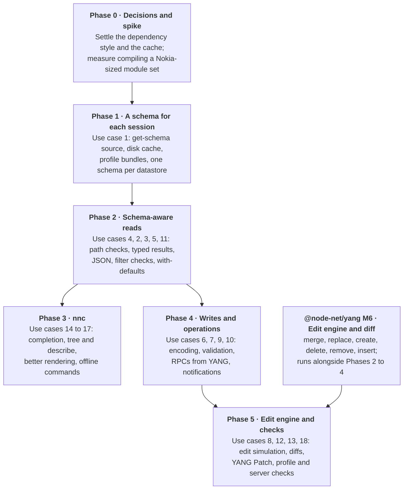

# @node-net/netconf × @node-net/yang integration plan

Status: plan, 2026-11-09. Updated for JSON output and JSON input: @node-net/yang is a hard dependency and the glue lives in `src/yang/`, not `src/schema/`, so the first and last rows of the decisions table were decided the other way.

## Summary

@node-net/netconf can now use @node-net/yang. With M5, @node-net/yang can:

- build a schema from a hello message, the YANG library or `modules-state`;
- decode and encode XML and RFC 7951 JSON with typed values;
- apply with-defaults and add defaults;
- validate data, including `must`, `when`, leafref and `unique`.

Its design doc ([net-yang-design.md](https://github.com/node-net-org/yang/blob/main/docs/net-yang-design.md) §10) already plans for @node-net/netconf to use it, with dependencies running only from @node-net/netconf and nnc to @node-net/yang.

This plan lists 18 use cases and orders them in five phases. The first phase builds and caches a schema for each session, and everything else depends on it. The largest new piece of work, an edit-config merge engine, is kept to the last phase.

## Decisions to settle first

| Decision | Recommendation | Why |
| --- | --- | --- |
| Hard or optional dependency | Optional. @node-net/netconf keeps working with no schema, and YANG features switch on when a schema can be had. Load @node-net/yang with a dynamic `import()` inside async calls, never top-level await. | Connecting stays cheap, and devices that offer neither `<get-schema>` nor a YANG library still work. |
| Where modules come from | A chain: a disk cache keyed by module@revision (or the YANG library content-id), then module bundles shipped with a device profile, then `<get-schema>`. | `<get-schema>` is slow on large module sets, and some devices don't support it. |
| Where schemas live | One compiled schema per module set, shared by every session whose module set is the same, with one per datastore under NMDA. | Compiling is the expensive step, and many sessions to the same device type share a module set. |
| How results are exposed | Add typed results alongside the current ones (for example a `typed` option, or new methods) rather than changing what existing calls return. | Callers of `read()` and `readValue()` get the same results as today. |
| Repo-level boundary | Keep @node-net/yang's lint rule that forbids importing @node-net/netconf. All glue lives in @node-net/netconf, in a new `src/schema/` area. | Keeps @node-net/yang movable to its own repository, as its design (§14) intends. |

The cache directory and the profile bundle format should be settled before Phase 1 is coded.

## Phase 0 spike: compiling a Nokia-sized module set

Done 2026-11-10, with @node-net/yang's `scripts/compile-benchmark.mjs` on Nokia's published SR OS 26.10 modules (`nokia/7x50_YangModels`, fetched by `scripts/fetch-corpus.sh`), Node.js 22 on one core of the development machine. Times are the median of three runs.

| Module set | Modules loaded | Schema nodes | Compile | Heap the schema keeps | Peak RSS |
| --- | --- | --- | --- | --- | --- |
| `nokia-conf` alone (one 22 MB file) | 52 | 74,473 | 1.2 s | 170 MB (70 MB since statements are released) | 600 MB |
| `nokia-conf` and `nokia-state`, from the 301 submodules instead | 58 | 133,525 | 2.1 s | 286 MB | 580 MB |
| The whole release: every Nokia, OpenConfig and IETF module, with Nokia's deviations | 229 | 149,026 | 2.4 s | 306 MB (121 MB since statements are released) | 740 MB |
| For comparison: all of OpenConfig with the IETF RFC modules | 412 | 40,014 | 0.7 s | 74 MB | 300 MB |

Findings:

- **It works.** The whole release compiles with no diagnostics at all. The spike found one bug, now fixed: leafrefs, keys and defaults inside a subtree removed by `deviate not-supported` were still checked, which gave 38 false errors (Nokia removes `/if:interfaces` and parts of OpenConfig). @node-net/yang now skips them, as libyang does. The release is now in @node-net/yang's corpus tests.
- **Where the time goes.** Reading the text (lexer, parser and grammar check) takes about 60% of a compile, the compiler itself about 15%, and garbage collection about 10%. A cheap fix to the grammar check took 7% off. The rest is spread out, with no single hotspot left.
- **Memory is the larger cost.** Compiled nodes pointed back to their parsed statements, so a schema kept every statement tree. @node-net/yang now releases them once a schema is compiled (`keepStatements` keeps them), and the full release keeps 121 MB rather than 306 MB (2026-11-11). The spike's estimate of 210 MB for the statements was high: they were 187 MB.
- **The 7210 can't be measured this way.** The 7210 SAS test router (classic CLI) advertises about 140 `alu-conf-*` modules but has no ietf-netconf-monitoring, so no `<get-schema>`. Nokia publishes no 7210 modules on GitHub, so its modules would have to come from a device profile bundle.

**Decision: cache module text, not compiled schemas.** Measured on the whole release:

- *Caching parsed statement trees* (v8 serialisation) doesn't pay. Reading them back takes 0.83 s against 1.05 s to parse the text, and the cache is 190 MB against 45 MB of text.
- *Caching the compiled schema* would save at most about 1.2 s. It serialises to 241 MB, takes 1.3 s to read back against 2.4 s to compile, and comes back as plain objects. Classes, compiled patterns and XPath would need rebuilding by code that must track every change to the compiled model.
- *So:* the disk cache holds module text keyed by module@revision (or by the YANG library's content-id), as the decisions table proposes. Each process compiles a module set once, in the background, and shares it across every session with the same module set. At 1 to 3 seconds for the largest known vendor set, compiling is cheap enough not to cache. Revisit this only if a module set takes more than about 10 seconds.

## Use cases

There are 18 use cases in six areas. Effort is a rough size: S is days, M is a week or two, and L is several weeks. Numbers in "Depends on" refer to other rows.

| # | Area | Use case | What it gives | Where | Depends on | Effort | Phase |
| --- | --- | --- | --- | --- | --- | --- | --- |
| 1 | Foundation | Building a schema for each session | A `ModuleSource` backed by `<get-schema>`, with the module list and features from the YANG library or the hello; one schema per datastore under NMDA; cached | @node-net/netconf `operations/yang-library.ts`, `monitoring.ts` | — | M | 1 |
| 2 | Reads | Typed results | `read()` and `readValue()` return bigint, decimal64, booleans, `empty`, resolved identityrefs and instance-identifiers; origin and `wd:default` annotations come through | `client-content.ts` | 1 | M | 2 |
| 3 | Reads | RFC 7951 JSON output | JSON for any reply or notification, for scripts and an nnc `--json` option | @node-net/netconf, nnc `render/` | 1 | S | 2 |
| 4 | Reads | Checking paths against the schema | Unknown nodes rejected with suggestions; key names and key value types checked; lists told from leaf-lists; choices and cases seen through | `content/path.ts` | 1 | M | 2 |
| 5 | Reads | Checking filters before sending them | XPath filters parsed and checked (`parseXPath`, `checkXPath`); subtree filters built with canonical key values **Changed:** JSON subtree filters are now checked against the schema and built with canonical content-match values; XPath checking is still open | `content/`, `operations/base.ts` | 1, 4 | S | 2 |
| 6 | Writes | Encoding JS values for edit-config | Canonical XML; namespace declarations for identityrefs and instance-identifiers; list keys first, as RFC 7950 requires **Done for RFC 7951 JSON:** JSON `config` on edit-config, copy-config, edit-data, transactions and `configure()`'s `txn.merge`/`txn.replace`, with RFC 7952 edit metadata; JS values at a path (`txn.set(path, json)`) are later | `content/configure.ts` | 1, 4 | M | 4 |
| 7 | Writes | Validating locally before commit | Types, ranges, patterns, mandatory, must/when, leafref, unique and min/max-elements checked against fetched running or candidate data, for example via `configure({ validate: 'local' })` | `content/configure.ts`, `operations/transaction.ts` | 1, 6 (and 8 for the full result) | M | 4 |
| 8 | Writes | Simulating an edit offline | Apply an edit to a local copy of running, then validate and diff it; also a diff of two configs that understands list keys, YANG Patch (RFC 8072) generated from a diff, and better `compare` rendering | @node-net/yang (new edit engine), `operations/yang-patch.ts`, `compare.ts` | 1, 6 | L | 5 |
| 9 | Operations | RPCs and actions from YANG | `OperationDescriptor` and `ParamDescriptor` generated from `input` statements, so vendor RPCs need no hand-written profile entries; input validated, output decoded with types | `operations/descriptors.ts`, `devices/profile-spec.ts` | 1 | M | 4 |
| 10 | Operations | Notifications | Notifications decoded with types and validated; the available notifications listed for nnc's subscribe command | `operations/notifications.ts`, `subscriptions.ts` | 1 | S | 4 |
| 11 | Operations | With-defaults for servers with only `explicit` or `trim` | `report-all` and `report-all-tagged` provided by filling in or tagging defaults locally | `operations/with-defaults.ts` | 1, 2 | S | 2 |
| 12 | Device profiles | Checking profiles against the device's modules | Named paths and parameter types in profiles checked against, or derived from, leaf types at test time | `devices/profile-spec.ts`, `profiles/` | 1, 4 | S | 5 |
| 13 | Device profiles | A server conformance check | A device's replies validated against its own advertised schema, with `<operational>` issues reported as warnings; finds quirks automatically | @node-net/netconf testing, the DEF defect server | 1, 2 | M | 5 |
| 14 | nnc | Tab completion | Paths, key values for enumerations, identities and booleans, RPC names and leaf values, from `Schema.complete` | nnc `repl.ts`, `commands/descriptor.ts` | 1, 4 | M | 3 |
| 15 | nnc | `tree` and `describe <path>` | RFC 8340 tree diagrams; a node's type, default, units and description | nnc `commands/` | 1 | S | 3 |
| 16 | nnc | Better rendering | Lists as tables keyed by their keys, enum names, units | nnc `render/` | 2 | S | 3 |
| 17 | nnc | Offline commands | `schema fetch` downloads a device's modules; `validate <file>` checks config files and RFC 9195 instance-data files without a session | nnc `commands/` | 1 | S | 3 |
| 18 | Testing | A schema-aware test server | The mock server answers `<get>` with schema-valid data, rejects edit-config that breaks constraints, and applies defaults | `@node-net/netconf/src/testing` | 1, 8 | M | 5 |

## Roadmap

Phase 1 gates everything, and Phases 3 and 4 can run side by side once Phase 2 lands.

The first slice is Phases 1 and 2, then completion (use case 14). Each step is useful by itself. Phase 5 waits on @node-net/yang M6, which can be built in @node-net/yang alongside Phases 2 to 4.

- [ ] Phase 0: settle the decisions above and run the performance spike (spike done, and the schema-cache question settled: see above)
- [ ] Phase 1: a schema for each session (1)
- [ ] Phase 2: schema-aware reads (4, 2, 3, 5, 11)
- [ ] Phase 3: nnc (14, 15, 16, 17)
- [ ] Phase 4: writes and operations (6, 7, 9, 10)
- [x] @node-net/yang M6: edit engine and diff (`applyEdit`, `diffTrees`, `diffEdit`; see docs/rfcs.md in [node-net-org/yang](https://github.com/node-net-org/yang))
- [ ] Phase 5: edit simulation and checks (8, 12, 13, 18)

## Gaps in @node-net/yang this work exposes

The edit engine was the only gap that blocked a use case; @node-net/yang M6 closed it. The others limit how complete a use case is.

| Gap | Blocks or limits | Plan |
| --- | --- | --- |
| No edit-config engine: merge, replace, create, delete and remove; `insert` for ordered-by user lists; `nc:operation` read from the annotations @node-net/yang already passes through | Blocks 8 and 18; limits 7 to validating what is already on the device | **Done in @node-net/yang M6:** `applyEdit`, checked against sysrepo |
| No diff of two data trees | Blocks YANG Patch generation and schema-aware `compare` in 8 | **Done in @node-net/yang M6:** `diffTrees` and `diffEdit` |
| Vendor-scale performance not measured: only the IETF and OpenConfig sets have been tried, not module sets as big as Nokia's `nokia-conf` | Phase 1 for Nokia devices | **Done in the Phase 0 spike:** the whole SR OS 26.10 release compiles in 2.4 s |
| Whether a compiled schema can be cached, rather than recompiled from cached module text, is not settled | How fast a session starts | **Decided in the Phase 0 spike:** cache text, compile once per process |
| A compiled schema keeps its parsed statement trees, about two thirds of its heap (210 of 306 MB for SR OS) | Memory in nnc with several device types | **Done:** @node-net/yang releases them by default, and SR OS keeps 121 MB |
| `yang:xpath1.0` values aren't checked | Some must-style checks in 7 (for example NACM rules) | Already a known M5 gap; low priority |
| Annotations aren't visible to XPath | Rare `must` and `when` expressions | Already a known M5 gap; low priority |

Replies to filtered reads are partial trees, so checks on read results (13) must use @node-net/yang's `partial` mode, or they will report missing mandatory nodes that the filter left out.

## Risks and open questions

| Risk | Effect | Mitigation |
| --- | --- | --- |
| Vendor module sets are slow or large to compile | Slow session start, or high memory in nnc | Measured in the Phase 0 spike: 2.4 s and 306 MB for all of SR OS, 121 MB now that statement trees are released. Compile in the background and use a schema only once it is ready |
| Devices advertise modules they can't serve, or serve modules that don't compile | No schema, or a partial one | Compile what can be compiled, report the rest as warnings, and fall back to working without a schema |
| Strict local validation rejects edits the device would accept, because of device deviations | Users blocked by false errors | Local validation is opt-in at first; a profile can turn checks off, in the same style as content quirks |
| Typed results change what callers see | Breaking changes for existing callers | Add typed results alongside the current ones (see Decisions) |
| The @node-net/yang API is still at 0.0.1 and may change | Glue code in @node-net/netconf has to follow | Keep the glue in one area of @node-net/netconf; both packages live in one workspace until the API settles |

Open questions:

- [ ] Which devices offer `<get-schema>`? The 7210 SAS test router (classic CLI) doesn't: it has no ietf-netconf-monitoring. SR OS still needs checking before Phase 1 depends on it.
- [ ] Should device profiles ship module bundles, or only point at a source for them?
- [x] Should @node-net/yang and @node-net/netconf be published together, or should @node-net/yang be published first, before @node-net/netconf depends on it? First: @node-net/yang 0.1.0, then @node-net/netconf with `^0.1.0` (2026-11-14; `docs/cli.md` §2.2).
- [ ] Should the public docs site cover the YANG features as they land, or once Phase 3 is done?
