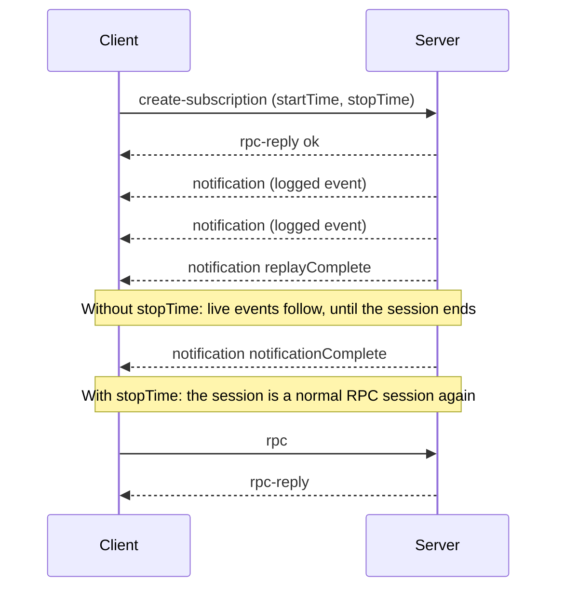

# RFC 5277: NETCONF Event Notifications

This is a conceptual overview of RFC 5277: the ideas in the RFC and how they fit together. It does not reproduce the spec, and where the two differ, the RFC wins. For the RFC's priority and where it lands in the design, see [rfcs.md](../rfcs.md).

Published July 2008. Defines the `:notification:1.0` and `:interleave:1.0` capabilities. It has not been obsoleted. RFC 8639/8640 (subscribed notifications) is the more capable successor, but 5277 is still the subscription mechanism most devices support.

## The problem it solves

Base NETCONF ([RFC 6241](./rfc6241-netconf.md)) is strictly request/response: the server never speaks unless asked. Devices also need to tell clients about things as they happen, such as configuration changes, faults, threshold crossings and state changes. Before this RFC, that meant falling back to SNMP traps or syslog, which use a different transport, data model and security model from NETCONF.

RFC 5277 adds **asynchronous, one-way `<notification>` messages** to an ordinary NETCONF session, using the same transport, authentication, access control and XML encoding as the rest of NETCONF. Its main features are:

- **Client-initiated**: the server sends nothing until the client asks with `<create-subscription>`.
- **Streams**: named feeds of events. The client picks one.
- **Server-side filtering** with the same subtree/XPath filters used by `<get>`.
- **Replay**: optionally re-send logged notifications from a point in the past.

## Key ideas

| Term | Meaning |
|------|---------|
| **Event** | Something that happened on the device that may interest a client. |
| **Event notification** | The `<notification>` message describing one event. |
| **Stream** | A named set of event notifications. Streams are predefined on the device. Configuring them is out of scope. An event can belong to several streams. |
| **Subscription** | One session's request to receive one stream, optionally filtered. It is **not persistent**: it lives as long as the session, or until its stop time. |
| **Replay** | Sending previously logged notifications, starting from a client-supplied time. |

Every server that supports notifications must provide the **`NETCONF` stream** (that exact name). It carries all the NETCONF XML notifications the server supports, and it is the stream used when `<create-subscription>` names none. Other streams (`SNMP`, `syslog`, vendor feeds) are optional and vendor-defined.

## Capabilities and namespaces

| Identifier | Meaning |
|------------|---------|
| `urn:ietf:params:netconf:capability:notification:1.0` | The server supports `<create-subscription>` and sends `<notification>`. |
| `urn:ietf:params:netconf:capability:interleave:1.0` | The server keeps processing other RPCs on a session with an active subscription. Depends on `:notification`. |

Two XML namespaces are involved:

| Namespace | Contains |
|-----------|----------|
| `urn:ietf:params:xml:ns:netconf:notification:1.0` | `<create-subscription>`, `<notification>`, `<eventTime>` |
| `urn:ietf:params:xml:ns:netmod:notification` | The `<netconf><streams>` discovery data, and the `<replayComplete>` and `<notificationComplete>` notifications |

## Discovering streams

The client reads the available streams with an ordinary `<get>`:

```xml
<rpc message-id="101" xmlns="urn:ietf:params:xml:ns:netconf:base:1.0">
  <get>
    <filter type="subtree">
      <netconf xmlns="urn:ietf:params:xml:ns:netmod:notification">
        <streams/>
      </netconf>
    </filter>
  </get>
</rpc>
```

Each `<stream>` has:

- `name`: unique on the server.
- `description`
- `replaySupport`: a boolean.
- `replayLogCreationTime`: required if replay is supported.
- `replayLogAgedTime`: the time of the last notification aged out of the log, present if any have been.

The list is filtered by the user's privileges, so different users can see different streams.

## `<create-subscription>`

```xml
<rpc message-id="102" xmlns="urn:ietf:params:xml:ns:netconf:base:1.0">
  <create-subscription xmlns="urn:ietf:params:xml:ns:netconf:notification:1.0">
    <stream>NETCONF</stream>
    <filter type="subtree">...</filter>
    <startTime>2026-11-01T00:00:00Z</startTime>
  </create-subscription>
</rpc>
```

All of the parameters are optional:

| Parameter | Meaning |
|-----------|---------|
| `stream` | The stream name. Defaults to `NETCONF`. |
| `filter` | Same format as the `<get>` filter. Defaults to everything. |
| `startTime` | Turns on **replay** from this time. Without it, the subscription only delivers new events. |
| `stopTime` | Ends the subscription at this time. Only valid with `startTime`, and must be later than it. It may be in the future. |

The times are XML `dateTime` values (RFC 3339) and must include a time zone. They are compared against each event's **generation time** (`eventTime`), not the time it was logged or sent.

The reply is `<ok/>` or an `<rpc-error>`. The RFC defines these errors:

| Condition | `error-tag` |
|-----------|-------------|
| `stopTime` without `startTime` | `missing-element` (`bad-element`: `startTime`) |
| `stopTime` earlier than `startTime` | `bad-element` (`stopTime`) |
| `startTime` in the future | `bad-element` (`startTime`) |
| Replay requested but not supported | `operation-failed` |
| A subscription is already active on this session | `operation-failed` |
| Unknown stream or invalid filter syntax | An `<rpc-error>` (tag not specified) |

If `startTime` is earlier than the oldest logged event, replay starts from the oldest one available. That isn't an error.

### Subscription rules a client must respect

- **One subscription per session.** A second `<create-subscription>` fails.
- **A subscription can't be modified.** To change the stream or filter, start a new session.
- **There is no "cancel subscription" operation.** A subscription only ends when:
  - its `stopTime` is reached, or
  - the session ends (`<close-session>`, `<kill-session>` from another session, or transport loss).
- **Without `:interleave`**, the server only has to accept `<close-session>` on a subscribed session. Any other RPC is rejected with `resource-denied`. A client talking to such a server needs a **dedicated session** for notifications.
- With `:interleave`, the server must keep processing RPCs, so one session can carry both.

## The `<notification>` message

```xml
<notification xmlns="urn:ietf:params:xml:ns:netconf:notification:1.0">
  <eventTime>2026-11-07T09:15:00Z</eventTime>
  <netconf-config-change xmlns="urn:ietf:params:xml:ns:yang:ietf-netconf-notifications">
    ...
  </netconf-config-change>
</notification>
```

- It is a **top-level message**, not an RPC. It has **no `message-id`** and gets no reply. The client must recognise it by element name and namespace, and keep it away from RPC reply correlation.
- `eventTime`, the time the event source generated the event, is the only content this RFC defines. The event payload that follows it is defined by other specs, for example RFC 6470 for the base NETCONF events or vendor YANG modules.
- Each notification is a complete, well-formed XML document, framed by the transport like any other message.
- Notifications can arrive **between** RPC replies on an interleaved session. The client cannot assume a fixed order between notifications and replies to other requests.

## Filtering

- The filter is applied to the **content inside** `<notification>`, not the wrapper itself.
- If a filter tests a field that a notification doesn't contain, the notification is **filtered out**. For example, filtering on `severity=critical` drops events that have no severity at all.
- Subtree filters match if the result is non-empty. XPath filters are evaluated and converted to a boolean.
- XPath filtering is only available if the server advertises the base `:xpath` capability. There is no separate notification XPath capability.
- The filter belongs to this one subscription. It doesn't change the stream.

## Replay



- A stream supports replay only if the device logs its events. How much is logged is up to the implementation. `replayLogCreationTime` and `replayLogAgedTime` show what is available.
- **`<replayComplete>`** is sent once all of the logged notifications have been sent. After it, a subscription without a stop time continues with live events, starting with any generated since the subscription was created.
- **`<notificationComplete>`** is sent when a subscription with a stop time ends. The session then returns to normal request/response operation, **even without `:interleave`**. The client is responsible for closing it if it isn't needed.
- Neither of these can be filtered out.

## Security considerations

- Notifications are never sent before the transport is up, the hellos have been exchanged and the user is authenticated.
- `<create-subscription>` behaves like a deferred `<get>`: the server applies access control (NACM, RFC 8341) **per notification, per session**, and must not send content the user isn't authorised to see. Two users subscribed to the same stream can receive different notifications. Stream names can be sensitive too.
- Streams relayed from other sources (SNMP, syslog) may have different security properties over NETCONF than over their native transport. The server is responsible for access control on them.
- Subscriptions consume server resources. A buggy client that keeps opening subscribed sessions can exhaust them, and `<kill-session>` is the remedy.

## Where it lands in @node-net/netconf

| Concept | RFC | Module |
|---------|-----|--------|
| Recognising `<notification>` and routing it away from `message-id` correlation | 5277 §2.2 | `messages/session.ts` (`Session`, `notification` event) |
| `NOTIFICATION_NS` | 5277 §4 | `messages/constants.ts` |
| `<create-subscription>`, stream discovery, replay (`replayComplete`, `notificationComplete`), `AsyncIterable` API with a bounded queue | 5277 §2.1, §3.2–3.3 | `operations/notifications.ts`, entry point `@node-net/netconf/operations/notifications` ([design §8](../../net-netconf-design.md#8-operations-layer-base-operations-and-extensions-operations)) |
| `:interleave` check: without it, other RPCs on the subscribed session are refused locally until the subscription ends | 5277 §6 | `operations/notifications.ts`, through the session's RPC guard (`RpcContext.addRpcGuard`) |
| Typed decoders for the `NETCONF` stream's base events | [RFC 6470](./rfc6470-base-notifications.md) | `operations/base-notifications` ✅ |
