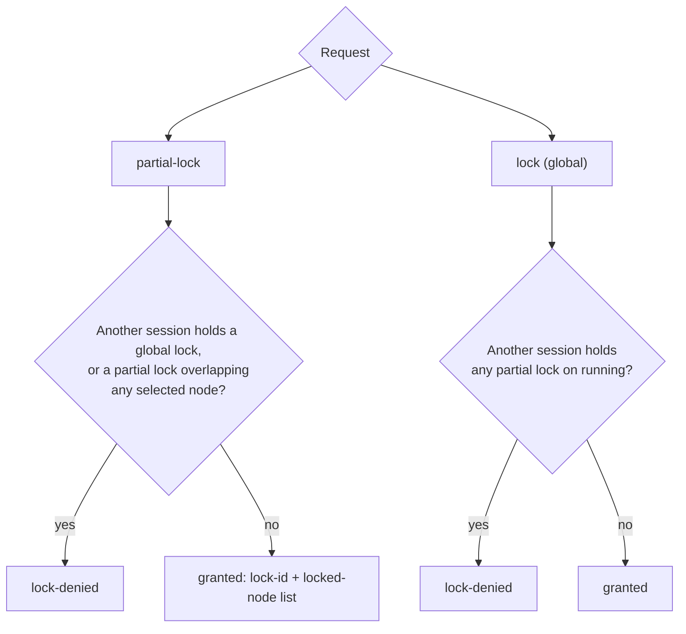

# RFC 5717: Partial Lock Remote Procedure Call (RPC) for NETCONF

This is a conceptual overview of RFC 5717: the ideas in the RFC and how they fit together. It does not reproduce the spec, and where the two differ, the RFC wins. For the RFC's priority and where it lands in the design, see [rfcs.md](../rfcs.md).

Published December 2009. Defines the `:partial-lock:1.0` capability (`urn:ietf:params:netconf:capability:partial-lock:1.0`) and the `ietf-netconf-partial-lock` YANG module (namespace `urn:ietf:params:xml:ns:netconf:partial-lock:1.0`), with two RPCs: `<partial-lock>` and `<partial-unlock>`.

## The problem it solves

RFC 6241 `<lock>` locks a **whole datastore**. While one manager holds it, no one else can change anything, even a part of the configuration they have nothing to do with. On a large device with several management systems (one for interfaces, one for routing policy, an operator on the CLI), that serialises all work.

A partial lock locks **only the parts of `running` a session is about to change**, so several sessions can make changes at the same time, as long as their parts don't overlap.

## The RPCs

### `<partial-lock>`

```xml
<rpc message-id="1" xmlns="urn:ietf:params:xml:ns:netconf:base:1.0">
  <partial-lock xmlns="urn:ietf:params:xml:ns:netconf:partial-lock:1.0">
    <select xmlns:if="urn:ietf:params:xml:ns:yang:ietf-interfaces">/if:interfaces/if:interface[if:name='eth0']</select>
    <select xmlns:if="urn:ietf:params:xml:ns:yang:ietf-interfaces">/if:interfaces/if:interface[if:name='eth1']</select>
  </partial-lock>
</rpc>
```

```xml
<rpc-reply message-id="1" xmlns="urn:ietf:params:xml:ns:netconf:base:1.0">
  <lock-id xmlns="urn:ietf:params:xml:ns:netconf:partial-lock:1.0">127</lock-id>
  <locked-node xmlns="urn:ietf:params:xml:ns:netconf:partial-lock:1.0" xmlns:if="…">/if:interfaces/if:interface[if:name='eth0']</locked-node>
  <locked-node xmlns="urn:ietf:params:xml:ns:netconf:partial-lock:1.0" xmlns:if="…">/if:interfaces/if:interface[if:name='eth1']</locked-node>
</rpc-reply>
```

| | Meaning |
|---|---|
| `select` (one or more) | An **XPath 1.0** expression that must evaluate to a node set. Prefixes are bound by `xmlns:` declarations in scope on the element. |
| `lock-id` | The ID of the new lock, used to release it. |
| `locked-node` (one or more) | An `instance-identifier` for each node that was actually locked. |

### `<partial-unlock>`

Takes the `lock-id` and releases that lock. Only the session that holds the lock can release it.

## What gets locked

- **Only `running`.** There is no datastore parameter. Partial locks don't apply to `candidate` or `startup`.
- **The selected nodes and everything below them.** Locking an interface also locks its subinterfaces, addresses and so on.
- **The set of nodes is fixed when the lock is taken.** The XPath is evaluated once. A node created later that would have matched it is **not** locked. A node created later *under* a locked node is, because it is a descendant.
- **A lock lasts until `<partial-unlock>` or the end of the session.** If a locked node is deleted, the lock stays, but no longer covers that node.
- A session may hold **several partial locks**, and its own locks may overlap.

`locked-node` is the reliable answer to "what do I hold". Use it rather than re-evaluating the `select` expressions.

## How it interacts with other locks



- **A partial lock is refused** if another session holds a global lock on `running`, or a partial lock on any of the same nodes. Nothing is locked: it is all or nothing.
- **A global `<lock>` is refused** while any other session holds a partial lock on `running`.
- **Another session's edits** to a locked node fail with `in-use`, as with a global lock. Edits elsewhere are allowed.
- A session holding a global lock may also take partial locks, though they add nothing.

The `lock-denied` error's `error-info` contains the `session-id` of a holder (0 for a non-NETCONF holder). The RFC doesn't put the conflicting `lock-id` there. The lock list in [RFC 6022](./rfc6022-netconf-monitoring.md) `/netconf-state/datastores/datastore/locks/partial-lock` shows every partial lock with its `lock-id`, `locked-by-session`, `select` and `locked-node` entries.

## Errors

| Condition | Error |
|-----------|-------|
| A `select` isn't a valid XPath | `invalid-value` |
| A `select` doesn't evaluate to a node set | `invalid-value`, app tag `not-a-node-set` |
| Every `select` matches no nodes | `operation-failed`, app tag `no-matches` |
| Without `:xpath`, a `select` isn't an instance-identifier | `invalid-value`, app tag `invalid-lock-specification` |
| Access control refuses it (checked before conflicts) | `access-denied` |
| A conflicting lock exists | `lock-denied`, with the holder's `session-id` in `error-info` |
| Unknown or someone else's `lock-id` | `invalid-value` |

## A partial lock is not a transaction

A partial lock only stops others from changing the nodes. It doesn't make a set of edits atomic, and it doesn't involve `candidate` or `commit`. A typical use is:

1. `<partial-lock>` the parts you will change.
2. `<get-config>` them, to read the current state while no one else can change it.
3. `<edit-config>` on `running`, with `rollback-on-error` if the device supports it.
4. `<partial-unlock>`.

## Support in practice

Few devices implement it. Devices that use `candidate` mostly expect a global lock on `candidate` instead. Check the capability before relying on it.

## Where it lands in @node-net/netconf

| Concept | RFC | Module |
|---------|-----|--------|
| `client.ops.partialLock.lock(selects)` returning a `PartialLock` handle (`lockId`, `lockedNodes`, `unlock()`, `await using`), and `client.ops.partialLock.unlock(lockId)` | 5717 | `operations/partial-lock` ✅ ([design §8](../../net-netconf-design.md)), gated on `:partial-lock:1.0`; unit-tested only, since no open-source server implements it |
| Selects as `xpath(expr, namespaces)` or YANG paths through `client.content.toXPath(path)` | 5717, 7950 | `operations/partial-lock`, content `pathXPath()` ✅ |
| `locked-node` paths resolved with the declarations in scope and returned as RFC 7951 instance-identifiers (module names in place of prefixes) | 5717, 7951 §6.11 | `operations/partial-lock` ✅ (`qualifiedPath`) |
| The holder's `session-id` from a `lock-denied` error | 5717, 6241 | `PartialLockDeniedError` (a `LockDeniedError`) ✅ |
| Partial locks in `/netconf-state` | 6022 | `operations/monitoring` `datastores()` ✅ |
