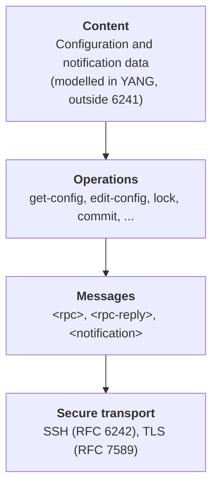
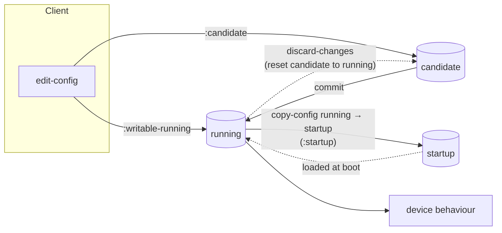
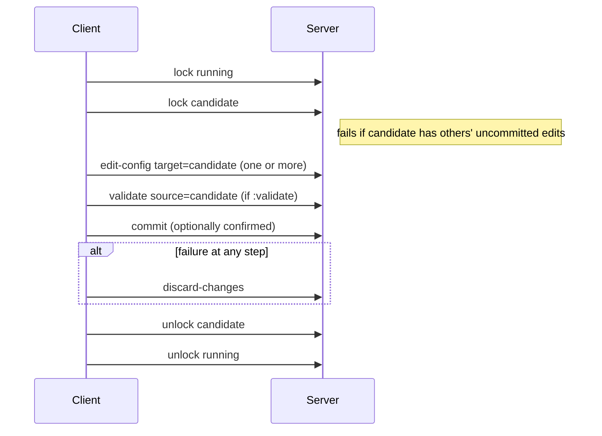
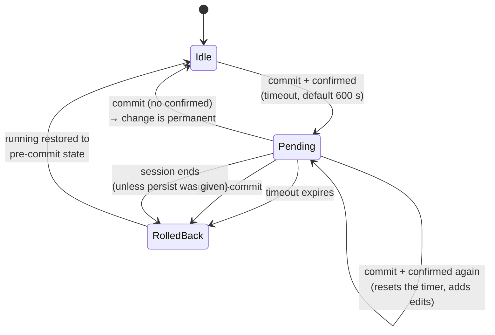

# RFC 6241: Network Configuration Protocol (NETCONF)

This is a conceptual overview of RFC 6241: the ideas in the RFC and how they fit together. It does not reproduce the spec, and where the two differ, the RFC wins. For the RFC's priority and where it lands in the design, see [rfcs.md](../rfcs.md).

Published June 2011. Obsoletes RFC 4741 (NETCONF 1.0). Defines protocol version `base:1.1`.

## The problem it solves

Before NETCONF, devices were configured over CLI scraping or SNMP. CLIs are made for humans: they have no stable grammar, no structured errors and no transactions. SNMP never worked well for configuration. NETCONF gives a device a programmatic configuration API with these properties:

- **Structured data** (XML) instead of text to scrape.
- **Configuration is separate from state**, so a client can read back exactly what it wrote, without counters and other operational data mixed in.
- **Multiple configuration datastores**, so changes can be staged, validated and committed as a unit.
- **Transactions**: locking, all-or-nothing edits, and commits that roll back automatically if not confirmed.
- **Capability discovery**, so a client learns what a device supports at connect time instead of guessing.

## Conceptual layers

The RFC splits the protocol into four layers. Each one only depends on the layer below it, and this split maps directly onto @node-net/netconf's own layering (see [design §3](../../net-netconf-design.md)).



| Layer | What it defines | Where it is specified |
|-------|-----------------|-----------------------|
| Content | The actual configuration and state trees | YANG modules (RFC 7950 and many others). RFC 6241 is deliberately content-agnostic. |
| Operations | The base RPCs and their parameters | RFC 6241 §7–8 |
| Messages | RPC framing, request/reply correlation, error reporting | RFC 6241 §4 |
| Secure transport | Authentication, integrity, confidentiality, message delimiting | RFC 6242 (SSH), RFC 7589 (TLS) |

RFC 6241 requires the transport to be connection-oriented, authenticated, encrypted and integrity-protected, and it requires the transport to supply the **username** that NETCONF uses for access control (RFC 8341 NACM). NETCONF has no login of its own.

## Sessions and the hello exchange

A **session** is one logical connection between a client and a server. When a session opens, **both peers send `<hello>` at once, without waiting for each other**. Each hello lists the peer's capabilities. The server's hello also carries a `session-id`, a number that identifies the session (for example in `kill-session` and `lock-denied` errors).

```xml
<!-- server hello -->
<hello xmlns="urn:ietf:params:xml:ns:netconf:base:1.0">
  <capabilities>
    <capability>urn:ietf:params:netconf:base:1.0</capability>
    <capability>urn:ietf:params:netconf:base:1.1</capability>
    <capability>urn:ietf:params:netconf:capability:candidate:1.0</capability>
    <capability>urn:ietf:params:netconf:capability:confirmed-commit:1.1</capability>
    <capability>http://example.com/ns/acme?module=acme-system&amp;revision=2024-01-01</capability>
  </capabilities>
  <session-id>4</session-id>
</hello>
```

Rules worth remembering:

- The client **must not** send a `session-id`. If it does, the server terminates the session.
- Each side must advertise at least one base version (`base:1.0` and/or `base:1.1`). The session uses the **highest version both peers advertise**. If they share none, the session is closed.
- Capabilities are URIs. The standard ones look like `urn:ietf:params:netconf:capability:{name}:{version}`. Vendor and YANG-module capabilities can be any URI and often carry query parameters (`module=`, `revision=`, `features=`, `deviations=`).
- The capability set is **fixed for the life of the session**. A client checks capabilities once, after the hello, and can then rely on them.
- The XML namespace is still `urn:ietf:params:xml:ns:netconf:base:1.0` in 1.1. Only the capability URI changes.

## Messages: `<rpc>` and `<rpc-reply>`

Every request is an `<rpc>` with a **`message-id`** attribute. The server copies the `message-id`, and **every other attribute on `<rpc>`**, onto the matching `<rpc-reply>`. The client uses this to correlate replies with requests. If the `message-id` is missing, the server rejects the request with `missing-attribute`.

```xml
<rpc message-id="101" xmlns="urn:ietf:params:xml:ns:netconf:base:1.0">
  <get-config><source><running/></source></get-config>
</rpc>

<rpc-reply message-id="101" xmlns="urn:ietf:params:xml:ns:netconf:base:1.0">
  <data> ... </data>
</rpc-reply>
```

A reply holds one of the following:

- `<ok/>`: the operation succeeded and returns no data.
- `<data>`: the result of a retrieval (`get`, `get-config`).
- One or more `<rpc-error>` elements: the operation failed, or partly failed.
- Content specific to the RPC (for vendor and YANG-defined RPCs).

**Pipelining.** A client may send further requests before earlier ones have been answered. The server must process requests **serially** and reply **in the order received**. Because of this, a client can match replies by `message-id` and also treat the stream as ordered. Ordering doesn't remove the need for `message-id`, but it means a missing or unexpected reply is an error that the client can detect.

**Notifications** (RFC 5277) share the same channel but are `<notification>` elements with no `message-id`. A client must route them separately from RPC replies, even though 6241 doesn't define them.

```mermaid
sequenceDiagram
    participant C as Client
    participant S as Server
    par Both send immediately
        C->>S: #lt;hello#gt; (capabilities)
    and
        S->>C: #lt;hello#gt; (capabilities, session-id)
    end
    Note over C,S: Version = highest common base; capabilities now fixed
    C->>S: #lt;rpc message-id="1"#gt; lock running
    C->>S: #lt;rpc message-id="2"#gt; edit-config   (pipelined)
    S-->>C: #lt;rpc-reply message-id="1"#gt; #lt;ok/#gt;
    S-->>C: #lt;rpc-reply message-id="2"#gt; #lt;ok/#gt;
    S--)C: #lt;notification#gt; (no message-id, RFC 5277)
    C->>S: #lt;rpc message-id="3"#gt; close-session
    S-->>C: #lt;rpc-reply message-id="3"#gt; #lt;ok/#gt;
    Note over C,S: Server releases locks, closes transport
```

## The `<rpc-error>` model

Errors are structured, not free text. This is one of NETCONF's biggest advantages over CLI automation. Each `<rpc-error>` has these fields:

| Element | Required | Meaning |
|---------|----------|---------|
| `error-type` | yes | The layer the error came from: `transport`, `rpc`, `protocol` or `application`. |
| `error-tag` | yes | A fixed enumeration (see below). The programmatic error code. |
| `error-severity` | yes | `error` or `warning`. No standard tag uses `warning`, but servers may. |
| `error-app-tag` | no | A more specific code from the data model or the vendor (for example a YANG `must` failure). |
| `error-path` | no | An XPath expression locating the offending node in the request or datastore. |
| `error-message` | no | Human-readable text, optionally with `xml:lang`. |
| `error-info` | no | Structured details that depend on the tag, such as `bad-element`, `bad-attribute`, `bad-namespace` or `session-id`. |

A reply can contain **several** `<rpc-error>` elements (for example with `continue-on-error`). A reply that holds only warnings has still succeeded.

The `error-tag` values, grouped by intent:

| Group | Tags |
|-------|------|
| Malformed request | `malformed-message`, `missing-attribute`, `bad-attribute`, `unknown-attribute`, `missing-element`, `bad-element`, `unknown-element`, `unknown-namespace`, `invalid-value`, `too-big` |
| Data state conflicts | `data-exists` (create on existing), `data-missing` (delete on absent) |
| Concurrency | `in-use`, `lock-denied` (`error-info` carries the lock holder's `session-id`) |
| Authorization and resources | `access-denied`, `resource-denied` |
| Operation failure | `operation-not-supported`, `operation-failed`, `rollback-failed`, `partial-operation` (deprecated in 1.1) |

## Datastores

A **configuration datastore** is a complete set of configuration that can bring a device from its initial state to a desired state. RFC 6241 defines three:

| Datastore | Always present? | Purpose |
|-----------|-----------------|---------|
| `running` | Yes | The configuration the device is using now. |
| `candidate` | With `:candidate` | A scratch copy. Edits build up here with no effect on the device until `<commit>` copies them into running. **It is shared by all sessions.** |
| `startup` | With `:startup` | The configuration loaded at boot. Without this capability, a device usually saves changes to running automatically. |



**Configuration vs state data.** Configuration is what you write (interface MTU). State is what the device reports (interface counters, operational status). `<get-config>` returns configuration only, from any datastore. `<get>` returns configuration **and** state, and always reads `running`. NMDA (RFC 8342 and 8526) later reworks this model with `<operational>` and `<get-data>`, but the 6241 model is what most devices still speak.

## Base operations

| Operation | Purpose | Key parameters |
|-----------|---------|----------------|
| `get-config` | Read configuration from a datastore | `source`, `filter` |
| `get` | Read running configuration plus state | `filter` |
| `edit-config` | Change a datastore by applying a patch | `target`, `default-operation`, `test-option`, `error-option`, `config` or `url` |
| `copy-config` | Replace a whole datastore with another one, or with inline/URL content | `source`, `target` |
| `delete-config` | Delete a datastore (never `running`) | `target` |
| `lock` / `unlock` | Take or release a global lock on a datastore | `target` |
| `close-session` | End this session gracefully | none |
| `kill-session` | Force another session to end | `session-id` |

Capabilities add more: `commit`, `discard-changes` and `cancel-commit` (`:candidate` / `:confirmed-commit`), and `validate` (`:validate`).

## `edit-config`: patch semantics

`edit-config` doesn't send a whole configuration. It sends a **patch**: an XML tree that mirrors the datastore structure, where any element can carry an `operation` attribute (in the base namespace) saying what to do with that subtree.

| `operation` | Exists in target | Absent from target |
|-------------|------------------|--------------------|
| `merge` (default) | Merge into existing | Create |
| `replace` | Replace the subtree | Create |
| `create` | **Error** `data-exists` | Create |
| `delete` | Delete | **Error** `data-missing` |
| `remove` (1.1) | Delete | Silently ignore |

The other parameters control the edit as a whole:

- **`default-operation`** (`merge` | `replace` | `none`) applies wherever no `operation` attribute is given. `none` means "only touch nodes that carry an explicit operation". Parent elements are then just a path to the change, and a missing parent gives `data-missing`. This is the safest mode for targeted deletes.
- **`test-option`** (needs `:validate`): `test-then-set` (the default when `:validate` is supported) validates before applying, `set` applies without validating, and `test-only` validates without applying (1.1).
- **`error-option`**: `stop-on-error` (the default), `continue-on-error`, or `rollback-on-error` (needs `:rollback-on-error`, and makes the edit atomic).

```xml
<edit-config>
  <target><candidate/></target>
  <default-operation>none</default-operation>
  <config>
    <top xmlns="http://example.com/schema/1.2/config">
      <interface>
        <name>Ethernet0/0</name>
        <mtu operation="delete"/>
      </interface>
    </top>
  </config>
</edit-config>
```

`copy-config` is the full-replace counterpart: the target ends up identical to the source. `replace` as an `operation` attribute is the same idea limited to one subtree.

## Subtree filtering

`get` and `get-config` take a `<filter type="subtree">`. The filter is an XML template of the data you want back. The server works out what to return from the kind of node each element in the template is:

| Filter node | Looks like | Effect |
|-------------|------------|--------|
| Namespace selection | Any element in a namespace | Only data in that namespace is considered |
| Containment node | An element with child elements | "Descend into here" |
| Selection node | An empty element, for example `<mtu/>` | "Return this node and everything under it" |
| Content match node | A leaf with a value, for example `<name>eth0</name>` | "Only list entries where this leaf equals this value". Siblings are then selected for matching entries. |
| Attribute match | An attribute on a filter element | Match on the attribute value |

```xml
<filter type="subtree">
  <top xmlns="http://example.com/schema/1.2/config">
    <interfaces>
      <interface>
        <name>eth0</name>   <!-- content match: only eth0 -->
        <mtu/>              <!-- selection: return its mtu -->
      </interface>
    </interfaces>
  </top>
</filter>
```

An **empty** filter selects nothing. Leaving the filter out selects everything. With the `:xpath` capability, `<filter type="xpath" select="...">` accepts an XPath 1.0 expression instead, with namespace prefixes resolved from the filter element's namespace declarations.

## Locking

`<lock>` takes an **exclusive, global** lock on a whole datastore for the calling session. Other sessions can still read it but can't change it.

- If another session holds the lock, the request fails with `lock-denied`, and `error-info/session-id` names the holder. The value is `0` if the holder isn't a NETCONF session, for example a CLI user.
- A `candidate` lock is also refused if the candidate holds **uncommitted changes from someone else**. Because the candidate is shared, locking it would capture another session's half-finished edit.
- **Locks are released when the session ends**, however it ends. A client can't leave a datastore locked by mistake once its session has gone. This is why `kill-session` is the way to clear a stuck lock.
- Partial (subtree) locks are a separate extension, RFC 5717.

## Standard capabilities

| Capability | Adds |
|------------|------|
| `:writable-running` | `running` can be the target of `edit-config` and `copy-config`. |
| `:candidate` | The `candidate` datastore, plus `<commit>` and `<discard-changes>`. |
| `:confirmed-commit:1.1` | `<commit><confirmed/>` with `confirm-timeout`, `persist` / `persist-id`, and `<cancel-commit>`. |
| `:rollback-on-error` | `error-option=rollback-on-error` (an atomic edit). |
| `:validate:1.1` | The `<validate>` operation and `edit-config test-option`. |
| `:startup` | The `startup` datastore (save to startup explicitly). |
| `:url` | `<url>` as a source or target in `copy-config`, `edit-config` and `validate`. The supported schemes are listed as a query parameter on the capability. |
| `:xpath` | XPath filters. |

Servers that speak only 1.0 (RFC 4741) advertise the **1.0 forms** of the two versioned capabilities, so a client must recognise both:

- `:confirmed-commit:1.0`: `<commit><confirmed/>` with `confirm-timeout` only. There is no `persist`/`persist-id` and no `<cancel-commit>`.
- `:validate:1.0`: `<validate>` and `test-option`, but with no `test-only` value.

Only send the 1.1-only features when the `:1.1` URI is advertised. The other capabilities (`:candidate:1.0`, `:writable-running:1.0` and so on) have the same URI in both versions.

The two transaction models a client will meet are:

1. **Direct** (`:writable-running` only): `lock running`, then `edit-config running` (ideally with `rollback-on-error`), then `unlock`. Each edit takes effect at once.
2. **Candidate** (`:candidate`): changes are staged and then applied together. RFC 6241 Appendix E recommends this sequence:



Nokia SR OS, Junos and IOS-XR all support the candidate model. The Nokia SR OS profile in this repo uses it.

## Confirmed commit

A confirmed commit lets a client apply a change that **reverts automatically unless it is confirmed**. It protects against a change that cuts off the management connection the client would need in order to fix it.



- The confirming `<commit>` must normally come from the **same session**.
- With `<persist>token</persist>`, the pending commit survives the session ending, and **any** session can confirm or cancel it by passing `<persist-id>token</persist-id>`. This matters when the change itself might drop the connection: the client reconnects and confirms.
- A rollback restores running to its state **before the confirmed commit**, including any later `confirmed` commits made in the same window.

## What changed from 1.0 to 1.1

- Chunked framing on SSH ([RFC 6242](./rfc6242-netconf-over-ssh.md)). This is the most important change in practice.
- The `remove` operation, and `test-only` in `test-option`. A 1.0 server won't accept `remove`. Use `delete` instead, which fails if the node is absent.
- `:confirmed-commit:1.1` adds `cancel-commit` and `persist`/`persist-id`.
- `:validate:1.1` accepts inline `<config>` as the source.
- XPath namespace handling clarified, `partial-operation` deprecated.
- The base protocol defined as a YANG module (`ietf-netconf`, Appendix C).


## Where it lands in @node-net/netconf

| Concept | RFC | Module |
|---------|-----|--------|
| Hello, capabilities, version selection | 6241 §8.1 | `messages/` (`Session`) |
| `message-id` correlation, pipelining, notification routing | 6241 §4, 5277 | `messages/` (`Session`) |
| `<rpc-error>` model | 6241 §4.3, App. A | `messages/rpc-error.ts` |
| Base operations, candidate workflow, confirmed commit | 6241 §7–8 | `operations/base.ts` |
