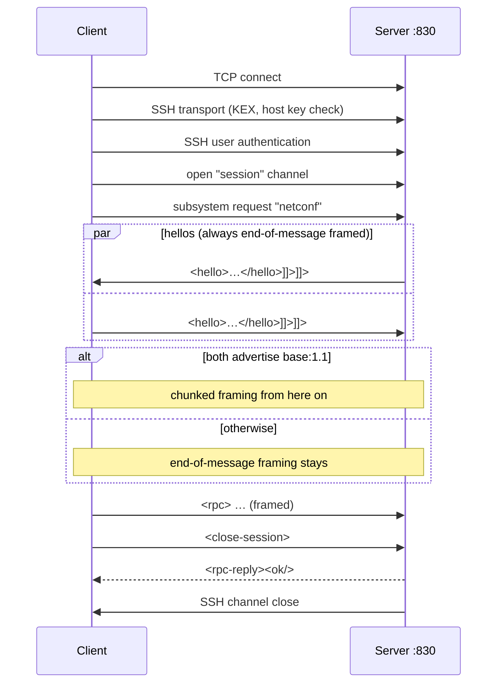
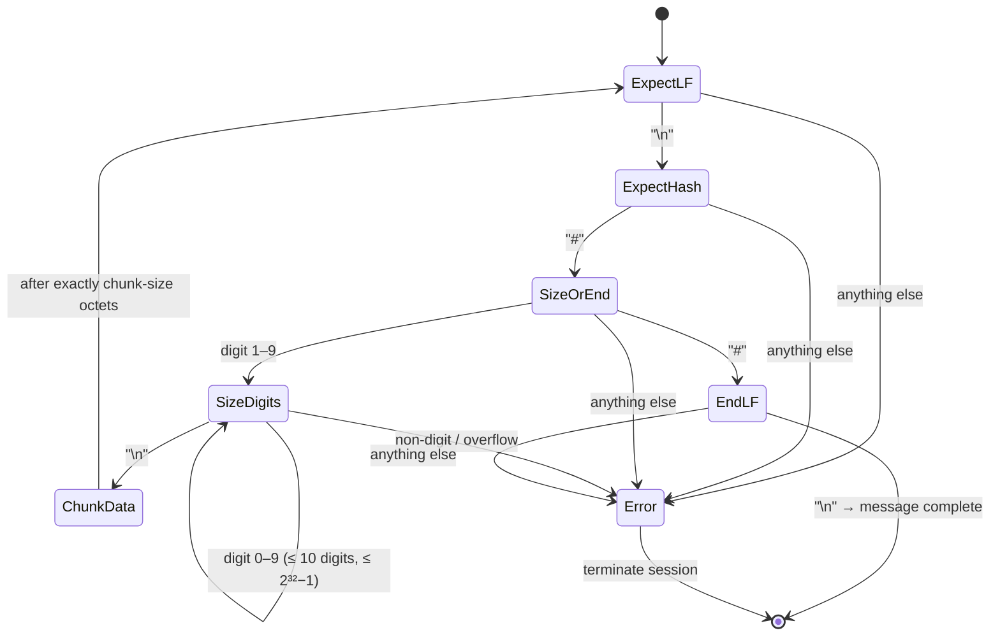
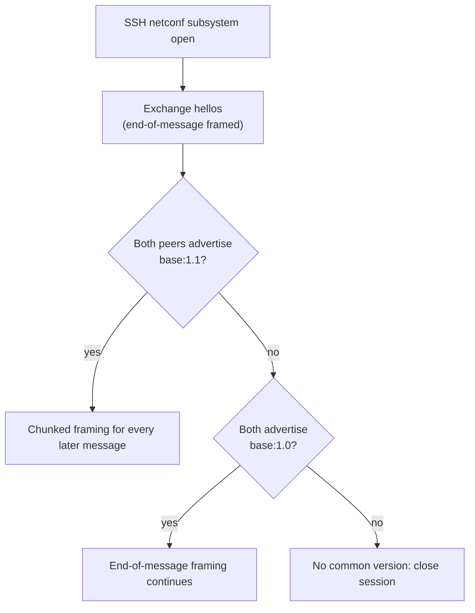

# RFC 6242: Using NETCONF over SSH

This is a conceptual overview of RFC 6242: the ideas in the RFC and how they fit together. It does not reproduce the spec, and where the two differ, the RFC wins. For the RFC's priority and where it lands in the design, see [rfcs.md](../rfcs.md).

Published June 2011. Obsoletes RFC 4742. It is the mandatory-to-implement transport for NETCONF.

## Key ideas

1. NETCONF runs as an **SSH subsystem** called `netconf`. It is not a shell, so there's no prompt to scrape.
2. The **default port is 830**, which is IANA-assigned. Servers may also allow it on port 22 with the subsystem.
3. SSH carries a byte stream, and NETCONF needs **message boundaries**. RFC 6242 defines two framing mechanisms: **end-of-message** (1.0) and **chunked** (1.1).
4. The framing is **negotiated through the hello exchange**: hellos always use end-of-message framing, and the session switches to chunked framing afterwards if both sides advertise `base:1.1`.

## Connection setup

The SSH client is always the NETCONF client. ([RFC 8071](./rfc8071-call-home.md) Call Home reverses only the TCP connection; the SSH roles stay the same.) The SSH layer handles server authentication (host key), user authentication (password, public key, ...) and encryption. The authenticated SSH username becomes the NETCONF username.



The client should check the server's **host key** against a known key or fingerprint. The RFC lists this under security considerations, and @node-net/netconf makes it mandatory.

## End-of-message framing (base:1.0)

Each message is followed by the six-character sequence `]]>]]>`:

```
<rpc message-id="1" ...>...</rpc>]]>]]>
```

The receiver scans the byte stream for the delimiter. It's simple, but it has a known flaw. `]]>]]>` is well-formed inside XML **character data** (the `>` doesn't need escaping) and can appear in comments or CDATA. A message whose content contains the sequence (for example a login banner or description string) gets cut in half, and an attacker who controls such a string can inject messages. This flaw is the main reason chunked framing exists.

## Chunked framing (base:1.1)

A message is sent as one or more **length-prefixed chunks**, followed by an end-of-chunks marker:

```
\n#<chunk-size>\n<chunk-data>
\n#<chunk-size>\n<chunk-data>
...
\n##\n
```

- `chunk-size` is a decimal number from **1 to 4294967295** (2³²−1), with no leading zeros. The data is exactly that many **octets**, not characters, which matters for UTF-8.
- A message can be split into chunks at any point, even inside a multi-byte UTF-8 character, so a decoder must join chunk data as bytes before decoding text.
- The content is never scanned for delimiters, so any byte sequence is safe.
- Any violation (a bad header, a size of 0, a size too large, a missing LF) is a **framing error**, and the receiver must **terminate the session**. Once framing is lost, the session can't recover.

Example: one `<rpc>` sent as two chunks:

```
\n#4\n
<rpc
\n#18\n
 message-id="102">
\n##\n
```

The decoder is a small state machine:



## Framing negotiation



The switch happens **right after the hellos**. The first byte after the server's hello delimiter may already be a chunk header, so a decoder must be able to change mode between two messages in the same buffer.

## Security considerations

- **Host key verification** is the client's only protection against a man-in-the-middle attack. Skipping it defeats SSH.
- **End-of-message injection**: the `]]>]]>` flaw above. Prefer 1.1 whenever the device supports it.
- **Resource limits**: a chunk header can announce up to 4 GiB. A robust client caps the total message size it will buffer, not just the chunk size. @node-net/netconf does this as a security check.
- The NETCONF username is the SSH username, so access control (NACM) is only as strong as the SSH authentication.

## Where it lands in @node-net/netconf

| Concept | RFC | Module |
|---------|-----|--------|
| SSH subsystem, port 830, host-key policy | 6242 §3 | `transport/ssh.ts` (`Connection`) |
| End-of-message and chunked framing, size limits | 6242 §4 | `transport/framing/` |
