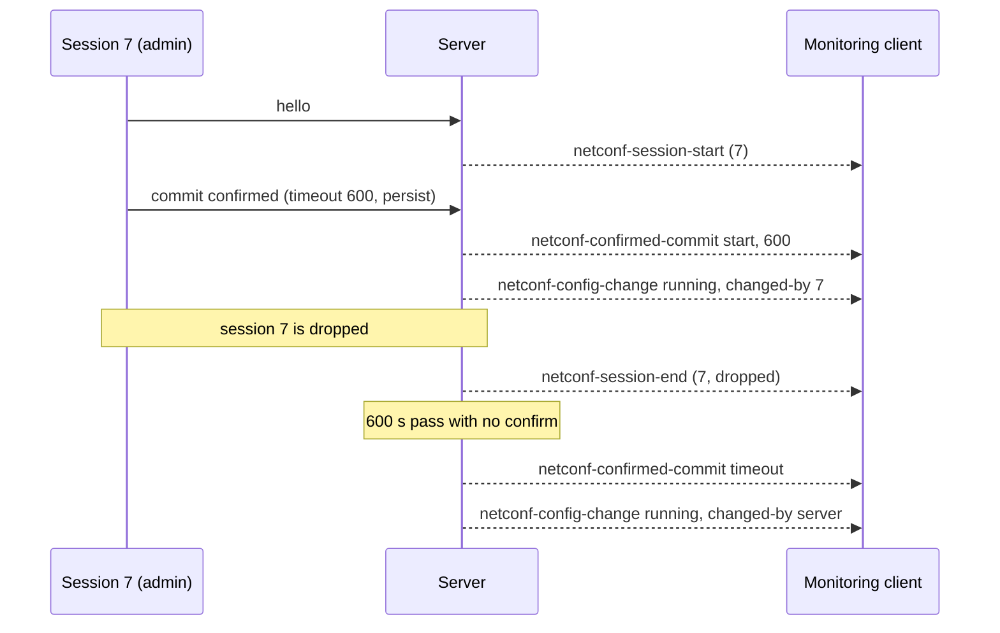

# RFC 6470: NETCONF Base Notifications

This is a conceptual overview of RFC 6470: the ideas in the RFC and how they fit together. It does not reproduce the spec, and where the two differ, the RFC wins. For the RFC's priority and where it lands in the design, see [rfcs.md](../rfcs.md).

Published February 2012. Defines the `ietf-netconf-notifications` YANG module (prefix `ncn`, namespace `urn:ietf:params:xml:ns:yang:ietf-netconf-notifications`), which holds five notifications about the NETCONF server itself.

## The problem it solves

[RFC 5277](./rfc5277-event-notifications.md) gives NETCONF a way to deliver notifications, but it defines no events of its own. The default `NETCONF` stream exists, and nothing says what goes on it. RFC 6470 fills that stream with events about **the management system itself**:

- the configuration changed, and who changed it
- the server's capabilities changed while sessions were open
- a session started or ended
- a confirmed commit started, was extended, confirmed, cancelled, or timed out

A client that needs to know when its cached view of the device is stale, or that another manager is working on the device, can subscribe to these events instead of polling.

The RFC adds **no capability URI and no RPC**. A server shows support by advertising the module in the hello, like any other YANG 1.0 module (`…ietf-netconf-notifications?module=ietf-netconf-notifications&revision=2012-02-06`). The events arrive on the `NETCONF` stream through an ordinary `<create-subscription>`.

## How an event arrives

Each event is the content of an RFC 5277 `<notification>`: an `eventTime` followed by one element in the `ncn` namespace.

```xml
<notification xmlns="urn:ietf:params:xml:ns:netconf:notification:1.0">
  <eventTime>2026-11-07T10:15:02Z</eventTime>
  <netconf-config-change xmlns="urn:ietf:params:xml:ns:yang:ietf-netconf-notifications">
    <changed-by>
      <username>admin</username>
      <session-id>42</session-id>
      <source-host>192.0.2.10</source-host>
    </changed-by>
    <datastore>running</datastore>
    <edit>
      <target xmlns:if="urn:ietf:params:xml:ns:yang:ietf-interfaces">/if:interfaces/if:interface[if:name='eth0']</target>
      <operation>replace</operation>
    </edit>
  </netconf-config-change>
</notification>
```

A decoder therefore takes the `event` element of a notification, checks its namespace and local name, and reads a few leaves. No schema is needed.

## Who did it: the shared groupings

Most events say which session caused them, using one of two groupings.

**`common-session-parms`** names a session:

| Leaf | Meaning |
|------|---------|
| `username` | The name the transport authenticated (the SSH user, or the name mapped from a TLS certificate, see [RFC 7589](./rfc7589-netconf-over-tls.md)). |
| `session-id` | The NETCONF session ID. **`0` means a non-NETCONF session**, such as a CLI user. This is the same convention as the lock holder in [RFC 6022](./rfc6022-netconf-monitoring.md). |
| `source-host` | The peer's IP address. Optional, because not every session has one. |

**`changed-by`** wraps a choice between two cases:

- `server`, an empty leaf: the server made the change itself, for example on boot or when a confirmed commit timed out.
- the `common-session-parms` of the session that made the change.

## The five events

### `netconf-config-change`

Sent when the `running` or `startup` datastore changes, by any means: `<edit-config>`, `<copy-config>`, `<commit>`, the CLI, or the server itself. Changes to `candidate` are **not** reported. They aren't in effect until a commit, and the commit then produces a `running` change.

| Leaf | Meaning |
|------|---------|
| `changed-by` | Who made the change (above). |
| `datastore` | `running` (the default, so it may be left out) or `startup`. |
| `edit*` | A list of what was changed. Each entry has a `target` (an `instance-identifier` path to the node) and an `operation` (`merge`, `replace`, `create`, `delete` or `remove`). |

Points a client should handle:

- **The `edit` list is optional and may be partial.** A server can send the event with no `edit` entries at all. Treat the event as "something changed", and treat the edits only as a hint about where.
- **`target` is an XPath-style path with namespace prefixes**, and the prefixes are bound by `xmlns:` declarations on the element (or an ancestor). A decoder must return the prefix-to-namespace map with the path, or resolve it, because the prefix string alone means nothing.
- **One transaction can produce one event** with many edits, or several events. The RFC doesn't fix the grouping.

### `netconf-capability-change`

Sent when the server's capabilities change while it is running, for example when a module is loaded or a feature is turned on. The hello a client received is a snapshot, and this event is how the client learns it is out of date.

| Leaf | Meaning |
|------|---------|
| `changed-by` | Who caused it, often `server`. |
| `added-capability*` | URIs that are new. |
| `deleted-capability*` | URIs that are gone. |
| `modified-capability*` | URIs whose **parameters** changed, for example a module `revision`, or the `content-id` of `:yang-library:1.1` ([RFC 8525](./rfc8525-yang-library.md)). |

A changed `content-id` or module revision is the signal to throw away a cached schema. The current list is always readable from `/netconf-state/capabilities` ([RFC 6022](./rfc6022-netconf-monitoring.md)).

### `netconf-session-start` and `netconf-session-end`

`netconf-session-start` carries the `common-session-parms` of the new session.

`netconf-session-end` carries the same, plus:

| Leaf | Meaning |
|------|---------|
| `killed-by` | The session ID that sent `<kill-session>`. Present only when `termination-reason` is `killed`. |
| `termination-reason` | `closed` (normal `<close-session>`), `killed`, `dropped` (transport lost), `timeout` (idle timeout), `bad-hello` (the hello was invalid or never arrived), or `other`. |

These match the counters in `/netconf-state/statistics`: `dropped` and `timeout` are what RFC 6022 counts as `dropped-sessions`, and `bad-hello` is `in-bad-hellos`.

A client never sees its own `session-start` (it can't be subscribed yet), and normally doesn't see its own `session-end`.

### `netconf-confirmed-commit`

Tracks a confirmed commit (RFC 6241 §8.4) through its life.

| Leaf | Meaning |
|------|---------|
| session parameters | The `common-session-parms` of the session that acted. **Left out for a `timeout` event**, because no session acted. |
| `confirm-event` | `start`, `extend` (another confirmed commit before the timeout), `complete` (confirmed by a plain `<commit>`), `cancel` (`<cancel-commit>`, or the session closed before confirming) or `timeout` (the server rolled back). |
| `timeout` | Seconds until rollback. Present for `start` and `extend`. |

A `timeout` event means the configuration has been **rolled back**, and a `netconf-config-change` with `changed-by/server` normally follows. For a client running a confirmed commit, this is how it hears that the device reverted without it, for example after a lost connection.

## Event lifecycle

The events relate to each other like this:



The `<persist>` token is what lets the commit outlive session 7. Without it, RFC 6241 §8.4 reverts the commit as soon as the session ends, and the event is `cancel` rather than `timeout`.

## Security considerations

- These events reveal **who is connected, from where, and what they change**. Read access to them should be restricted, for example with NACM (RFC 8341), which can control access to individual notifications.
- The paths in `edit/target` can name sensitive configuration even though the values aren't sent.

## Where it lands in @node-net/netconf

| Concept | RFC | Module |
|---------|-----|--------|
| Decoders from a `Notification.event` to typed objects: a discriminated union on the event name, `changedBy` as `{ server: true } \| { username, sessionId, sourceHost? }`, `datastore` defaulted to `running` | 6470 §2 | `operations/base-notifications` ✅ ([design §8](../../net-netconf-design.md)): `decodeBaseNotification()` and one decoder per event |
| `edit/target` resolved with the declarations in scope and returned as an RFC 7951 instance-identifier (module names in place of the server's prefixes), not as the server's prefixed text | 6470 §2, 7950 §9.13, 7951 §6.11 | `operations/base-notifications` ✅ (`qualifiedPath`) |
| A malformed base event (required leaf missing, unknown enum value, unparseable target) reported, not skipped | 6470 §2 | `BaseNotificationError`, a `ProtocolError` |
| Subscribing to the `NETCONF` stream that carries the events | 5277 | `operations/notifications` ✅ |
| `<notification>` routing and `eventTime` | 5277 | `messages/session.ts` (`notification` event) |
| `modified-capability` / `content-id` change as the trigger to drop cached schemas | 6470 §2, 8525 | `yang-library` (planned) and caller docs |
| `confirmed-commit` `timeout` / `cancel` as the signal that a confirmed commit reverted | 6470 §2, 6241 §8.4 | `transaction` (planned) and caller docs |
