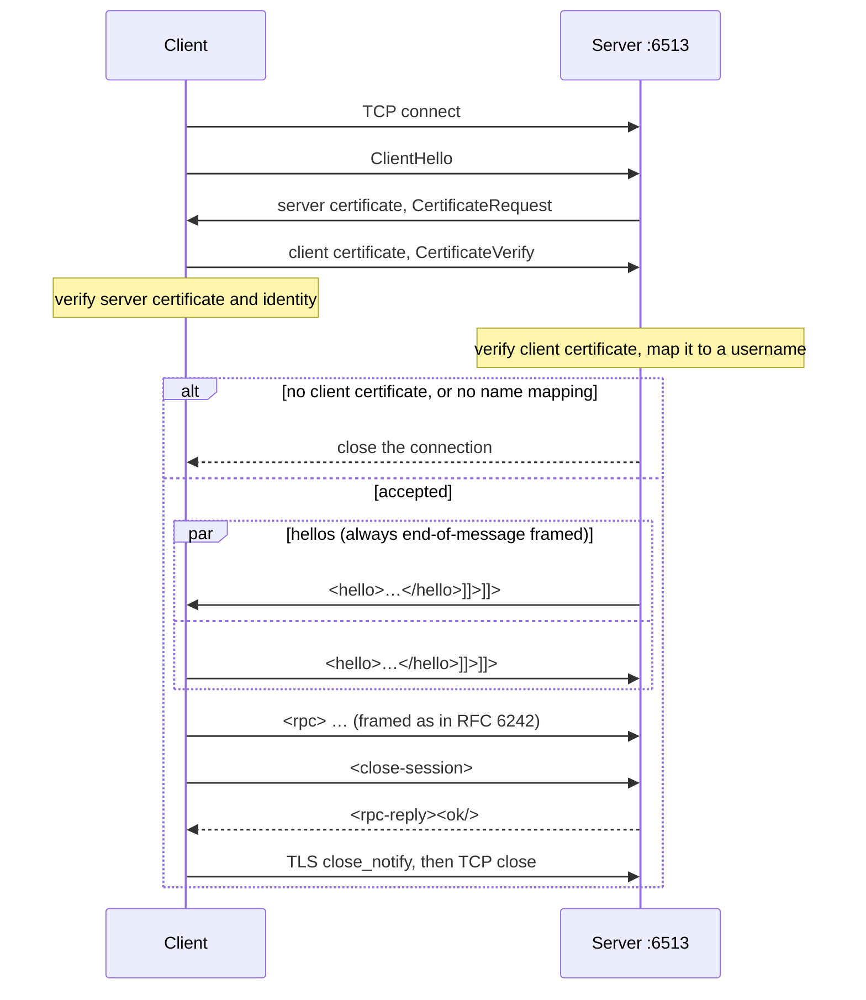

# RFC 7589: Using NETCONF over TLS with Mutual X.509 Authentication

This is a conceptual overview of RFC 7589: the ideas in the RFC and how they fit together. It does not reproduce the spec, and where the two differ, the RFC wins. For the RFC's priority and where it lands in the design, see [rfcs.md](../rfcs.md).

Published June 2015. Obsoletes RFC 5539. It is the second standard NETCONF transport, next to [SSH (RFC 6242)](./rfc6242-netconf-over-ssh.md).

## Key ideas

1. NETCONF runs directly over a **TLS connection**, on IANA port **6513**. There is no subsystem or channel layer: once TLS is up, the bytes are NETCONF.
2. **Both sides authenticate with X.509 certificates.** The server must ask for a client certificate and must refuse a client that doesn't send one. There are no passwords.
3. The server turns the client's certificate into a **NETCONF username** with the **cert-to-name** rules of RFC 7407. That name is what NACM and [RFC 6022](./rfc6022-netconf-monitoring.md) monitoring see.
4. Everything above TLS is the same as SSH: the hello exchange, and **RFC 6242 framing**, end-of-message for the hellos and chunked afterwards if both sides advertise `base:1.1`.

Point 4 is the reason it matters to the design: TLS only replaces how the reliable, authenticated byte stream is built. Framing, the session and every operation are unchanged.

## Connection setup

The NETCONF client is the TLS client, and opens the connection. (With [RFC 8071](./rfc8071-call-home.md) Call Home, the device opens the TCP connection to port 4335, but the TLS roles stay the same.)

All NETCONF messages travel as TLS application data. When the session ends, the side closing it sends a TLS `close_notify` alert before closing TCP, so that a truncation attack can be told apart from a normal close.

## Authenticating the server

The client must check two things about the server's certificate:

1. **The chain is valid** (RFC 5280) up to a trust anchor the client has been configured with. The client may also be configured with the server certificate's fingerprint directly.
2. **The certificate names the server the client meant to reach**, using the RFC 6125 rules: the host name or IP address the client was given must match a DNS name or IP address in the certificate's `subjectAltName`.

The second check is what stops a valid certificate issued for some other device from being accepted. Unlike SSH, there is no "accept the key on first use": a client with no trust anchor can't authenticate any server.

## Authenticating the client: cert-to-name

The server verifies the client's certificate chain, then has to decide **which user** it is. RFC 7589 uses the `cert-to-name` list from the RFC 7407 YANG module (`ietf-x509-cert-to-name`), which is also used by SNMP over TLS.

Each entry in the list has:

| Field | Meaning |
|-------|---------|
| `id` | Order. Entries are tried from the lowest `id` up. |
| `fingerprint` | Matches a certificate **in the presented chain**: the client's own certificate, or a CA certificate above it. A hash algorithm byte followed by the hash. |
| `map-type` | How to get the name once the fingerprint matches. |
| `name` | The username, used only with `map-type` `specified`. |

The map types:

| `map-type` | Username taken from |
|------------|---------------------|
| `specified` | The configured `name`. |
| `san-rfc822-name` | An email address in the `subjectAltName`. |
| `san-dns-name` | A DNS name in the `subjectAltName`. |
| `san-ip-address` | An IP address in the `subjectAltName`. |
| `san-any` | The first of the above found in the `subjectAltName`. |
| `common-name` | The subject's CN. |

Matching a CA's fingerprint with a `san-…` or `common-name` map type is the scalable setup: every certificate the CA issues is accepted, and each one yields its own username. Matching a single client certificate with `specified` is the precise setup for one client.

If no entry produces a name, the server **must close the connection**. For the client, a TLS handshake that completes and is then closed with no hello usually means exactly this: the certificate was trusted but is not mapped to any user.

## What changed from RFC 5539

- **The cert-to-name mapping is standardised** through RFC 7407. RFC 5539 left the derivation of the username largely to the implementation, so the same certificate could give different usernames on servers from different vendors.
- **Framing comes from RFC 6242.** RFC 5539 had its own end-of-message framing with the same `]]>]]>` flaw, and no chunked framing.

## Security considerations

- **Certificate validation is the client's only protection** against a man-in-the-middle attack, as host-key checking is for SSH. Turning it off defeats TLS.
- The **server identity check** (RFC 6125) matters as much as chain validation, and is the step most often skipped by TLS libraries that only check the chain.
- The usernames that come out of cert-to-name are what NACM (RFC 8341) authorises, so the mapping policy is part of access control. A broad CA fingerprint with `common-name` lets anyone who can get a certificate from that CA choose their own username.
- Use current TLS versions and cipher suites. RFC 7589 requires at least TLS 1.2. BCP 195 (RFC 9325) gives the current recommendations.
- The same resource limits apply as for SSH: a chunk header can announce up to 4 GiB, so the client caps how much it buffers.

## Where it lands in @node-net/netconf

| Concept | RFC | Module |
|---------|-----|--------|
| TLS `Connection` over `node:tls`, port 6513, client certificate and key, trust anchors | 7589 | `transport/tls.ts` ✅ (`tls()`, [design §5.1](../../net-netconf-design.md)) |
| Chain validation and RFC 6125 server identity always on with `ca`; turning verification off needs `insecure: 'insecure-accept-any'` and logs a warning | 7589, 6125 | `transport/tls.ts` ✅ |
| Pinning to a server certificate fingerprint, alone or with `ca` | 7589 | `transport/tls.ts` ✅ |
| `minVersion: 'TLSv1.2'`, preferring 1.3 | 7589, 9325 | `transport/tls.ts` ✅ |
| End-of-message hellos, then chunked framing on `base:1.1` | 7589, 6242 §4 | `transport/framing/` (shared with SSH) |
| A refused client certificate, or a connection closed after the handshake but before the hello, reported as a likely cert-to-name failure | 7589 | `transport/tls.ts` ✅ as an `AuthenticationError` |
| The TLS client handshake over an accepted call-home socket on port 4335 | 8071 | `transport/call-home.ts` (planned) |
| Cert-to-name configuration | 7407 | Not implemented: it is server configuration. Documented so callers know which certificate field becomes their username. |
