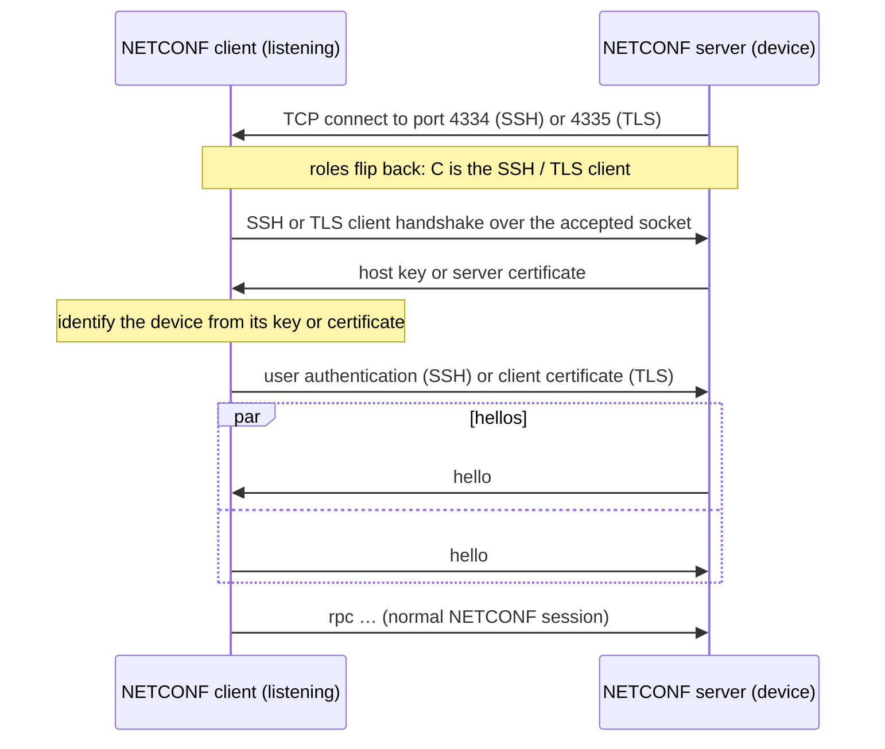

# RFC 8071: NETCONF Call Home and RESTCONF Call Home

This is a conceptual overview of RFC 8071: the ideas in the RFC and how they fit together. It does not reproduce the spec, and where the two differ, the RFC wins. For the RFC's priority and where it lands in the design, see [rfcs.md](../rfcs.md).

Published February 2017. Covers NETCONF over SSH, NETCONF over TLS and RESTCONF. Only the NETCONF parts are summarised here.

## The problem it solves

Normally the NETCONF client connects to the device. That fails when the client **can't reach the device**:

- the device is behind NAT or a firewall that blocks inbound connections, for example a CPE or a box on a customer network
- the device gets its address dynamically, and the client doesn't know it
- the device has just been installed, and the management system doesn't yet know it exists

With Call Home, the **device opens the TCP connection** to the management system. Everything after TCP is the same as usual: the management system is still the SSH or TLS **client**, and still the NETCONF **client**.

## The role reversal is TCP only

| | Normal | Call Home |
|---|---|---|
| TCP initiator | Client | **Server** |
| TCP listener | Server, port 830 (SSH) or 6513 (TLS) | **Client**, port **4334** (SSH) or **4335** (TLS) |
| SSH / TLS client | Client | Client |
| NETCONF client | Client | Client |

Keeping the SSH and TLS roles unchanged is the design choice that makes Call Home cheap: authentication, framing and the whole NETCONF session work exactly as in [RFC 6242](./rfc6242-netconf-over-ssh.md) and [RFC 7589](./rfc7589-netconf-over-tls.md). Only the code that opens the socket is different.

## Identifying the device

On a normal connection, the client knows which device it meant to reach, and checks the host key or certificate against that. On a Call Home connection, **the client doesn't know who is calling** until the handshake shows it.

- **The source IP address is not an identity.** It may be a NAT address shared by many devices, or spoofed. The RFC says the client must not rely on it to identify the device.
- **For SSH**, the device is identified by its **host key**. The client starts the SSH handshake, receives the host key, and looks it up among the devices it knows. Only then does it know which credentials to use for user authentication. Host keys that are certificates (RFC 6187) let a client accept devices signed by a trusted CA without listing each key.
- **For TLS**, the device is identified by its **certificate**. The client can't do the usual RFC 6125 host name check, because it has no name to check against. It matches a fingerprint, or a field such as a serial number in a manufacturer certificate (an IEEE 802.1AR IDevID), instead.
- If the key or certificate is unknown, the client closes the connection.

So the order of decisions on the client is: accept the socket, run the handshake as far as the server's identity, **choose the device and its credentials from that identity**, then authenticate.

## Connection management

RFC 8071 only defines the protocol. *When* a device calls home is device configuration, modelled in the NETCONF server YANG module (`draft-ietf-netconf-netconf-client-server`):

- **Persistent**: the device keeps a connection open, and reconnects when it drops. The client sends RPCs whenever it likes.
- **Periodic**: the device calls home at intervals, stays connected for a while, and then disconnects, or lets the client close the session.
- A list of clients to try, in order, and keepalives to detect a dead connection through NAT.

A client listening for Call Home should expect the same device to connect more than once: after a drop, at the next period, or while an old connection is still timing out.

## Security considerations

- The listening port is open to anyone. A client must expect connections from unknown devices and from attackers, and must limit how much work it does before the server is identified. A flood of connections is a denial-of-service risk.
- Host key and certificate checks are no weaker than for a normal connection, as long as the client identifies the device by its key, not its address.
- The device must be configured with the client's address and must trust that address. Pointing a device at the wrong client gives that client a session, but not the device's credentials: the client still has to authenticate to the device.

## Where it lands in @node-net/netconf

| Concept | RFC | Module |
|---------|-----|--------|
| `listenCallHome()` on 4334 / 4335: each accepted socket goes to the SSH or TLS transport and becomes an ordinary `NetconfClient`, yielded by `for await` | 8071 | `transport/call-home.ts` (listener) and `call-home.ts` (facade) ✅ ([design §5.1](../../net-netconf-design.md)) |
| SSH and TLS transports over an already-connected socket | 8071 | `callHomeSsh` in `transport/ssh.ts`, `callHomeTls` in `transport/tls.ts` ✅ |
| Choosing credentials from the presented host key or certificate: `identify(caller)` runs once the host key (SSH) or certificate (TLS) is seen, and only then are the device's credentials sent (SSH, via ssh2's `authHandler`). Over TLS our certificate is the listener's, since Node can't choose one after seeing the server's | 8071 | ✅ |
| Unknown key or certificate: closed and reported as a `rejected` event; set-up failures as `failed` events; nothing thrown | 8071 | ✅ |
| Limits on connections that haven't finished identifying themselves: `maxPending`, `handshakeTimeout`, `maxQueued` | 8071 | ✅ |
| Persistent and periodic reconnection | YANG draft | Device configuration. The listener simply yields a new `NetconfClient` each time (netopeer2's persistent call home dials again as soon as a session closes). |
