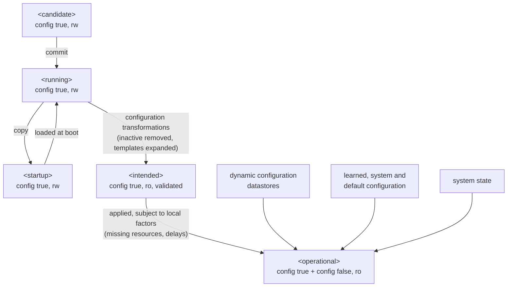

# RFC 8342: Network Management Datastore Architecture (NMDA)

This is a conceptual overview of RFC 8342: the ideas in the RFC and how they fit together. It does not reproduce the spec, and where the two differ, the RFC wins. For the RFC's priority and where it lands in the design, see [rfcs.md](../rfcs.md).

Published March 2018. Updates RFC 7950 (YANG 1.1). Defines the NMDA datastore model, the `ietf-datastores` YANG module (datastore identities) and the `ietf-origin` YANG module (the `origin` metadata annotation). It defines no protocol operations. The NETCONF operations that use it are in [RFC 8526](./rfc8526-netconf-nmda.md), and per-datastore module discovery is in the [YANG library, RFC 8525](./rfc8525-yang-library.md).

## The problem it solves

A configurable item usually has two values: the one the operator **configured**, and the one the device is **actually using**. They differ for many reasons: hardware that isn't present, a protocol that negotiated something else, or simply the time it takes a change to reach the hardware.

The original NETCONF model had only configuration datastores (`running`, `candidate`, `startup`). Operational state was not a datastore at all, just the extra `config false` data that `<get>` returns alongside `<running>`. That forced YANG authors to model everything **twice**:

- a `config true` tree for what was configured, for example `/interfaces`, and
- a parallel `config false` tree for what is in use, for example `/interfaces-state`.

The RFC lists the costs. The duplicated trees are hard to read and operationally awkward. The link between `/foo` and `/foo-state` is not machine readable. Filters over configuration and over the matching state have to be written differently.

NMDA fixes this by defining each node **once** in the schema and letting **different datastores hold different instances** of it. The configured MTU lives in `<running>` and the MTU in use lives in `<operational>`, at the same path. It also adds datastores for things the old model couldn't express: inactive configuration, templates, and configuration from outside the conventional datastores.

## Key terms

| Term | Meaning |
|------|---------|
| **Datastore** | A conceptual place to store and access information. Maps to an instantiated YANG data tree. |
| **Datastore schema** | All schema nodes of all modules a given datastore supports, after its deviations and features. Different datastores can have different schemas. |
| **Configuration transformation** | Adding, changing or removing configuration between `<running>` and `<intended>`, for example dropping inactive nodes or expanding templates. |
| **Conventional configuration** | Configuration held in `<running>`, `<candidate>`, `<startup>` or `<intended>`. |
| **Dynamic configuration** | Configuration from a dynamic configuration datastore, obtained at run time from other systems. |
| **Learned configuration** | Configuration learned through protocols (link negotiation, routing, DHCP) that is neither conventional nor dynamic. |
| **System configuration** | Configuration the device supplies itself. |
| **Default configuration** | A value from the data model used because nothing else provided one. |
| **Applied configuration** | Configuration actively in use, from any of the five sources above. |
| **System state** | Non-configuration data such as status and counters. Modelled as `config false`. |
| **Operational state** | Applied configuration plus system state. |
| **Remnant configuration** | Configuration still applied for a while after it was removed, until its resources (connections, memory, file handles) are released. |

## The datastores



The diagram follows the RFC's Figure 2. "rw" and "ro" are from the client's point of view and only conceptual: `<candidate>` and `<startup>` are optional in NETCONF, `<running>` need not be writable, and standard NETCONF changes `<startup>` only by copying `<running>` into it.

| Datastore | Kind | Contains | Persists across reboot | Notes |
|-----------|------|----------|------------------------|-------|
| `<startup>` | Conventional | `config true` | Typically, via non-volatile storage | Only on devices that separate startup from running. Loaded into `<running>` at boot. |
| `<candidate>` | Conventional | `config true` | No. Reset to `<running>` at boot | Edited without affecting the device, then committed to `<running>`. |
| `<running>` | Conventional | `config true` | Only if there's no `<startup>` and storage exists | **Must** be supported if the device is configurable through conventional datastores. May hold inactive or template configuration, but must always be a valid data tree. |
| `<intended>` | Conventional | `config true` | No (rebuilt from `<running>`) | Read-only. `<running>` after all transformations: what the system tries to apply. Updated and validated **immediately** whenever `<running>` is written. Must always be valid. On simple implementations it is identical to `<running>`. |
| Dynamic | Dynamic | `config true` (schema may differ) | No, by definition ("ephemeral") | Feeds `<operational>` directly, not through `<running>`. Each one defines its own semantics. |
| `<operational>` | Operational | `config true` **and** `config false` | No | Read-only. Everything in use: applied configuration from every source, plus system state. |

The four conventional datastores share **exactly one datastore schema**, which is what lets protocols copy between them (NETCONF's `<copy-config>`). A module with no configuration nodes may be left out of that schema unless something imports it. Dynamic datastores may use a different schema. The schema of `<operational>` must be a superset of all configuration datastore schemas, except that a server may leave out configuration nodes it can't report accurately.

### How `config true` and `config false` map onto datastores

| Node type | Conventional datastores | Dynamic datastores | `<operational>` |
|-----------|-------------------------|--------------------|-----------------|
| `config true` | The configured value | The dynamically supplied value | The value **in use**, with its origin |
| `config false` | Not present | Not present | Present |

This is the key change for module authors and clients. In the original model `config true` meant "configuration only". In NMDA a `config true` node also appears in `<operational>`, where it carries the applied value. That is why a single `/interfaces/interface/mtu` can answer both "what did I configure?" (read `<running>` or `<intended>`) and "what is in use?" (read `<operational>`).

The RFC's BGP example (Appendix C.2) shows the intended modelling style: state nodes such as `peer/state` sit inside the same `bgp` tree as the configuration, with "no separate `bgp-state` hierarchy".

## Why `<operational>` differs from `<intended>`

A client can see how much of its intended configuration is in use by comparing `<intended>` with the `config true` part of `<operational>`. The RFC names these reasons for a difference:

| Reason | Effect | Example |
|--------|--------|---------|
| **Missing resources** | In `<intended>`, absent from `<operational>` | Configuration for an interface card that isn't inserted. Validity can't depend on hardware presence, or removing a card would make the configuration invalid. |
| **System-controlled resources** | Appear in and disappear from `<operational>` as the system decides | A card is inserted, and matching configuration in `<intended>` is then applied. |
| **System, learned and default values** | In `<operational>`, absent from `<intended>` | An auto-created loopback, a DHCP-learned address, a defaulted leaf. |
| **Remnant configuration** | Still in `<operational>` after removal from `<intended>` | A deleted BGP peer stays, in state `closing`, until its connection is torn down. |
| **Delay** | Changes take time to percolate | Any change, briefly. |
| **Inactive or template configuration** | In `<running>`, removed or expanded in `<intended>` | Vendor "inactive" markers. The RFC notes no standard mechanism for this exists yet. |

Other rules for `<operational>`:

- A read returns the value **in use**, whatever the YANG `default` says. If no value comes back, the node is not in use.
- What counts as "in use" depends on the schema and the implementation. Functionality that is neither enabled nor operational **should** be left out.
- **Semantic constraints may be violated**: `when`, `must`, `mandatory`, `unique`, `min-elements`, `max-elements` and key uniqueness. Remnant configuration is the typical cause. A client must not assume `<operational>` validates against the model.
- **Syntactic constraints must not be violated**: hierarchy, identifiers and types. A node that would break them is not returned.
- Servers should use YANG **deviations** where they know in advance that they don't fully conform to the `<operational>` schema.

## The `origin` annotation

As configuration flows into `<operational>`, each configuration node is tagged with where it came from. `origin` is an RFC 7952 metadata annotation defined in `ietf-origin`, and its value is an identity:

| Identity | Meaning |
|----------|---------|
| `or:origin` | Abstract base. |
| `or:intended` | From `<intended>`. |
| `or:dynamic` | From a dynamic configuration datastore. Can be refined per datastore. |
| `or:system` | Supplied by the device, for example an always-present loopback or interfaces auto-created for the hardware present. |
| `or:learned` | Learned through protocol interactions such as link-layer negotiation, routing protocols or DHCP. |
| `or:default` | A model default, from a `default` statement or a default explained in a `description`. Only used when no other source provided a value. |
| `or:unknown` | The server can't tell. Servers **should** use this rather than guess. |

Rules:

- `origin` applies only to **configuration** nodes in `<operational>`. State nodes don't carry it.
- A node without the annotation **inherits** its parent's origin. Top-level configuration nodes must carry it.
- When a value could come from several sources, the node's YANG `description` decides. If a negotiated value overrides configuration, report `learned` even when the two values are equal. If it doesn't, report `intended`.

From the RFC's Appendix C.1 (abbreviated). The hostname was configured as `foo.example.com` but DHCP supplied another, `eth1` is configured but its hardware is missing so it doesn't appear at all, and `lo0` was created by the system:

```xml
<system xmlns="urn:example:system"
        xmlns:or="urn:ietf:params:xml:ns:yang:ietf-origin">
  <hostname or:origin="or:learned">bar.example.com</hostname>
  <interface or:origin="or:intended">
    <name>eth0</name>
    <auto-negotiation>
      <enabled or:origin="or:default">true</enabled>
      <speed>1000</speed>                      <!-- inherits or:intended -->
    </auto-negotiation>
    <speed>100</speed>                         <!-- config false: no origin -->
    <address or:origin="or:learned">
      <ip>2001:db8::1:100</ip>
      <prefix-length>64</prefix-length>
    </address>
  </interface>
  <interface or:origin="or:system">
    <name>lo0</name>
  </interface>
</system>
```

Note that the same leaf name, `speed`, is used for configuration (`auto-negotiation/speed`, the advertised speed) and for state (`interface/speed`, the actual speed) in this module. Both are in one tree, and `<operational>` holds both.

The RFC's examples are inconsistent on one point. §5.3.4 says origin applies to all configuration nodes **except non-presence containers**, yet the C.2 and C.3 examples put `or:origin="or:intended"` on the top-level `bgp` and `interfaces` containers. The module text says top-level configuration nodes must be annotated, which suggests those containers stand in for that. In the first C.3.2 example, `interfaces` is marked `intended` even though only the system-provided `lo0` is under it. In the second, only one of the two system-provided `lo0` addresses is marked `system`. The other inherits `intended`, which the prose doesn't explain. A client should read origin per node, apply inheritance, and not depend on how a server annotates containers.

## Datastore identities

`ietf-datastores` gives each datastore a YANG identity so protocol operations can name it, for example the `datastore` parameter of `<get-data>` in [RFC 8526](./rfc8526-netconf-nmda.md).

| Module | Namespace | Prefix |
|--------|-----------|--------|
| `ietf-datastores` | `urn:ietf:params:xml:ns:yang:ietf-datastores` | `ds` |
| `ietf-origin` | `urn:ietf:params:xml:ns:yang:ietf-origin` | `or` |

```
ds:datastore                 abstract base
├── ds:conventional          abstract
│   ├── ds:running
│   ├── ds:candidate
│   ├── ds:startup
│   └── ds:intended
├── ds:dynamic               abstract base for dynamic datastores
└── ds:operational
```

The typedef `ds:datastore-ref` is an identityref to `ds:datastore`, so it also accepts identities defined in other modules. `ietf-origin` has a matching `or:origin-ref`. Both modules are revision `2018-02-14`.

**The identity set is open.** Appendix A says a new datastore must define an identity derived from `ds:datastore` (or one of its children), and, if it feeds `<operational>`, an origin identity derived from `or:origin`. Appendix B shows an example `ephemeral` datastore with `eph:ds-ephemeral` (base `ds:dynamic`) and `eph:or-ephemeral` (base `or:dynamic`). A client should therefore treat datastore names and origin values as **qualified identity strings**, not a closed list, and should accept a derived identity where it expects a base (for example any `or:dynamic` refinement).

## Implications for YANG and for clients

**For YANG (RFC 7950 updates):**

- XPath in a `config false` node, a notification, or an RPC/action `input`/`output` is evaluated against **all of `<operational>`**, not `<running>` plus state.
- Actions are always invoked in the context of `<operational>`, and the target node must exist there. An action on a configured but not-yet-present interface fails.
- RFC 8342 does not constrain what an RPC or action does. One may write to any datastore.

**For clients:**

- Read configuration from `<running>` (what was written) or `<intended>` (what the system is trying to apply). Read state, and applied values, from `<operational>`.
- Expect to find state under the configuration path in NMDA modules, not under a `-state` tree.
- Don't assume a node in `<intended>` appears in `<operational>`, or the reverse. Use `origin` to explain the difference.
- Don't validate `<operational>` replies against semantic constraints.
- The set of datastores is not fixed. The architecture names conceptual datastores but does not require any protocol to expose all of them. Discover what a server offers from its [YANG library](./rfc8525-yang-library.md).

RFC 8342 itself does not say how `<get>` and `<get-config>` behave on an NMDA server, how a client detects NMDA support, or how existing `-state` trees are retired. The only statement about `<get>` describes the original model: it returns `<running>` together with operational state. The NETCONF-side compatibility rules are in [RFC 8526](./rfc8526-netconf-nmda.md).

## What the RFC leaves to implementations

- What "in use" means for a given node.
- Which configuration transformations exist between `<running>` and `<intended>`. None are standardised.
- Whether to report a configuration node in `<operational>` at all, if the server can't report it accurately.
- How a dynamic datastore's data is applied (implicitly on write, or by an explicit RPC). Each dynamic datastore must define this.
- How a server flags a node it can't return because it would break syntactic constraints. The RFC only says "some other mechanism".
- Which origin to report when sources overlap, guided by the module's `description`.
- Which datastores each protocol exposes. RESTCONF, for example, presents one unified writable datastore.

## Security considerations

The modules only define identities and an annotation, so the RFC says they add no security impact of their own. The one concern is `origin`: it can reveal that certain control-plane protocols are running on the device (a `learned` value implies a routing protocol or DHCP). It is only visible to clients that may read the applied configuration, and administrators should take its sensitivity into account when writing access rules.

## Where it lands in @node-net/netconf

| Concept | RFC | Module |
|---------|-----|--------|
| Datastores by identity. Base operations keep the closed `'running' \| 'candidate' \| 'startup'`. The `nmda` extension takes `running`, `candidate`, `startup`, `intended`, `operational`, or any `{ name, namespace }` identity (`DatastoreRef`). | 8342 §5, §7 | `operations/base.ts` (classic names), `operations/identities.ts` and `operations/nmda.ts` |
| `client.content.read(path, { source: 'config+state' })` sends a plain `<get>`, which returns `<running>` plus state, not the NMDA `<operational>` datastore: no applied values, no `origin`. `source: 'operational'` is refused with a pointer to `client.ops.nmda.getData()` (design §5.9). | 8342 §4.1, §5.3 | `client.ts` (`ReadOptions.source`) |
| `getData({ datastore, originFilter, withOrigin, … })` against `intended`, `operational` and other datastores | 8342 §5, via 8526 | `operations/nmda.ts` |
| Reading `or:origin` on reply nodes, with inheritance from the nearest annotated ancestor and prefixes resolved in scope | 8342 §5.3.4, §7 | `origins()` in `operations/nmda.ts` |
| Datastore and origin values as namespace-qualified identities; other identities accepted as `{ name, namespace }` | 8342 Appendix A, B | `operations/identities.ts` |
| Discovering which datastores a server supports, and each one's schema | 8342 §3 (datastore schema), via 8525 | `operations/yang-library.ts` |
