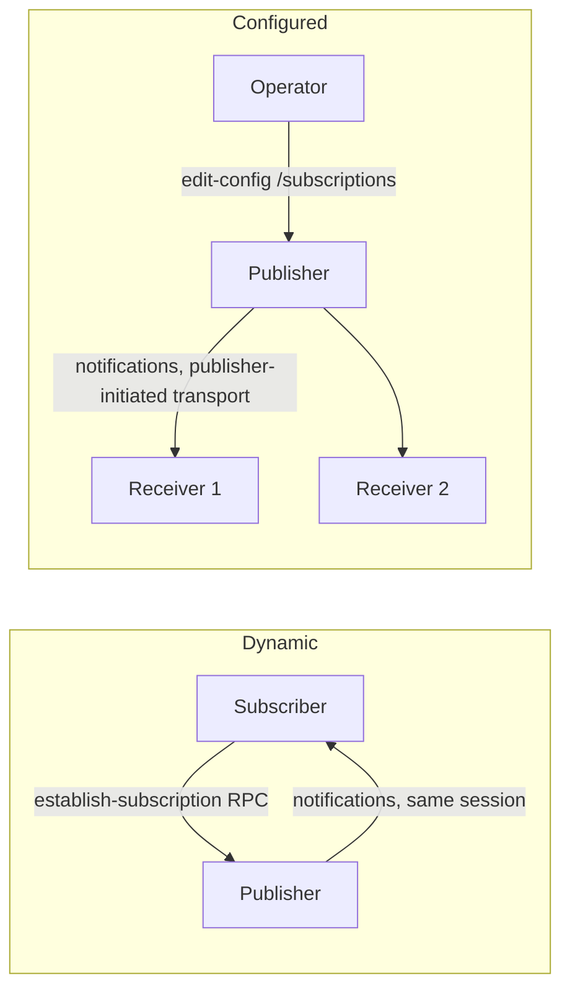
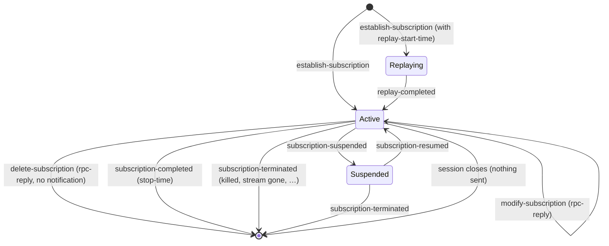

# RFC 8639: Subscription to YANG Notifications

This is a conceptual overview of RFC 8639: the ideas in the RFC and how they fit together. It does not reproduce the spec, and where the two differ, the RFC wins. For the RFC's priority and where it lands in the design, see [rfcs.md](../rfcs.md).

Published September 2019. Defines the `ietf-subscribed-notifications` YANG module (prefix `sn`, namespace `urn:ietf:params:xml:ns:yang:ietf-subscribed-notifications`). It is transport-independent: [RFC 8640](./rfc8640-netconf-dynamic-subscriptions.md) binds it to NETCONF, and [RFC 8641](./rfc8641-yang-push.md) builds datastore subscriptions on top of it.

## The problem it solves

[RFC 5277](./rfc5277-event-notifications.md) `<create-subscription>` works, but it has hard limits:

- **One subscription per session**, and it can't be changed or ended without closing the session.
- **No subscription ID**, so there is nothing to refer to later.
- **No way to discover or manage subscriptions** from another session.
- **Only the client can start one.** A device can't be configured to push events to a collector on its own.

RFC 8639 replaces it with a general subscription model: many subscriptions per session, each with an ID, which can be modified, deleted, killed by an administrator, and monitored. It also adds **configured subscriptions**, which live in the device configuration and are pushed to receivers without any client session.

RFC 5277 is not obsoleted. Both can exist on one server.

## Terms

| Term | Meaning |
|------|---------|
| **Publisher** | The server that generates and sends notifications. |
| **Subscriber** | The client that asks for a subscription (dynamic) or configures one (configured). |
| **Receiver** | Where the notifications go. For a dynamic subscription, the subscriber itself. |
| **Event stream** | A continuous, ordered flow of event records, such as the `NETCONF` stream from RFC 5277. Listed under `/streams`. |
| **Event record** | One notification's content. |
| **Filter** | Subtree or XPath, applied to each event record. Defined inline, or as a named entry under `/filters` and referred to by name. |
| **Subscription** | A stream (or, with RFC 8641, a datastore), an optional filter, an optional stop time, and receivers. Has a `uint32` **subscription ID**. |

## Dynamic and configured subscriptions



| | Dynamic | Configured |
|---|---|---|
| Created by | `establish-subscription` RPC | Configuration under `/subscriptions` |
| Lifetime | Until deleted, killed, stopped, or **the session ends** | Until removed from the configuration; survives reboot |
| Receivers | The session that created it | Any number, configured |
| Transport | The subscriber's session | The publisher connects out (HTTPS, UDP and others, defined elsewhere) |
| Changed by | `modify-subscription` from the owning session | Editing the configuration |

**NETCONF only supports dynamic subscriptions** ([RFC 8640](./rfc8640-netconf-dynamic-subscriptions.md)). A NETCONF client can still *configure* a configured subscription, but the notifications travel over some other transport to a receiver, not back over NETCONF.

## The RPCs

### `establish-subscription`

| Input | Meaning |
|-------|---------|
| `stream` | The event stream name. (RFC 8641 adds `datastore` as the other choice of target.) |
| `stream-filter-name`, or `stream-subtree-filter` / `stream-xpath-filter` | A named filter, or one given inline. |
| `replay-start-time` | Replay stored events from this time first. Needs the `replay` feature and a stream with `replay-support`. |
| `stop-time` | End the subscription at this time. |
| `encoding` | `encode-xml` or `encode-json`. Defaults to the transport's natural encoding. |
| `dscp`, `weighting`, `dependency` | Optional QoS hints (`dscp`, `qos` features). |

| Output | Meaning |
|--------|---------|
| `id` | The new subscription ID. |
| `replay-start-time-revision` | Set when the requested replay start was earlier than the oldest stored event, to the time replay actually starts from. |

### `modify-subscription`, `delete-subscription`, `kill-subscription`

- **`modify-subscription`** changes the filter or `stop-time` of a dynamic subscription. Only the session that owns it may do this. The stream itself can't be changed.
- **`delete-subscription`** ends a dynamic subscription. Owning session only.
- **`kill-subscription`** ends any dynamic subscription, from **any** session with permission. It is the administrator's tool, the subscription version of `<kill-session>`.

All three take the subscription `id`. A configured subscription can't be changed by these RPCs. It is changed by editing the configuration.

### Errors and hints

A refused request names its reason as an **identity**, and may include **hints** about what would have been accepted, so the client can retry with something better rather than guessing.

| Reason identity | Meaning |
|-----------------|---------|
| `no-such-subscription` | Unknown ID, or one the session doesn't own. |
| `stream-unavailable` | No such stream, or no access. |
| `filter-unsupported` | The filter is invalid or too complex. A `filter-failure-hint` may say why. |
| `replay-unsupported` | The stream doesn't keep a replay log. |
| `encoding-unsupported`, `dscp-unavailable` | The requested encoding or DSCP isn't available. |
| `insufficient-resources` | The publisher can't take on another subscription. |

How these appear on the wire is the transport binding's job. For NETCONF, see [RFC 8640](./rfc8640-netconf-dynamic-subscriptions.md).

## Subscription state change notifications

The publisher tells receivers what happened to a subscription with notifications in the `sn` namespace. Each carries the subscription `id`, so they can always be matched to a subscription.

| Notification | When |
|--------------|------|
| `subscription-started` | A configured subscription starts sending to a receiver. |
| `subscription-modified` | A configured subscription was changed, or a referenced filter changed. netopeer2 also sends it for a dynamic subscription's `modify-subscription`, before the RPC reply. |
| `replay-completed` | Replay has caught up to the present. Live events follow. |
| `subscription-completed` | The `stop-time` was reached. Nothing more will be sent. |
| `subscription-suspended` | The publisher has **paused** sending, for example because of `insufficient-resources` or a congested receiver. The subscription still exists. |
| `subscription-resumed` | Sending has started again after a suspend. |
| `subscription-terminated` | The subscription has ended for a reason the receiver didn't ask for, for example it was killed, or the stream went away. Carries a reason identity. |

The lifecycle of a dynamic subscription:



A subscriber must treat **suspended** as "events may have been lost": the RFC doesn't promise that events from the suspended period are sent later.

## The data tree

```
streams/stream* [name]
├── description
├── replay-support                 present if the stream keeps a replay log
├── replay-log-creation-time
└── replay-log-aged-time           oldest event still in the log
filters/stream-filter* [name]      named filters, referred to by name
subscriptions/subscription* [id]
├── stream | datastore (8641), filter, stop-time, encoding, transport
├── configured-subscription-state  valid | invalid | concluded (configured only)
└── receivers/receiver* [name]
    ├── sent-event-records, excluded-event-records
    └── state                      active | suspended | connecting | disconnected
```

`/streams` is how a client discovers what it can subscribe to. `/subscriptions` lists **both** kinds: dynamic subscriptions appear there read-only while they exist, so an administrator can find one to kill.

## Discovery

`ietf-subscribed-notifications` is a YANG 1.1 module, so it is **not listed in the hello**. It is found through the YANG library ([RFC 8525](./rfc8525-yang-library.md)), with its features: `configured`, `replay`, `subtree`, `xpath`, `encode-xml`, `encode-json`, `dscp`, `qos` and others. A client should check `subtree` / `xpath` before sending a filter of that type.

## Security considerations

- Subscriptions are a way to read data, so NACM (RFC 8341) must be applied to each event record, not just to the RPC that set up the subscription. Records the receiver may not read are dropped and counted in `excluded-event-records`.
- A configured subscription sends data to receivers that never authenticated *into* the device, so who can configure subscriptions matters.
- Subscriptions consume publisher resources. `kill-subscription`, `insufficient-resources` and suspension are the controls for that.

## Where it lands in @node-net/netconf

| Concept | RFC | Module |
|---------|-----|--------|
| `client.ops.subscriptions.establish({ stream, filter, replayStartTime, stopTime })` returning a `DynamicSubscription` with its `id` and an `AsyncIterable` of updates | 8639 §2.4.2 | `operations/subscriptions` ✅ ([design §8](../../net-netconf-design.md)) |
| `modify()`, `delete()` on the subscription; `kill(id)` on `client.ops.subscriptions` | 8639 §2.4.3–2.4.5 | `operations/subscriptions` ✅ |
| Reason identities from `error-app-tag` | 8639 §2.4.6 | `subscriptionErrorReason()` ✅; errors stay `RpcError`, with hints in `error-info` |
| State change notifications routed by `id`; `completed` and `terminated` end the iterator, `suspended` / `resumed` are delivered in-band. A dynamic stop-time sends nothing (`subscription-completed` is for configured subscriptions), so the subscription ends itself | 8639 §2.7 | `operations/subscriptions` ✅ |
| `streams()` and read-only `/subscriptions` | 8639 §3 | `operations/subscriptions` ✅ |
| Module and feature check through the YANG library, not the hello | 8639 §4, 8525 | `support()` in `operations/subscriptions` ✅ |
| Configured subscriptions | 8639 §2.5 | Not implemented: NETCONF can't receive them. They can be configured with ordinary `editConfig`. |
