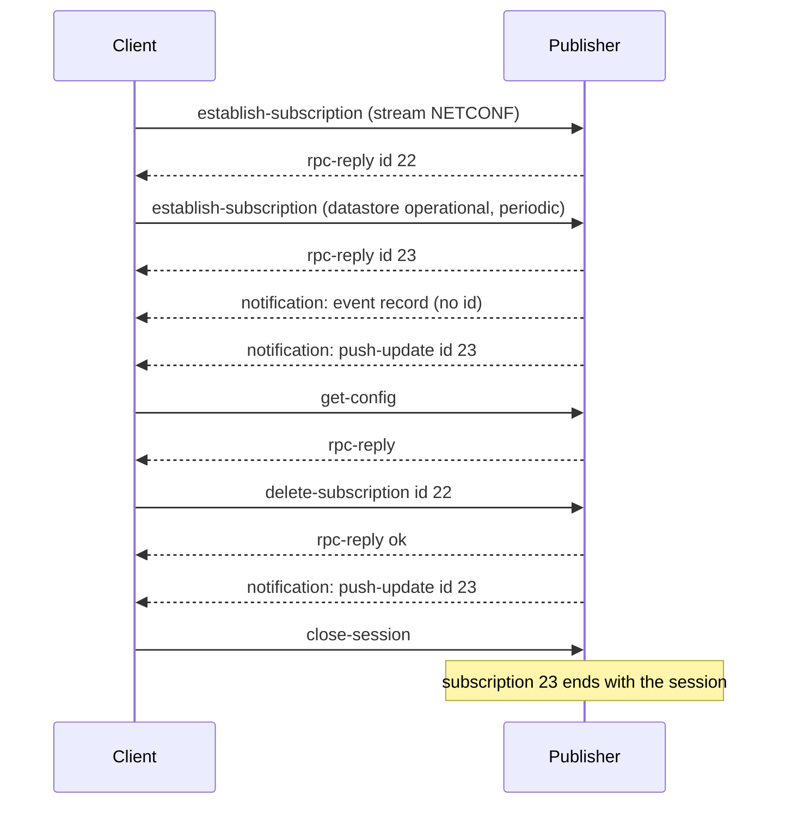

# RFC 8640: Dynamic Subscription to YANG Events and Datastores over NETCONF

This is a conceptual overview of RFC 8640: the ideas in the RFC and how they fit together. It does not reproduce the spec, and where the two differ, the RFC wins. For the RFC's priority and where it lands in the design, see [rfcs.md](../rfcs.md).

Published September 2019. A short binding document. It adds no YANG module and no RPC. It says how the dynamic subscriptions of [RFC 8639](./rfc8639-subscribed-notifications.md) and [RFC 8641 (YANG-Push)](./rfc8641-yang-push.md) run over a NETCONF session.

## Key ideas

1. **Dynamic subscriptions only.** NETCONF is client-initiated, so it carries only subscriptions a client asks for on its own session. Configured subscriptions need a publisher-initiated transport and are out of scope.
2. **The RPCs are ordinary NETCONF RPCs.** `establish-subscription`, `modify-subscription`, `delete-subscription` and `kill-subscription` are sent in `<rpc>` and answered in `<rpc-reply>`, in the `sn` (or `yp`) namespace.
3. **Notifications use the RFC 5277 envelope.** Event records, YANG-Push updates and subscription state changes all arrive as `<notification>` with an `eventTime`, on the session that established the subscription.
4. **The subscription belongs to the session.** When the session ends, its dynamic subscriptions end with it, and nothing is sent.
5. **RPCs and notifications are interleaved.** A session with active subscriptions must still accept RPCs, including more `establish-subscription`s and `modify-subscription`. This is the RFC 5277 `:interleave` behaviour, and the publisher must support it.

## What it looks like

Establishing a subscription to the `NETCONF` stream:

```xml
<rpc message-id="101" xmlns="urn:ietf:params:xml:ns:netconf:base:1.0">
  <establish-subscription xmlns="urn:ietf:params:xml:ns:yang:ietf-subscribed-notifications">
    <stream>NETCONF</stream>
    <stream-xpath-filter xmlns:ncn="urn:ietf:params:xml:ns:yang:ietf-netconf-notifications">/ncn:netconf-config-change</stream-xpath-filter>
  </establish-subscription>
</rpc>
```

```xml
<rpc-reply message-id="101" xmlns="urn:ietf:params:xml:ns:netconf:base:1.0">
  <id xmlns="urn:ietf:params:xml:ns:yang:ietf-subscribed-notifications">22</id>
</rpc-reply>
```

Then, on the same session:

```xml
<notification xmlns="urn:ietf:params:xml:ns:netconf:notification:1.0">
  <eventTime>2026-11-07T10:15:02Z</eventTime>
  <netconf-config-change xmlns="urn:ietf:params:xml:ns:yang:ietf-netconf-notifications">…</netconf-config-change>
</notification>
```

and, when the subscription ends from the publisher's side:

```xml
<notification xmlns="urn:ietf:params:xml:ns:netconf:notification:1.0">
  <eventTime>2026-11-07T11:00:00Z</eventTime>
  <subscription-terminated xmlns="urn:ietf:params:xml:ns:yang:ietf-subscribed-notifications">
    <id>22</id>
    <reason>stream-unavailable</reason>
  </subscription-terminated>
</notification>
```

## Telling subscriptions apart

A session can now hold several subscriptions, so an incoming `<notification>` has to be matched to one of them:

| Notification | How to match it |
|--------------|-----------------|
| State changes (`subscription-terminated`, `-suspended`, `-resumed`, `-completed`, `replay-completed`, …) | They carry `<id>`. |
| YANG-Push `push-update` and `push-change-update` | They carry `<id>`. |
| Event records from a stream (for example `netconf-config-change`) | **They carry no subscription ID.** With more than one stream subscription on a session, the client can only tell them apart by content. |

The last row is a real limit of the 2019 design. Work on a notification message header with the subscription ID has been done in the NETCONF working group since; it is not used here. Until a server sends one, a client that needs to know which subscription an event record belongs to should put each stream subscription on its own session, or keep one stream subscription per session.

## Mixing with RFC 5277

The two mechanisms must not share a session (RFC 8640 §3). The publisher MUST refuse `<create-subscription>` with `operation-not-supported` while the session has an RFC 8639 subscription, and `establish-subscription` once a `<create-subscription>` has succeeded. A publisher that implements RFC 8639 but not RFC 5277 must not advertise `:notification:1.0`. A client should pick one mechanism per session: RFC 8639 if the YANG library lists `ietf-subscribed-notifications`, and RFC 5277 otherwise.

netopeer2 2.1 departs from this: it accepts `establish-subscription` after `<create-subscription>`, and refuses the reverse with `operation-failed` ("Session already subscribed"). @node-net/netconf refuses both locally, for the rest of the session once either has been sent.

## Errors

A refused RPC returns a normal `<rpc-error>`. The binding maps the RFC 8639 failure onto it:

- `error-app-tag` holds the **reason identity**, for example `ietf-subscribed-notifications:filter-unsupported` or, for YANG-Push, `ietf-yang-push:period-unsupported`.
- `error-info` holds the **hints** from the RPC's error structure, for example a `filter-failure-hint`, or a supported `period-hint` for YANG-Push.
- `error-tag` is one of the usual RFC 6241 tags.

So a client recognises a subscription error by its `error-app-tag`, not its `error-tag`, and reads `error-info` to retry with something the publisher will accept.

## Encoding

Over NETCONF the notification content is XML, the same as every other NETCONF message. A subscriber can leave `encoding` out, or send `encode-xml`.

## Session lifecycle



## Security considerations

- The NETCONF transport (SSH or TLS) provides authentication and confidentiality. The NETCONF username is what NACM applies to each notification.
- A subscriber can use subscriptions to put load on the publisher. The publisher protects itself with `insufficient-resources` refusals and by suspending subscriptions.

## Where it lands in @node-net/netconf

| Concept | RFC | Module |
|---------|-----|--------|
| Subscription RPCs sent through the ordinary `RpcContext` | 8640 | `operations/subscriptions` ✅ ([design §8](../../net-netconf-design.md)) |
| `<notification>` routing to the subscriptions extension | 8640, 5277 | `messages/session.ts` (`notification` event) |
| Matching notifications to a subscription by `<id>`, holding ones that arrive before the establish reply; event records without an `id` delivered to the session's one stream subscription (a second stream subscription is refused locally) | 8640 | `operations/subscriptions` ✅ |
| All subscriptions ending when the session closes: every iterator finishes, and `ended` says `closed` | 8640 | `operations/subscriptions` ✅ |
| Subscription error reasons from the `error-app-tag` identity | 8640 | `subscriptionErrorReason()` ✅, on the ordinary `RpcError` |
| Refusing to mix `createSubscription` and `establish` (RFC 8639) on one session | 8640, 5277 | A session RPC guard in `operations/subscriptions` ✅, as a `SubscriptionError` |
