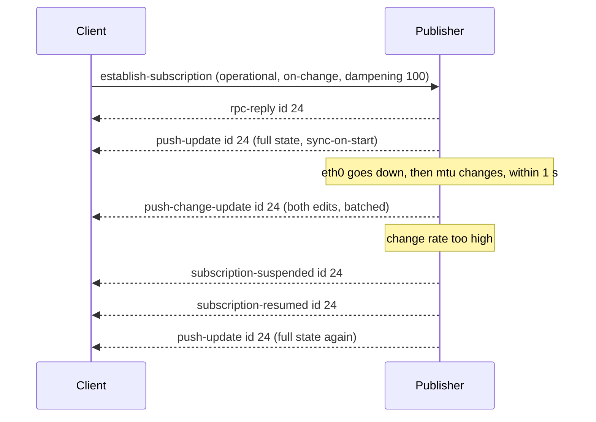

# RFC 8641: Subscription to YANG Notifications for Datastore Updates (YANG-Push)

This is a conceptual overview of RFC 8641: the ideas in the RFC and how they fit together. It does not reproduce the spec, and where the two differ, the RFC wins. For the RFC's priority and where it lands in the design, see [rfcs.md](../rfcs.md).

Published September 2019. Defines the `ietf-yang-push` YANG module (prefix `yp`, namespace `urn:ietf:params:xml:ns:yang:ietf-yang-push`). It extends [RFC 8639](./rfc8639-subscribed-notifications.md) subscriptions so that the target can be a **datastore** instead of an event stream. Over NETCONF it runs as described in [RFC 8640](./rfc8640-netconf-dynamic-subscriptions.md).

## The problem it solves

Monitoring by polling (`<get>` every few seconds) wastes work on both sides, misses changes between polls, and gets slower as the data grows. YANG-Push lets the client say **which part of a datastore** it wants, and have the server **push** it:

- **Periodic**: the whole selected subtree, every N centiseconds. This is streaming telemetry, for example interface counters every 10 seconds.
- **On-change**: only what changed, soon after it changes. This is for state that changes rarely but matters when it does, for example an interface going down or a BGP neighbour changing state.

It replaces vendor-specific telemetry with one standard model that works on any YANG data, and on any NMDA datastore ([RFC 8342](./rfc8342-nmda.md)), including `operational`.

## What it adds to a subscription

YANG-Push augments `establish-subscription` (and `modify-subscription` and the `/subscriptions` list) with a new target and an update trigger:

| Input | Meaning |
|-------|---------|
| `datastore` | An NMDA datastore identity, such as `ds:running` or `ds:operational`. Replaces `stream`. |
| `datastore-subtree-filter`, `datastore-xpath-filter`, or `selection-filter-ref` | Which nodes to watch: an inline subtree or XPath filter, or a named filter under `/filters`. |
| `periodic` / `period` | Send everything selected every `period` **centiseconds**. |
| `periodic` / `anchor-time` | Align the periods to this time, so updates land on, say, whole minutes. |
| `on-change` / `dampening-period` | The minimum gap between updates, in centiseconds. Changes inside the gap are batched into the next update. `0` means send at once. |
| `on-change` / `sync-on-start` | Send the full current state first, then changes. Defaults to `true`. |
| `on-change` / `excluded-change*` | Change types to leave out: `create`, `delete`, `insert`, `move`, `replace`. |

`stop-time`, `encoding`, QoS and the other RFC 8639 parameters work as before.

## The two update notifications

### `push-update`: the full selected state

```xml
<notification xmlns="urn:ietf:params:xml:ns:netconf:notification:1.0">
  <eventTime>2026-11-07T10:15:00Z</eventTime>
  <push-update xmlns="urn:ietf:params:xml:ns:yang:ietf-yang-push">
    <id>23</id>
    <datastore-contents>
      <interfaces xmlns="urn:ietf:params:xml:ns:yang:ietf-interfaces">
        <interface><name>eth0</name><oper-status>up</oper-status></interface>
      </interfaces>
    </datastore-contents>
  </push-update>
</notification>
```

Sent every period for a periodic subscription, and for an on-change subscription when it starts (with `sync-on-start`) or is resynchronised. `datastore-contents` holds the selected data in the same form as a `<get-data>` reply.

### `push-change-update`: what changed

```xml
<push-change-update xmlns="urn:ietf:params:xml:ns:yang:ietf-yang-push">
  <id>24</id>
  <datastore-changes>
    <yang-patch>
      <patch-id>0</patch-id>
      <edit>
        <edit-id>edit1</edit-id>
        <operation>replace</operation>
        <target>/ietf-interfaces:interfaces/interface=eth0/oper-status</target>
        <value>
          <oper-status xmlns="urn:ietf:params:xml:ns:yang:ietf-interfaces">down</oper-status>
        </value>
      </edit>
    </yang-patch>
  </datastore-changes>
</push-change-update>
```

On-change subscriptions only. The changes are a **YANG Patch** (RFC 8072): a list of edits, each with an operation (`create`, `delete`, `insert`, `move`, `merge`, `replace`, `remove`), a target and, where needed, a value.

Points a client should handle:

- **By the RFC, the YANG Patch `target` is a RESTCONF-style path** (`/module:container/list=key/leaf`, RFC 8072's `target-resource-offset`), relative to the datastore. It is not XPath, and not the `instance-identifier` used by [RFC 6470](./rfc6470-base-notifications.md). Keys are percent-encoded and comma-separated. **Servers differ:** netopeer2 2.1 sends a YANG path with key predicates instead, such as `/ietf-netconf-acm:nacm/groups/group[name='x']`. @node-net/netconf returns the target as text; `parsePath()` reads netopeer2's form.
- **Applying the patch to a local copy** of the state requires that copy to start from a `push-update`. A client that missed updates must resynchronise.
- **`incomplete-update`**: either notification may carry this flag, meaning the publisher could not include everything selected, for example because of access control or a node it couldn't read in time. The data is not a complete picture.

### `resync-subscription`

An RPC that asks the publisher to send a fresh `push-update` on an on-change subscription. A client uses it after a suspend, or whenever it suspects its copy has drifted.

## How updates flow



After `subscription-resumed`, an on-change subscription restarts with a full `push-update`, so changes lost during the suspend are covered by the new state.

## On-change isn't available for everything

Some data can't sensibly be watched for change. Counters change all the time, and some state is only computed when read. A publisher may refuse on-change for parts of the tree, and the `on-change` feature says whether it supports on-change at all. RFC 8641 allows a YANG extension, `notifiable-on-change`, to mark which nodes support it. [RFC 9196](../rfcs.md) adds a model a client can read to find out, per datastore and per node, whether on-change is supported and what periods are allowed.

## Errors and hints

Refusals use the RFC 8639 mechanism, with reason identities from `ietf-yang-push`:

| Reason | Meaning | Hint the publisher may give |
|--------|---------|-----------------------------|
| `period-unsupported` | The period is too short or not allowed. | `period-hint` |
| `on-change-unsupported` | On-change isn't supported for some selected node. | `filter-failure-hint` |
| `on-change-sync-unsupported` | `sync-on-start` isn't supported. | |
| `cant-exclude` | An `excluded-change` can't be honoured. | |
| `datastore-not-subscribable` | The datastore can't be subscribed to. | |
| `update-too-big`, `result-too-big`, `sync-too-big` | The selection would produce updates the publisher won't send. | `object-count-estimate`, `object-count-limit`, `kilobytes-estimate`, `kilobytes-limit` |
| `unchanging-selection` | The selection can never change, for example a filter that selects nothing. | |

Over NETCONF the identity is in `error-app-tag` and the hints are in `error-info` ([RFC 8640](./rfc8640-netconf-dynamic-subscriptions.md)). The size hints let a client split a too-large selection into several subscriptions.

## Discovery

`ietf-yang-push` is a YANG 1.1 module, found through the YANG library ([RFC 8525](./rfc8525-yang-library.md)), not the hello. Its `on-change` feature says whether on-change is supported at all. It also requires `ietf-subscribed-notifications`.

## Security considerations

- A push is a read. NACM (RFC 8341) is applied to each update, and nodes the receiver may not read are left out, with `incomplete-update` set.
- Short periods and large selections use publisher resources, so periods and sizes are limited by the publisher, with the errors above.
- On-change subscriptions can reveal timing: the moment a change happens, not just its result.

## Where it lands in @node-net/netconf

| Concept | RFC | Module |
|---------|-----|--------|
| `client.ops.subscriptions.establish({ datastore, filter, periodic: { period, anchorTime } \| onChange: { dampeningPeriod, syncOnStart, excludedChanges } })`, periods in centiseconds as on the wire | 8641 | `operations/subscriptions` ✅ ([design §8](../../net-netconf-design.md)) |
| A typed update stream: `{ type: 'push-update', contents }` and `{ type: 'push-change-update', patch }`, each with `incomplete` | 8641 | `operations/subscriptions` ✅ |
| YANG Patch decoding, with targets returned as text | 8641, 8072 | `operations/subscriptions` ✅ |
| `resync()` on an on-change subscription | 8641 | `operations/subscriptions` ✅ (an automatic resync after `subscription-resumed` is not built: `resumed` is delivered in-band so the reader decides) |
| Reason identities from `error-app-tag` | 8641 | `subscriptionErrorReason()` ✅; size and period hints in `error-info` are left in the `RpcError` |
| Datastore identities | 8342 | `DatastoreRef` (see [RFC 8342](./rfc8342-nmda.md)) |
| Discovering on-change and period support | 9196 | Planned awareness only (P2 in [rfcs.md](../rfcs.md)) |
| Built on the subscription lifecycle, RPCs and `id` routing | 8639, 8640 | `operations/subscriptions` ✅ |
